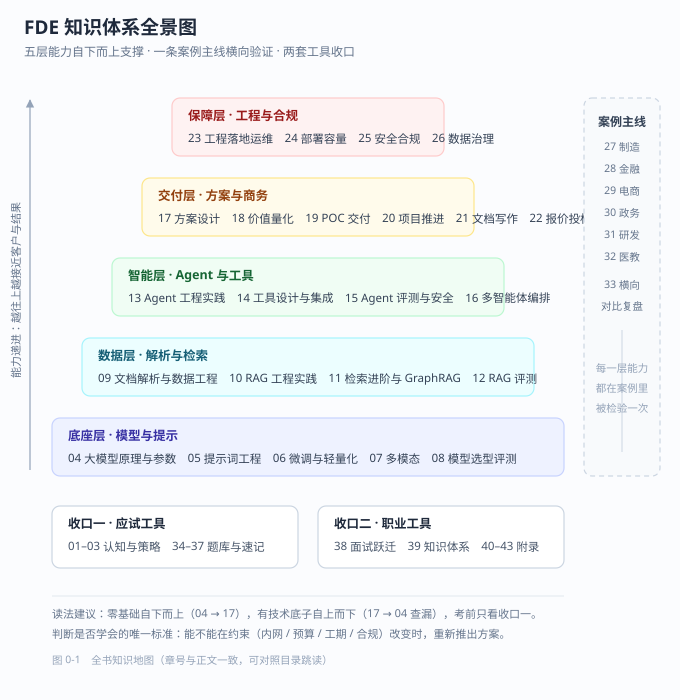

# 全书导读与目录

> 你手上这份东西不是「AI 科普」，是一本**工程手册 + 应试教材 + 项目复盘集**三合一。
>   
> 它只回答一个问题：**给定客户的内网、预算、工期和合规约束，你怎么把一个大模型项目做成、验收掉、并通过认证考试。**



---

## 0.1 先说清楚：这本书补的是哪三个断点

市面上的资料大致分两类：一类讲原理（Transformer、注意力、微调），读完能复述论文，但客户问「这玩意儿在我们车间能用吗」还是答不上；另一类讲提示词技巧，收藏了几百条模板，但一到要写方案、算显存、定验收指标就哑火。

中间断掉的三段，恰好是 FDE 岗位的全部工作内容：

| 断点          | 典型症状                                | 本书对应章节                |
| ----------- | ----------------------------------- | --------------------- |
| **原理 → 工程** | 知道注意力机制，但不知道 7B 模型跑起来要几张卡、延迟多少、并发几个 | 04 参数、24 容量规划         |
| **工程 → 交付** | 能搭出 demo，但不敢承诺指标、写不出方案、算不清报价        | 17–22 方案与商务篇          |
| **交付 → 验收** | 系统上线了，但说不清「效果好不好」，客户一句「感觉不太准」就卡住    | 12 RAG 评测、15 Agent 评测 |

> [!IMPORTANT]
> **一句话记住全书的立场**
>
>   
> **技术选型从来不是「哪个更强」，而是「在什么约束下够用且能验收」。**
>   
> 全书所有参数、所有表格、所有案例，都在为这句话提供证据。

---

## 0.2 写给谁：三类读者，三种读法

| 读者画像                       | 你现在的状态                 | 建议入口                            | 目标           |
| -------------------------- | ---------------------- | ------------------------------- | ------------ |
| **转型者**（开发 / 数据 / 售前转 FDE） | 有技术底子，缺项目视角与商务语言       | 第 17 章 → 第 27 章案例 → 回头补 09–15   | 能独立讲完一个完整方案  |
| **在职交付者**（已在做 AI 项目）       | 会干活，但方案写得散、指标定不清、复盘没结构 | 第 12 章 → 第 19 章 → 第 33 章        | 把经验沉淀成可复用的方法 |
| **应试者**（只为通过认证）            | 时间紧，要最短路径              | 第 02 章 → 第 37 章速记 → 第 34–36 章刷题 | 两周内达到及格线以上   |

**这本书不必读的人**：只想调 API 写个小工具、不需要对客户承诺效果、不涉及内网与合规的读者。这本书 60% 的篇幅在讲约束与验收，对你是负担。

---

## 0.3 全书结构：九篇 + 附录

每一篇开头都有一页**篇导读**：说明这一篇解决什么问题、章节地图、为什么是这个顺序、三条核心判断、读法建议。**不知道从哪读时，先读篇导读。**

| 篇              | 章节    | 解决什么问题                    | 读完后你应该能做到                      | 篇导读       |
| -------------- | ----- | ------------------------- | ------------------------------ | --------- |
| **一 认知与考试**    | 01–03 | 这个岗位到底干什么、考什么、怎么准备        | 说清 FDE 与算法工程师 / 售前的区别；知道自己差哪几项 | [第一篇导读](第一篇-认知与考试/第一篇导读.md) |
| **二 技术基础**     | 04–08 | 模型怎么工作、提示词怎么写、要不要微调、怎么选模型 | 独立完成模型选型并给出理由与成本               | [第二篇导读](第二篇-技术基础/第二篇导读.md) |
| **三 数据与 RAG**  | 09–12 | 文档怎么进库、怎么检索准、怎么证明它准       | 交付一个指标可验收的知识库                  | [第三篇导读](第三篇-数据与RAG工程/第三篇导读.md) |
| **四 Agent 工程** | 13–16 | 怎么让模型动手做事、工具怎么设计、怎么防它闯祸   | 上线一个带写操作的 Agent 并配好护栏          | [第四篇导读](第四篇-Agent工程/第四篇导读.md) |
| **五 方案与商务**    | 17–22 | 方案怎么写、价值怎么算、POC 怎么控、报价怎么报 | 独立完成一份能过评审的方案与报价               | [第五篇导读](第五篇-方案与商务/第五篇导读.md) |
| **六 工程与合规**    | 23–26 | 怎么部署、要多少卡、合不合规、知识怎么长期运营   | 出一份部署架构图 + 合规清单                | [第六篇导读](第六篇-工程与合规/第六篇导读.md) |
| **七 行业案例**     | 27–33 | 六个行业的真实约束与踩坑              | 见到新行业能快速定位约束类型                 | [第七篇导读](第七篇-行业案例/第七篇导读.md) |
| **八 应试**       | 34–37 | 题库、模拟卷、速记                 | 通过认证考试                         | [第八篇导读](第八篇-应试/第八篇导读.md) |
| **九 职业发展**     | 38–39 | 面试怎么讲项目、能力怎么持续长           | 有一份能讲 40 分钟的项目叙事               | [第九篇导读](第九篇-职业发展/第九篇导读.md) |
| **附录**         | 40–44 | 术语、公式、文献、指标基准、检查清单        | 现场查数、写方案、交付前逐项打勾               | [附录导读](附录/附录导读.md)  |

---

## 0.4 三条阅读路径（按你手上的时间选一条）

### 路径 A：14 天速通（应试优先，约 30 小时）

| 天       | 内容                           | 时长  |
| ------- | ---------------------------- | --- |
| D1–D2   | 02 大纲与评分规则 + 03 备考方法         | 4 h |
| D3–D5   | 04 模型原理 + 05 提示词（只读「必答要点」小节） | 6 h |
| D6–D8   | 10 RAG 工程实践 + 12 评测（这两章占分最高） | 8 h |
| D9–D10  | 13 Agent 工程 + 15 评测与安全       | 5 h |
| D11–D12 | 17 方案设计 + 19 POC 交付          | 4 h |
| D13     | 37 速记册通读一遍 + 34 单选题库刷完       | 2 h |
| D14     | 36 模拟卷两套限时做完，错题回查            | 3 h |

> [!WARNING]
> **速通路线的唯一风险**
>
>   
> 你会「知道答案」但「讲不出理由」。简答题按点给分，理由占一半分。**至少把 03 的四段式模板背下来**，否则容易在简答上失分。

### 路径 B：8 周系统学（真学会，约 90 小时）

| 周  | 主线                        | 配套动作                       |
| -- | ------------------------- | -------------------------- |
| W1 | 01–04 认知 + 模型原理           | 用本地 7B 模型跑通一次推理，记录显存与延迟    |
| W2 | 05–08 提示词 / 微调 / 多模态 / 选型 | 写 3 个生产级提示词模板，做一次模型选型对比表   |
| W3 | 09–10 数据与 RAG 主链路         | 拿 20 份真实 PDF 建一个能问答的库      |
| W4 | 11–12 检索进阶 + 评测           | 建 30 条黄金集，跑出四个指标基线         |
| W5 | 13–16 Agent               | 做一个带 2 个工具（1 读 1 写）的 Agent |
| W6 | 17–22 方案与商务               | 写一份完整方案（12 章）+ 一份报价单       |
| W7 | 23–26 工程合规 + 27–33 案例     | 画部署图、算容量、过一遍合规清单           |
| W8 | 34–39 应试 + 职业             | 两套模拟卷 + 一份 40 分钟项目叙事稿      |

### 路径 C：现场查阅（不当书读，当手册用）

| 你正在做的事         | 直接翻                           |
| -------------- | ----------------------------- |
| 客户说「我们数据不能出内网」 | 24.3 部署拓扑、25 合规章              |
| 要报一个价格         | 22 报价与投标、41 公式清单              |
| 客户问「凭什么说它准」    | 12 评测、43 指标基准                 |
| 效果不好要排查        | 10.10 Bad Case 排查、11.1 检索失败三因 |
| 要写方案           | 21 方案文档写作（12 章结构）             |
| 明天要面试          | 38 面试与职业跃迁                    |
| 项目要进入下一阶段      | 44 交付检查清单总汇（按阶段打勾）            |

---

## 0.5 每章的统一写法（知道结构，读得更快）

除题库与附录外，每章都按同一套六段式组织，你可以只挑需要的段落读：

```text
① 场景切入 —— 一个具体的、带数字的现场问题（不是「随着 AI 的发展」）
② 原理骨架 —— 只讲影响工程决策的那部分原理，不讲推导
③ 参数与表格 —— 可直接抄进方案的数字、阈值、对比表
④ 算例 —— 至少一个从头算到尾的完整计算
⑤ 坑与判断 —— 真实项目里踩过的、以及「如果重来会怎么改」
⑥ 本章考点速记 —— 应试用的浓缩版
```

> [!TIP]
> **一个实用读法**
>
>   
> 时间紧时，**只读 ③④⑤ 三段**。②原理段是给「要跟客户技术负责人对话」的人准备的；⑥速记段考前看一遍即可。

---

## 0.6 符号与口径约定（避免误读）

全书数字都有明确口径，跨章对比时请先对齐口径：

| 符号 / 表述                  | 含义                      | 备注                      |
| ------------------------ | ----------------------- | ----------------------- |
| `7B` / `14B` / `72B`     | 参数量，单位十亿                | 指稠密模型；MoE 另注激活参数        |
| `FP16` / `INT8` / `INT4` | 权重精度，每参数 2 / 1 / 0.5 字节 | 实际显存还要加 KV Cache 与运行时开销 |
| `QPS`                    | 每秒查询数                   | 默认指峰值，不是日均摊平            |
| `P95 延迟`                 | 95% 请求在该时间内返回           | 承诺 SLA 用它，不用平均值         |
| `¥/千 Token`              | 输入与输出分开计价               | 输出通常贵 2–4 倍             |
| `人月`                     | 1 人全职 1 个月（按 21.75 工作日） | 报价时另乘管理系数               |
| `≥ / ≤` 后的数字             | 经验阈值，非标准                | 出处见 43 附录 D             |
| 「本期不做」                   | 明确的范围外声明                | 写进方案，防止验收扯皮             |

**成本口径**：本书所有成本均指**五年 TCO**（含硬件、软件、实施、运维、迁移），不含客户侧人力。只报「模型调用费」的报价在真实项目里一定会亏，理由见 22.1。

**时效口径**：法规条款、模型价格、榜单分数三类信息**变化最快**。书中法规以生效日标注（如《生成式人工智能服务管理暂行办法》2023-08-15 施行），价格与榜单请以你签约时的实际报价与最新榜单为准，书中数字仅作量级参考。

---

## 0.7 配套资产清单

| 资产          | 数量           | 位置                     | 用法                                  |
| ----------- | ------------ | ---------------------- | ----------------------------------- |
| **篇导读**     | 10 页         | 各篇目录下 `第X篇导读.md`       | 不知从哪读时先看它（问题 / 地图 / 顺序 / 三条判断 / 读法） |
| 自绘架构图 / 流程图 | 38 张         | `附件/`（各章用 `../附件/` 引用） | 可直接放进方案，改配色即可                       |
| 公式与参数速查     | 30+ 条        | 41 附录 B                | 现场算数用                               |
| 提示词模板       | 10 套         | 41 附录 B                | 复制后改字段                              |
| 代码骨架        | 4 段          | 41 附录 B                | RAG 主流程 / 增量索引 / Agent 循环 / 引用校验    |
| 单选题         | 80 道         | 34                     | 全部带解析                               |
| 简答 + 案例题    | 20 + 8 道     | 35                     | 带评分要点                               |
| 模拟卷         | 2 套          | 36                     | 限时自测                                |
| 记忆卡         | 100 张        | 37                     | 遮住答案自测                              |
| 术语          | 160 条        | 40                     | 对齐客户语言                              |
| 指标基准        | 80+ 项        | 43                     | 定验收指标时查                             |
| 计算题         | 10 道带解       | 41.6                   | 考前手算一遍                              |
| **交付检查清单**  | 10 张 / 120 项 | [44-附录E-交付检查清单总汇](附录/44-附录E-交付检查清单总汇.md)    | 打印出来按阶段逐项打勾                         |

---

## 0.8 图表目录（38 张自绘图，可直接改用）

全部为手写 SVG：浅色背景、深色文字，改配色和文字即可放进方案。**「用途」一列告诉你什么场合翻哪张。**

**认知与应试**

| 图                  | 章  | 用途         |
| ------------------ | -- | ---------- |
| 图 0-1 全书知识地图（`31`） | 导读 | 讲清「这本书怎么用」 |
| 图 1-1 考核总览（`01`）   | 1  | 一页说清考试结构   |
| 图 1-2 能力模型（`11`）   | 1  | 自测 T 型能力缺口 |
| 图 3-1 四周备考计划（`09`） | 3  | 给同事讲备考节奏   |
| 图 3-2 简答题模板（`10`）  | 3  | 考前看结构      |

**技术基础**

| 图                    | 章 | 用途                           |
| -------------------- | - | ---------------------------- |
| 图 4-1 大模型工作原理（`02`）  | 4 | 给非技术客户解释「它为什么会有幻觉」           |
| 图 4-2 提示词三范式（`03`）   | 4 | 讲 Zero-shot / Few-shot / CoT |
| 图 4-3 技术路线决策树（`12`）  | 4 | 提示词 / RAG / 微调 / Agent 怎么选   |
| 图 5-1 提示词六层结构（`22`）  | 5 | 培训团队写提示词                     |
| 图 6-1 微调与轻量化路线（`23`） | 6 | 讲清 LoRA / QLoRA / 量化关系       |
| 图 8-1 模型选型决策树（`32`）  | 8 | **客户问「为什么不用最强的」时用**          |

**数据与 RAG**

| 图                        | 章  | 用途                 |
| ------------------------ | -- | ------------------ |
| 图 9-1 文档解析流水线（`24`）      | 9  | 讲数据工程量为什么这么大       |
| 图 10-1 RAG 完整链路（`04`）    | 10 | 方案必备总图             |
| 图 10-2 分块与混合检索（`05`）     | 10 | 讲清「为什么不能按字数切」      |
| 图 10-3 高级 RAG 架构（`13`）   | 10 | 进阶方案（多路召回 + 重排）    |
| 图 10-4 RAG 评测体系（`14`）    | 10 | 讲「凭什么说它准」          |
| 图 10-5 权限架构（`20`）        | 10 | 讲检索前过滤（pre-filter） |
| 图 10-6 成本与延迟预算（`21`）     | 10 | 讲清成本大头在哪           |
| 图 11-1 查询理解与多路召回（`25`）   | 11 | 讲「召不回」怎么修          |
| 图 11-2 GraphRAG 示意（`26`） | 11 | 讲关系型问题的解法          |

**Agent 工程**

| 图                        | 章  | 用途                    |
| ------------------------ | -- | --------------------- |
| 图 13-1 ReAct 智能体循环（`06`） | 13 | 讲 Agent 的基本循环         |
| 图 13-2 Agent 调用时序（`15`）  | 13 | 讲 Function Calling 十步 |
| 图 14-1 工具契约（`27`）        | 14 | 讲工具描述该怎么写             |
| 图 16-1 四种编排拓扑（`33`）      | 16 | **劝阻「什么都拆多智能体」时用**    |

**方案与商务**

| 图                    | 章  | 用途                |
| -------------------- | -- | ----------------- |
| 图 17-1 方案设计六步法（`07`） | 17 | 讲方法论              |
| 图 17-2 部署模式对比（`08`）  | 17 | 公有云 / 私有化 / 混合怎么选 |
| 图 17-3 方案文档结构（`16`）  | 17 | 12 章结构一页图         |
| 图 17-4 场景优先级矩阵（`18`） | 17 | 讲「先做哪一块」          |
| 图 18-1 售前价值树（`28`）   | 18 | 讲价值怎么拆            |
| 图 19-1 交付甘特（`19`）    | 19 | 16 周排期一页图         |
| 图 20-1 干系人地图（`34`）   | 20 | **项目启动第一张图**      |
| 图 22-1 报价结构分解（`35`）  | 22 | 讲「钱花在哪」           |

**工程与合规**

| 图                   | 章  | 用途                 |
| ------------------- | -- | ------------------ |
| 图 23-1 部署参考架构（`17`） | 23 | 方案必备拓扑图            |
| 图 24-1 容量规划（`30`）   | 24 | 讲清卡数怎么算            |
| 图 25-1 合规地图（`29`）   | 25 | 五部法规一页图            |
| 图 26-1 知识运营闭环（`36`） | 26 | **讲「上线只是第 0 天」时用** |

**案例、应试与职业**

| 图                   | 章  | 用途      |
| ------------------- | -- | ------- |
| 图 33-1 约束反转映射（`37`） | 33 | 案例题采分骨架 |
| 图 38-1 面试四轮（`38`）   | 38 | 讲面试在筛什么 |

> [!TIP]
> **怎么改这些图**
>
>   
> 用任意文本编辑器打开 `.svg`，改三处就能变成你自己的：① `<text>` 里的文字；② `fill="#..."` 的配色；③ `viewBox` 的宽高（改完记得同步 `width`/`height`）。
>   
> **不要截图再贴进 PPT**——矢量图在客户的高清投影上才不会糊。

---

## 0.9 开始之前，先做三个自测

不要急着翻第 1 章。先用三分钟回答这三个问题，答案会决定你该走哪条路径：

> [!NOTE]
> **自测一**
>
>   
> 客户说「我们有 5000 份制度文件，想让员工能问答」，你第一句追问什么？
>   
> （合格答案见 17.2：先问**谁在用、用在哪一步、现在这一步怎么做的、错一次的代价**，而不是问文件格式或模型选型。）

> [!NOTE]
> **自测二**
>
>   
> 一台 8 卡 A100 80G 的服务器，能同时服务多少个 14B 模型的并发用户？
>   
> （算法见 24.2：先算权重占用，再算 KV Cache，最后除单请求占用。答不出量级说明第 4、24 章要细读。）

> [!NOTE]
> **自测三**
>
>   
> 你的 RAG 系统答错了，客户问「准确率多少」，你怎么答？
>   
> （合格答案见 12.1：先定义「准确」拆成召回、忠实、相关三个可测指标，再给基线与样本量，而不是给一个笼统百分比。）

三个都答得上来 → 直接读第 17 章与案例篇。三个都答不上 → 从第 4 章开始，按路径 B 走。

---

## 0.10 版本与免责

- 本书内容基于 2026 年 10 月前的公开资料、论文与项目实践整理，法规条款以标注的生效日为准。
- 案例中的企业、数字、指标均为**脱敏与合成**，用于说明方法，不代表任何真实客户。
- 所有阈值（如 Context Recall ≥ 0.85）是**经验起点**，不是行业标准；实际项目必须用自己的黄金集重新标定。
- 引用论文均给出作者与年份，完整文献见 42 附录 C，便于你核实与深读。

<details>
<summary><b>一句话总结这份导读</b></summary>

>   
> 这本书的价值不在「知道多少」，而&#x5728;**「约束变了，你还能不能推出方案」**。
>   
> 如果读完你只记住一句话，希望是：**先问约束，再谈技术。**

</details>

---

**下一篇**：[第 1 章 岗位能力与职业路径](第一篇-认知与考试/01-岗位能力与职业路径.md)　|　**直接进案例**：[案例一 制造业设备维修](第七篇-行业案例/27-案例一-制造业设备维修.md)
