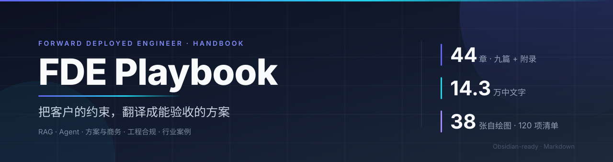

<div align="center">



<br>

[](00-全书导读与目录.md)
[](00-全书导读与目录.md)
[](附件/)
[](第八篇-应试/34-单选题库.md)
[](LICENSE)

**📘 一本写给「要对结果负责的技术人」的书。**

不是 AI 科普，也不是提示词合集——
它只回答一个问题：**给定客户的内网、预算、工期和合规约束，你怎么把一个大模型项目做成、验收掉。**

</div>

---

## 🧩 这本书补的是哪三个断点

市面上的资料大致两类：一类讲原理，读完能复述论文，但客户问「这玩意儿在我们车间能用吗」还是答不上；另一类讲提示词技巧，收藏了几百条模板，一到写方案、算显存、定验收指标就哑火。

中间断掉的三段，恰好是 FDE 的全部工作内容：

| 断点 | 典型症状 | 对应章节 |
| --- | --- | --- |
| 🔬 **原理 → 工程** | 知道注意力机制，但不知道 7B 模型跑起来要几张卡、延迟多少、并发几个 | 第 4 章、第 24 章 |
| 📦 **工程 → 交付** | 能搭出 demo，但不敢承诺指标、写不出方案、算不清报价 | 第 17–22 章 |
| ✅ **交付 → 验收** | 系统上线了，但说不清「效果好不好」，客户一句「感觉不太准」就卡住 | 第 12 章、第 15 章 |

> **技术选型从来不是「哪个更强」，而是「在什么约束下够用且能验收」。**
> 全书所有参数、所有表格、所有案例，都在为这句话提供证据。

---

## 🗺️ 知识地图


五层能力自下而上支撑，一条案例主线横向验证，两套工具收口。

---

## 📚 完整目录

<details>
<summary><b>📚 展开 44 章目录（每篇都有一页导读）</b></summary>

<br>

**🧭 第一篇 · 认知与考试** — 先搞清楚岗位与考试，再决定怎么用力　[导读 →](第一篇-认知与考试/第一篇导读.md)

- [第 1 章 岗位能力与职业路径](第一篇-认知与考试/01-岗位能力与职业路径.md)
- [第 2 章 考试大纲与评分规则](第一篇-认知与考试/02-考试大纲与评分规则.md)
- [第 3 章 备考策略与答题方法](第一篇-认知与考试/03-备考策略与答题方法.md)

**🧠 第二篇 · 技术基础** — 模型怎么工作、提示词怎么写、要不要微调、怎么选型　[导读 →](第二篇-技术基础/第二篇导读.md)

- [第 4 章 大模型原理与工程参数](第二篇-技术基础/04-大模型原理与工程参数.md)
- [第 5 章 提示词工程](第二篇-技术基础/05-提示词工程.md)
- [第 6 章 微调、对齐与模型轻量化](第二篇-技术基础/06-微调对齐与模型轻量化.md)
- [第 7 章 多模态与前沿技术](第二篇-技术基础/07-多模态与前沿技术.md)
- [第 8 章 模型选型与能力评测](第二篇-技术基础/08-模型选型与能力评测.md)

**🗃️ 第三篇 · 数据与 RAG 工程** — 文档怎么进库、怎么检索准、怎么证明它准　[导读 →](第三篇-数据与RAG工程/第三篇导读.md)

- [第 9 章 文档解析与数据工程](第三篇-数据与RAG工程/09-文档解析与数据工程.md)
- [第 10 章 RAG 工程实践](第三篇-数据与RAG工程/10-RAG工程实践.md)
- [第 11 章 检索进阶与 GraphRAG](第三篇-数据与RAG工程/11-检索进阶与GraphRAG.md)
- [第 12 章 RAG 评测与实验设计](第三篇-数据与RAG工程/12-RAG评测与实验设计.md)

**🤖 第四篇 · Agent 工程** — 怎么让模型动手做事，怎么防它闯祸　[导读 →](第四篇-Agent工程/第四篇导读.md)

- [第 13 章 Agent 工程实践](第四篇-Agent工程/13-Agent工程实践.md)
- [第 14 章 工具设计与集成工程](第四篇-Agent工程/14-工具设计与集成工程.md)
- [第 15 章 Agent 评测与安全](第四篇-Agent工程/15-Agent评测与安全.md)
- [第 16 章 多智能体与工作流编排](第四篇-Agent工程/16-多智能体与工作流编排.md)

**💼 第五篇 · 方案与商务** — 方案怎么写、价值怎么算、报价怎么报　[导读 →](第五篇-方案与商务/第五篇导读.md)

- [第 17 章 解决方案设计与售前](第五篇-方案与商务/17-解决方案设计与售前.md)
- [第 18 章 售前方法论与价值量化](第五篇-方案与商务/18-售前方法论与价值量化.md)
- [第 19 章 POC 与交付管理](第五篇-方案与商务/19-POC与交付管理.md)
- [第 20 章 项目推进与干系人沟通](第五篇-方案与商务/20-项目推进与干系人沟通.md)
- [第 21 章 方案文档写作](第五篇-方案与商务/21-方案文档写作.md)
- [第 22 章 商务报价与招投标](第五篇-方案与商务/22-商务报价与招投标.md)

**⚙️ 第六篇 · 工程与合规** — 怎么部署、要多少卡、合不合规、怎么长期运营　[导读 →](第六篇-工程与合规/第六篇导读.md)

- [第 23 章 工程落地与合规运维](第六篇-工程与合规/23-工程落地与合规运维.md)
- [第 24 章 部署与容量规划](第六篇-工程与合规/24-部署与容量规划.md)
- [第 25 章 安全与合规体系](第六篇-工程与合规/25-安全与合规体系.md)
- [第 26 章 数据治理与知识运营](第六篇-工程与合规/26-数据治理与知识运营.md)

**🏭 第七篇 · 行业案例** — 六个行业的真实约束与踩坑　[导读 →](第七篇-行业案例/第七篇导读.md)

- [第 27 章 案例一 制造业设备维修](第七篇-行业案例/27-案例一-制造业设备维修.md)
- [第 28 章 案例二 金融合规问答](第七篇-行业案例/28-案例二-金融合规问答.md)
- [第 29 章 案例三 电商客服 Agent](第七篇-行业案例/29-案例三-电商客服Agent.md)
- [第 30 章 案例四 政务信创知识库](第七篇-行业案例/30-案例四-政务信创知识库.md)
- [第 31 章 案例五 研发代码库](第七篇-行业案例/31-案例五-研发代码库.md)
- [第 32 章 案例六 医疗与教育](第七篇-行业案例/32-案例六-医疗与教育.md)
- [第 33 章 案例横向对比与复盘方法](第七篇-行业案例/33-案例横向对比与复盘方法.md)

**🎯 第八篇 · 应试** — 题库、模拟卷、速记　[导读 →](第八篇-应试/第八篇导读.md)

- [第 34 章 单选题库](第八篇-应试/34-单选题库.md)
- [第 35 章 简答与案例题库](第八篇-应试/35-简答与案例题库.md)
- [第 36 章 模拟试卷两套](第八篇-应试/36-模拟试卷两套.md)
- [第 37 章 考前速记册](第八篇-应试/37-考前速记册.md)

**📈 第九篇 · 职业发展** — 面试怎么讲项目、能力怎么持续长　[导读 →](第九篇-职业发展/第九篇导读.md)

- [第 38 章 面试与职业跃迁](第九篇-职业发展/38-面试与职业跃迁.md)
- [第 39 章 个人知识体系与持续学习](第九篇-职业发展/39-个人知识体系与持续学习.md)

**📎 附录 · 术语 · 公式 · 文献 · 基准 · 清单** — 现场查数、写方案、交付前打勾　[导读 →](附录/附录导读.md)

- [第 40 章 附录 A 术语表](附录/40-附录A-术语表.md)
- [第 41 章 附录 B 公式清单与模板库](附录/41-附录B-公式清单与模板库.md)
- [第 42 章 附录 C 参考文献与延伸阅读](附录/42-附录C-参考文献.md)
- [第 43 章 附录 D 行业指标基准库](附录/43-附录D-行业指标基准库.md)
- [第 44 章 附录 E 交付检查清单总汇](附录/44-附录E-交付检查清单总汇.md)
</details>

---

## 🚀 三条阅读路径

| 路径 | 适合谁 | 怎么走 |
| --- | --- | --- |
| ⚡ **14 天速通**（约 30 h） | 只为通过认证 | 第 2 章 → 第 3 章 → 第 4/5 章要点 → 第 10/12 章 → 第 13/15 章 → 第 17/19 章 → 第 37 章速记 → 第 34/36 章刷题 |
| 🌱 **8 周系统学**（约 90 h） | 真学会、要独立带项目 | 按篇顺序走，每周一篇，配套动作见 [全书导读](00-全书导读与目录.md) 的 0.4 |
| 🔍 **现场查阅** | 已经在做项目 | 直接看 [图表目录](00-全书导读与目录.md) 与 [附录 E 检查清单](附录/44-附录E-交付检查清单总汇.md) |

---

## 🧰 配套资产

| 资产 | 数量 | 在哪 |
| --- | --- | --- |
| 📑 篇导读 | 10 页 | 各篇目录下 `第X篇导读.md` |
| 🎨 自绘 SVG（可直接改配色放进方案） | 38 张 | [`附件/`](附件/) |
| ✅ 单选题（全带解析） | 80 道 | [第 34 章](第八篇-应试/34-单选题库.md) |
| ✍️ 简答 + 案例题 | 20 + 8 道 | [第 35 章](第八篇-应试/35-简答与案例题库.md) |
| 📝 模拟卷 | 2 套 | [第 36 章](第八篇-应试/36-模拟试卷两套.md) |
| 🃏 记忆卡 / 易混点 | 100 张 / 50 组 | [第 37 章](第八篇-应试/37-考前速记册.md) |
| 📖 术语 | 160 条 | [附录 A](附录/40-附录A-术语表.md) |
| 🧮 公式 · 模板 · 代码 · 计算题 | 30+ 条 / 10 套 / 4 段 / 10 道 | [附录 B](附录/41-附录B-公式清单与模板库.md) |
| 📊 指标基准 | 80+ 项 | [附录 D](附录/43-附录D-行业指标基准库.md) |
| ☑️ **交付检查清单** | **10 张 / 120 项** | [附录 E](附录/44-附录E-交付检查清单总汇.md) |

---

## 📖 怎么用

**🖥️ 方式一：直接读。** 从 [全书导读](00-全书导读与目录.md) 开始，页内链接已全部改成相对路径，GitHub 上可以直接跳转。

**🗂️ 方式二：当 Obsidian 库用。**

```bash
git clone https://github.com/funny8kids/fde-playbook.git
```

用 Obsidian 打开仓库根目录即可：callout 折叠块、`附件/` 相对路径、章节导航全部保留。

为了在 GitHub 上也能直接点开，正文里的 `[[双链]]` 已转成标准 Markdown 相对路径（GitHub 不解析 wikilink）；想换回双链，把链接改回 `[[文件名]]` 即可，文件层级与命名本来就是按 Obsidian 习惯设计的。

为了让 GitHub 上的渲染更干净，各章的 YAML frontmatter（title / tags）已移除——标题在 H1、导航在页脚，不影响阅读。

**🧰 方式三：只用工具页。** 直接跳到 [附录 E](附录/44-附录E-交付检查清单总汇.md) 打印清单，或到 [`附件/`](附件/) 拿图改配色。

---

## 🔄 维护

这个仓库是 Obsidian 版原稿的「发布镜像」，内容由脚本生成，保证两边不跑偏：

```bash
python tools/build.py --src /path/to/FDE全书 --out .
```

脚本做四件事：`[[双链]]` → 相对路径 Markdown 链接（含锚点）、去掉 YAML frontmatter、
Obsidian callout → GitHub alert、可折叠块（`-`/`+`）→ `<details>`，最后校验断链。

---

## ⚠️ 一些说明

- 案例中的企业、数字、指标均为**脱敏与合成**，用于说明方法，不代表任何真实客户。
- 所有阈值（如 `Context Recall ≥ 0.85`）是**经验起点**，不是行业标准；实际项目必须用自己的黄金集重新标定。
- 法规条款以标注的施行日为准；模型价格、榜单分数变化最快，请以签约时的实际情况为准。
- 本书为个人学习与工程实践整理，**非官方教材，与任何认证机构无关**。

---

## 📄 License

文字与图表采用 [CC BY-NC-SA 4.0](LICENSE)（署名 · 非商业性使用 · 相同方式共享）。
转载、改编、内部培训均可，请保留出处；商业用途需另行授权。

<div align="center">

**⭐ 如果这本手册帮你少踩一个坑，欢迎点个 Star。**

</div>
