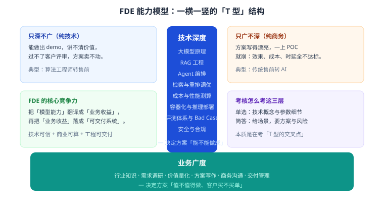
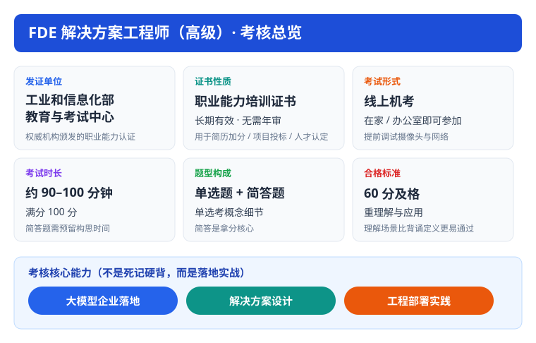

# 第 1 章 岗位能力与职业路径

> 返回 [全书目录](../00-全书导读与目录.md)。下一篇：[02-考试大纲与评分规则](02-考试大纲与评分规则.md)。

> [!NOTE]
> **本章解决什么问题**
>
> 搞清楚 FDE 到底是个什么岗位、这张证书是什么性质、考试怎么考、你差在哪。
>
> 很多人一上来就背概念，结果背了一堆「RAG 是什么」，却答不出「给你一个场景怎么落地」——这就是没读懂考核意图。

---

## 1.1 FDE 这个岗位到底在干什么

### 三种真实形态

「FDE」这个词在不同公司含义略有差异，但工作内核一致：**站在客户现场，把 AI 能力变成业务结果。**

| 形态 | 归属 | 典型工作 | 核心能力 |
| --- | --- | --- | --- |
| 厂商 FDE | AI 产品公司（如 Palantir 模式） | 进驻客户现场，用自家平台搭出客户要的系统 | 平台熟练度 + 业务理解 + 快速交付 |
| 集成商解决方案工程师 | 系统集成 / 咨询公司 | 投标、写方案、做 POC、带交付 | 方案写作 + 技术选型 + 成本测算 |
| 甲方 AI 平台工程师 | 企业 IT / 数字化部门 | 内部知识库、智能客服、流程自动化 | 需求梳理 + 系统集成 + 运营迭代 |

三种形态的共同点：**离业务近、离交付近、要对结果负责**。这决定了考核不会只考「模型原理」，而一定考「场景 → 方案 → 落地」。

### 能力模型：T 型结构

- **竖（技术深度）**：决定方案「能不能做成」。要能回答：这个场景该用 RAG 还是 Agent？分块怎么切？召回不准怎么调？显存够不够？
- **横（业务广度）**：决定方案「值不值得做、客户买不买单」。要能回答：这个场景一年省多少人力？为什么比竞品方案便宜？上线后谁维护？

> [!IMPORTANT]
> **考核的真实意图**
>
> 单选题考「竖」的细节（概念、参数、原理），简答题考「横 × 竖」的交叉点（给场景，要方案）。
>
> **只背概念的人，单选题能过，简答题一定崩。** 这是最常见的挂科原因。

### 一天的工作长什么样

一个典型 FDE 的一天（真实项目节奏）：

| 时段 | 事情 | 输出物 |
| --- | --- | --- |
| 上午 | 客户业务部门访谈：现有流程、痛点、数据在哪 | 需求清单、数据源清单 |
| 中午 | 拉数据样本试跑：文档解析质量、召回效果 | 可行性判断（能不能做） |
| 下午 | 写方案章节：架构图、选型理由、成本测算 | 方案 V0.3 |
| 傍晚 | 与研发对齐：接口、部署方式、排期 | 技术方案确认单 |
| 晚上 | 复盘 Bad Case：昨天客户试用的 20 条错误 | 调参清单 |

看出来了吗——**写方案、算成本、调效果**，这三件事占了 FDE 一半以上的时间。这正是本书第 17–22 章（方案与商务）、第 24 章（容量与成本）、第 12 章（评测调优）重点铺开的内容。

---

## 1.2 证书基础信息

| 项目 | 内容 |
| --- | --- |
| 证书全称 | FDE 解决方案工程师（高级） |
| 发证单位 | 工业和信息化部教育与考试中心 |
| 证书性质 | **职业能力培训证书**（非执业资格、非准入类） |
| 有效期 | 长期有效，无需年审 |
| 用途 | 简历背书、项目投标资质支撑、企业人才能力认定 |
| 面向方向 | AI 企业落地交付、大模型售前、AI 应用部署、RAG 项目实施 |
| 报名方式 | 通过授权培训机构报名，完成规定课时培训后参加结业考核 |

> [!WARNING]
> **性质要说清（简答/面试都可能被问）**
>
> 它证明你**接受过系统培训并通过考核**，不代表执业许可。和软考（计算机技术与软件专业技术资格）、注册类证书不是一回事。
>
> 正确表述：「职业能力培训证书，可作为能力证明与投标资质支撑」，而不是「从业资格证」。

---

## 1.3 考试怎么考

| 项目 | 说明 |
| --- | --- |
| 形式 | 线上机考 |
| 时长 | 约 90–100 分钟 |
| 题型 | 单选题 + 简答题 |
| 满分 / 合格 | 100 分 / 60 分及格 |
| 监考 | 摄像头 + 屏幕监控，需稳定网络 |

### 大纲五大模块与权重判断

官方大纲列了五个模块。按「内容体量 + 题型分布」判断，权重大致如下（**这是备考优先级判断，不是官方分值承诺**）：

| 模块 | 内容 | 题型倾向 | 备考优先级 |
| --- | --- | --- | --- |
| 模块 1 大模型基础理论 | LLM 概念、Token、Embedding、提示词、幻觉、成本、API | 单选密集 | ★★★☆ |
| 模块 2 RAG 知识库系统 | 全链路、分块、向量库、混合检索、重排、评估、Bad Case | **单选 + 简答双高** | ★★★★★ |
| 模块 3 Agent 智能体 | Function Calling、ReAct、多 Agent、记忆、护栏、编排 | 单选 + 简答 | ★★★★ |
| 模块 4 企业 AI 方案设计 | 调研、POC、选型、部署模式、成本、风险 | **简答主战场** | ★★★★☆ |
| 模块 5 工程落地与合规 | 数据治理、容器化、量化、安全、隐私、交付运维 | 单选 + 简答 | ★★★☆ |

> [!TIP]
> **分值博弈**
>
> 及格线 60 分，意味着**不需要全对**。策略是：
> - 单选拿到 80% 以上（概念题不难，靠对比表记忆）；
> - 简答每道都写满四段（哪怕不完美，结构分先拿到）；
> - RAG 模块必须吃透——它同时喂饱单选和简答。

---

## 1.4 你差在哪：20 项能力自测

按 1–5 分自评（1 = 完全不会，5 = 能独立交付）。低于 3 分的，就是你的复习重点。

**技术侧（竖）**

| # | 能力项 | 自评 |
| --- | --- | --- |
| 1 | 讲清 LLM 逐 Token 生成的原理及其后果（幻觉、不确定性） | |
| 2 | 说清 Token、上下文窗口、计费三者的关系 | |
| 3 | 解释 Embedding 为什么能做语义检索 | |
| 4 | 区分 Zero-shot / Few-shot / CoT，并知道各自适用场景 | |
| 5 | 列出幻觉的五类成因与对应缓解手段 | |
| 6 | 画完整 RAG 链路（离线 + 在线两段） | |
| 7 | 说清分块大小、重叠比例对效果的影响 | |
| 8 | 解释混合检索与 Re-rank 各自解决什么问题 | |
| 9 | 说出 RAG 四个核心评估指标及含义 | |
| 10 | 给一个 Bad Case，能定位到具体环节 | |
| 11 | 讲清 Function Calling 的完整时序 | |
| 12 | 讲清 ReAct 循环与它的失败模式 | |
| 13 | 说明 Agent 记忆的三层结构 | |
| 14 | 估算 7B 模型 FP16 / INT4 的显存占用 | |
| 15 | 说出量化的原理与代价 | |

**业务侧（横）**

| # | 能力项 | 自评 |
| --- | --- | --- |
| 16 | 用「价值 × 可行性」给客户需求排优先级 | |
| 17 | 写一份 12 章结构的解决方案文档 | |
| 18 | 算清一个项目的 Token 成本与 TCO | |
| 19 | 判断该公有云还是私有化，并说出理由 | |
| 20 | 列出上线前的合规检查项 | |

> [!NOTE]
> **自测结论怎么用**
>
> - 15 项以上 ≥ 4 分：直接进 07 章刷题，查漏补缺；
> - 8–14 项 ≥ 4 分：重点补 03、05 两章；
> - 少于 8 项：从 02 章老实通读，别跳。

---

## 1.5 报考与备考的五个坑

> [!WARNING]
> **坑 1：把培训证书当执业资格**
>
> 对外表述要准确。写简历可以写「持有 FDE 解决方案工程师（高级）职业能力培训证书」，不要写「持证上岗」。

> [!WARNING]
> **坑 2：相信「免考包过」**
>
> 正规考核必须本人参考、有监考。任何承诺免考、代考、包过的渠道，风险自负。

> [!WARNING]
> **坑 3：只背定义，不练方案**
>
> 这是最致命的。简答题占比不低，而它考的是「组织答案的能力」，必须动手写。

> [!WARNING]
> **坑 4：忽视工程数字**
>
> 「7B 模型要多少显存」「日均 1 万次问答一年多少钱」——这类题最能区分「看过文章」和「做过项目」。

> [!WARNING]
> **坑 5：不看合规**
>
> 数据合规、内容标识、算法备案，是近两年企业 AI 项目的硬门槛，也是简答题的常客。

---

## 1.6 三档备考路线

| 档位 | 周期 | 安排 | 适合 |
| --- | --- | --- | --- |
| 充裕档 | 4 周 | 第 1 周 02 章；第 2 周 03 章（重点）；第 3 周 04+05 章；第 4 周 06+07+题库 | 零基础 / 想真学懂 |
| 标准档 | 2 周 | 前 5 天 02+03；中间 5 天 04+05；最后 4 天 06+07+题库 | 有技术底子 |
| 冲刺档 | 5–7 天 | 每天 1 章「考点速记」+ 30 道单选 + 2 道简答手写 | 临时抱佛脚 |

**每天固定动作（无论哪档）：**

1. 早：读 1 节正文，用一句话总结「这节解决什么问题」；
2. 午：做 5 道对应章节单选，错题回原文定位；
3. 晚：手写 1 道简答（限时 15 分钟），对照模板改。

---

## 1.7 本章考点速记

<b>必背要点（点击展开自测）</b>

> 1. FDE = 前线部署工程师 / 解决方案工程师，核心是**把 AI 能力变成可验收的业务结果**。
> 2. 能力模型是 T 型：技术深度（能不能做成）× 业务广度（值不值得做）。
> 3. 证书是**职业能力培训证书**，长期有效、无需年审，非执业资格。
> 4. 考试：线上机考、90–100 分钟、单选 + 简答、100 分制 60 分及格。
> 5. 五大模块中 **RAG 权重最高**，方案设计是简答主战场。
> 6. 备考铁律：概念靠对比表，方案靠手写，数字靠手算。

---

**下一篇**：[第 2 章 考试大纲与评分规则](02-考试大纲与评分规则.md)
