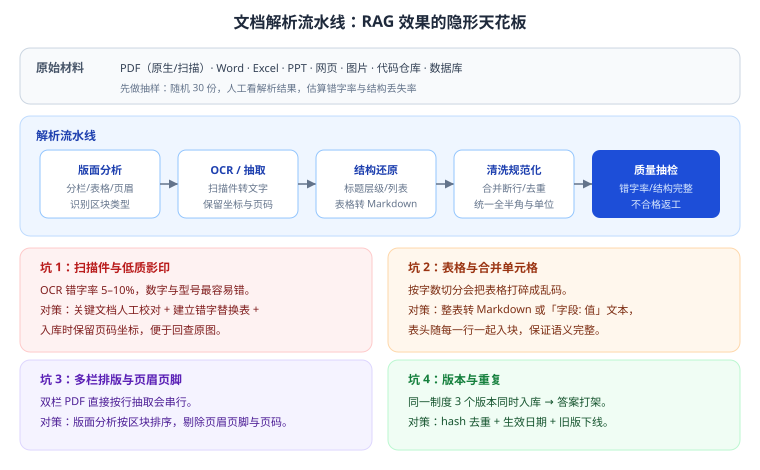

# 第 9 章 文档解析与数据工程

> 返回 [全书目录](../00-全书导读与目录.md)。上一篇：[08-模型选型与能力评测](../第二篇-技术基础/08-模型选型与能力评测.md)；下一篇：[10-RAG工程实践](10-RAG工程实践.md)。

> [!NOTE]
> **本章解决什么问题**
>
> RAG 项目里 40% 以上的工时花在数据上，而这部分最容易被「技术型选手」轻视。
> 本章把「解析—清洗—结构化—质量评估」这条流水线讲透，并给出可直接照做的验收标准。

---

## 9.1 为什么解析决定效果上限



一个残酷的算术：

```text
假设文档解析错字率 5%，检索命中 5 个块，每块 400 字
→ 平均每块有 20 个字是错的
→ 涉及数字、型号、条款号时，答案几乎必错
```

**检索不到的内容，模型永远答不出；解析错的内容，模型会「忠实地」答错。** 这是 RAG 最隐蔽的失效路径——看起来链路都通了，指标就是上不去。

---

## 9.2 解析流水线五步

### 第一步：版面分析

目的：知道「这一页是什么结构」，而不是把整页当一段文字。

| 要识别 | 为什么 |
| --- | --- |
| 分栏（单栏/双栏/三栏） | 双栏按行读会串行，必须按栏切 |
| 表格区域 | 表格要单独处理，不能按字数切 |
| 页眉页脚、页码、水印 | 噪声，必须剔除 |
| 标题层级 | 决定后续按结构分块 |
| 图片与图注 | 图注常含关键信息（图 3-2 液压回路） |

### 第二步：OCR 与文本抽取

| 文档类型 | 方案 | 注意 |
| --- | --- | --- |
| 原生 PDF | 直接抽取文字层 | 注意阅读顺序（按区块排序） |
| 扫描件 PDF | OCR（版面感知） | 保留坐标，便于回查原图 |
| 图片 | OCR | 分辨率不足时先超分 |
| 手写体 | 专用 OCR | 识别率低，关键字段需人工 |

> [!WARNING]
> **OCR 的三个高发错误**
>
> 1. **数字错**：`0` 与 `O`、`1` 与 `l`、`8` 与 `B`；
> 2. **单位错**：`mg` 与 `ml`、`万元` 与 `元`；
> 3. **表格串行**：合并单元格被读成一串乱码。
> 这三类错误在医疗、金融、制造场景里都可能造成实质损失，**必须抽检**。

### 第三步：结构还原

把「一堆文字」还原成「有结构的文本」：

```markdown
# 第 3 章 液压系统维护

## 3.2 常见故障

### 3.2.1 液压泵异响

| 现象 | 可能原因 | 处理 |
| --- | --- | --- |
| 嗡嗡声 | 油位不足 | 补油至标线 |
| 尖啸声 | 进气 | 检查吸油管密封 |

> 警示：拆卸前必须泄压，否则高压油可能伤人。
```

结构还原的价值：分块时能按标题切、引用时能标章节、检索时能匹配条号。

### 第四步：清洗规范化

| 规则 | 说明 |
| --- | --- |
| 合并断行 | 中文 PDF 常按版面断行，需按语义合并 |
| 去重 | 同一制度多版本、重复附件 |
| 统一全半角、标点、单位 | `１２３` → `123`；`ＭＰａ` → `MPa` |
| 去页眉页脚/页码/水印 | 高频噪声 |
| 保留表格结构 | 转 Markdown 或「字段: 值」 |
| 保留标题层级 | 作为分块依据 |

### 第五步：质量抽检（必须有）

| 指标 | 抽检方法 | 合格线（经验） |
| --- | --- | --- |
| 字符准确率 | 随机 10 页人工比对 | ≥ 98% |
| 结构完整率 | 标题层级是否保留 | ≥ 95% |
| 表格还原率 | 抽查 20 个表格 | ≥ 90% |
| 重复率 | hash 去重统计 | ≤ 2% |

> [!TIP]
> **把抽检写进方案**
>
> 「入库前随机抽检 30 份，字符准确率 ≥98% 方可入库，不达标返工。」——这一句能让评审相信你真的做过项目。

---

## 9.3 元数据设计（决定权限、引用与更新）

| 字段 | 类型 | 用途 | 缺失后果 |
| --- | --- | --- | --- |
| `doc_id` | string | 文档唯一标识 | 无法引用与追溯 |
| `chunk_id` | string | 块唯一标识 | 无法定位 |
| `title` / `section` | string | 展示出处 | 用户不信答案 |
| `page` | int | 页码 | 无法核对原文 |
| `source_type` | enum | 制度/手册/工单/网页 | 无法按来源加权 |
| `effective_date` | date | 生效日期 | 新旧版本混答 |
| `version` | string | 版本号 | 无法回滚 |
| `dept` / `visibility` | list/enum | 权限 | **越权泄露** |
| `tenant_id` | string | 租户隔离 | SaaS 场景串数据 |
| `hash` | string | 内容指纹 | 无法增量更新 |

> [!IMPORTANT]
> **一句话**
>
> **元数据不是「附加信息」，是 RAG 的功能开关。** 权限、引用、时效、增量，全都靠它。设计阶段少一个字段，上线后就要重建索引。

---

## 9.4 增量更新机制

知识库不是一次建完就结束，必须有更新机制：

| 场景 | 做法 |
| --- | --- |
| 文档新增 | 解析 → 分块 → 入库 |
| 文档修改 | hash 比对 → 删除旧块 → 写入新块 |
| 文档下线 | 标记 `status=deprecated`，检索时过滤 |
| 批量重建 | 版本化索引（新旧并存），切换后删除旧索引 |

```text
伪代码：
for doc in scan(source):
    h = sha256(doc.content)
    if h == db.get_hash(doc.id):      # 未变化，跳过
        continue
    chunks = split(parse(doc))
    vdb.delete_by_doc(doc.id)          # 先删旧块
    vdb.upsert(embed(chunks))          # 再写新块
    db.set_hash(doc.id, h)
```

> [!WARNING]
> **常见坑**
>
> 只做「插入」不做「删除」，导致同一文档新旧内容共存，答案自相矛盾。**增量更新必须成对：先删后插。**

---

## 9.5 数据质量六维评估表（可直接用于验收）

| 维度 | 检查项 | 不达标的后果 | 处理 |
| --- | --- | --- | --- |
| 完整性 | 关键章节是否缺失 | 答不上 | 补齐或缺省说明 |
| 准确性 | OCR 错字率、数字是否正确 | 答错（最危险） | 校对 + 替换表 |
| 一致性 | 多版本是否矛盾 | 前后不一 | 版本下线 |
| 时效性 | 是否过期 | 用旧政策答新问题 | 生效日期过滤 |
| 唯一性 | 是否重复入库 | 召回重复、浪费预算 | hash 去重 |
| 可用性 | 格式能否解析 | 入不了库 | 转格式/人工 |

---

## 9.6 特殊内容处理手册

| 内容 | 处理方式 |
| --- | --- |
| 表格 | 整表转 Markdown；表头随每行；合并单元格先展开 |
| 条款/法条 | 一条一块，保留条号（强检索特征） |
| 问答对 | 一问一答一块，问题也入向量 |
| 代码 | 按函数/类切（AST），保留签名与注释 |
| 图纸 | 图注 + OCR 标注文字；关键图纸人工写描述 |
| 公式 | 转 LaTeX 或自然语言描述（视场景） |
| 长列表 | 10–20 项一组，保留列表标题 |
| 目录页 | 不入库（噪声），但可提取结构信息 |

---

## 9.7 数据工程的排期建议

| 阶段 | 占比 | 说明 |
| --- | --- | --- |
| 盘点与抽检 | 15% | 摸清家底，估算工作量 |
| 解析与清洗 | 40% | 最耗时，尤其扫描件 |
| 分块与元数据 | 20% | 设计一次，长期受益 |
| 入库与索引 | 10% | 工程化，可脚本化 |
| 质量验收 | 15% | 抽检 + 修正 |

> [!TIP]
> **报价时的提醒**
>
> 客户常说「数据都整理好了，你们直接接就行」。**务必先抽检 30 份**——真实情况往往是 30% 是扫描件、20% 有重复版本、10% 是空文件。抽检报告既是工作量依据，也是后续变更的凭证。

---

## 9.8 表格与复杂版面：真正拉开差距的地方

文本解析大家都差不多，**表格和复杂版面才是分水岭**。企业文档里 80% 的「精确数字」都在表格里。

| 版面类型 | 难点 | 处理策略 | 失败表现 |
| --- | --- | --- | --- |
| 合并单元格 | 行列关系丢失 | 先识别合并区域，再展开成「每行带完整字段」 | 答案把 A 产品的价格配到 B 产品 |
| 跨页表 | 表头只在第一页 | 识别续表，自动补表头 | 第二页数据无字段名，检索不到 |
| 双栏排版 | 按行读取会左右串行 | 先做栏分割，再按栏内顺序读 | 句子语义混乱、无法理解 |
| 嵌套表 | 表中有表 | 内层表转为「字段: 值」文本 | 结构塌陷 |
| 公式 | 图片化、上下标 | 转 LaTeX 或纯文本描述 | 关键参数丢失 |
| 印章 / 手写批注 | 覆盖正文 | 单独图层处理，不参与正文抽取 | OCR 把印章文字混入正文 |
| 页眉页脚 / 水印 | 高频噪声 | 按位置 + 重复频率剔除 | 每块都带「内部资料 请勿外传」 |

**合并单元格的正确处理**（最容易做错）：

```text
原始（视觉）：
| 产品   | 规格        | 价格 |
| A      | 标准 / 专业  | 100 / 200 |

直接解析（错）：["产品","规格","价格"], ["A","标准 / 专业","100 / 200"]
→ 检索「专业版价格」时匹配不到 200

正确展开（对）：
| 产品 | 规格 | 价格 |
| A    | 标准 | 100  |
| A    | 专业 | 200  |
→ 每一行都是自解释的完整记录
```

> [!IMPORTANT]
> **一条验收标准**
>
> **表格还原的验收标准不是「看起来一样」，而是「每一行能独立回答一个问题」。**
> 抽检时这样测：随机取 20 个表格，针对每行问一个「这行的某个值是多少」，能答对即通过。这比肉眼看结构靠谱得多。

---

## 9.9 解析工具怎么选：按文档类型分，不按品牌分

没有「最好的解析工具」，只有「对这类文档最合适的」。

| 文档类型 | 推荐路线 | 理由 | 成本量级 |
| --- | --- | --- | --- |
| 电子版 PDF（有文字层） | 直接抽文字 + 版面分析 | 不用 OCR，准确率最高 | 极低 |
| 扫描件（印刷体） | OCR + 版面分析 + 后处理 | 主流 OCR 印刷体准确率已 >97% | 低 |
| 扫描件（手写/表格） | 专用表格 OCR 或多模态模型 | 通用 OCR 对表格结构还原差 | 中 |
| Word / 网页 | 直接解析结构（标题层级） | 结构化信息完整 | 极低 |
| 图片型 PPT | 逐页 OCR + 标题识别 | 版式自由，需人工抽检 | 中 |
| 图纸 / 工程图 | 专用工具或多模态模型 | 通用方案基本不可用 | 高 |
| 音视频 | ASR + 说话人分离 + 分段 | 转写质量决定上限 | 中 |

**三条选型建议**：

1. **能用文字层就别 OCR**：OCR 一定引入错误，能省就省。先检测 PDF 是否含文字层（很多「看起来像扫描件」的 PDF 其实有）。
2. **多模态模型适合「兜底」而不是「主力」**：成本高、速度慢，用来处理 OCR 失败的那 5% 最划算。
3. **不要追求一个工具通吃**：混合文档（8000 份里 40% 扫描件）就应该走两条流水线，分别抽检。

> [!TIP]
> **一个省钱的判断**
>
> 8000 份文档里，通常 20% 的文档贡献 80% 的检索命中。
> **先把这 20% 做到 99% 准确，剩下的用低成本方案过一遍**——比全量追求高准确率省一半预算。

---

## 9.10 数据工程排期算例：8000 份混合文档

这是最容易被低估、也最需要写进报价的部分。完整算例：

| 工作项 | 量 | 单位产能 | 人月 | 说明 |
| --- | --- | --- | --- | --- |
| 文档清点与分类 | 8000 份 | 400 份/人日 | 1.0 | 分出类型、密级、owner |
| 文本型解析 | 4800 份（14 万页） | 3 万页/人月 | 4.7 | 版面分析 + 表格还原 |
| 扫描件 OCR | 3200 份（9.6 万页） | 2 万页/人月 | 4.8 | 含方向校正、去噪 |
| 人工校对 | 抽 400 页精校 | 200 页/人月 | 2.0 | 建错字替换表 |
| 结构还原 | 核心 1200 份 | 600 份/人月 | 2.0 | 标题层级、条款、步骤 |
| 元数据补全 | 8000 份 | 4000 份/人月 | 2.0 | 含权限映射 |
| 抽检与返工 | 全量抽 5% | — | 1.5 | 字符准确率 ≥98% 才入库 |
| **合计** | | | **18.0 人月** | |

> [!WARNING]
> **这个数字要敢报**
>
> 客户听到「8000 份文档要 18 人月」通常第一反应是「太多了」。
> 应对方式不是压缩数字，而是**给出分解表 + 单位产能**（如上表），并补一句：「如果只做前 20% 的高频文档，可以压到 5 人月，覆盖约 75% 的咨询量。」
> **用范围控制换预算，比虚报工作量专业得多。**

---

## 9.11 本章考点速记

<details>
<summary><b>必背 6 条（点击展开自测）</b></summary>

> 1. 解析决定效果上限：检索不到、解析错，模型都救不回来。
> 2. 流水线五步：版面分析 → OCR/抽取 → 结构还原 → 清洗 → 质量抽检。
> 3. OCR 三类高发错误：数字、单位、表格串行。
> 4. 元数据十字段：doc_id、chunk_id、标题、章节、页码、来源、生效日期、版本、权限、hash。
> 5. 增量更新必须「先删后插」，否则新旧内容共存。
> 6. 质量六维：完整、准确、一致、时效、唯一、可用。

</details>

---

**上一篇**：[第 8 章 模型选型与能力评测](../第二篇-技术基础/08-模型选型与能力评测.md)　|　**下一篇**：[第 10 章 RAG 工程实践](10-RAG工程实践.md)
