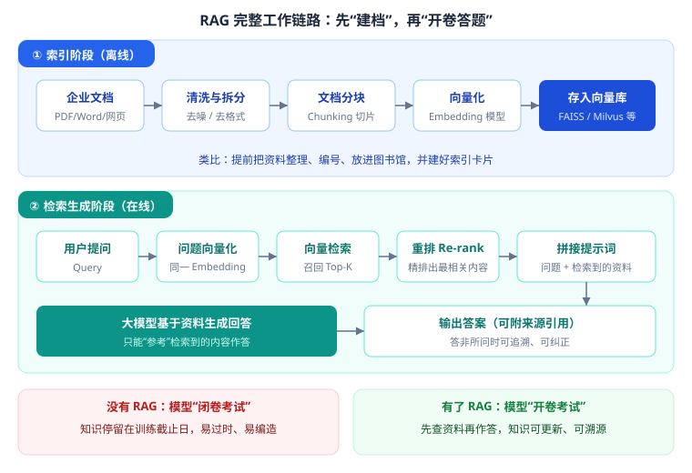
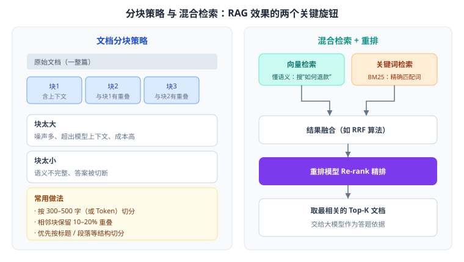
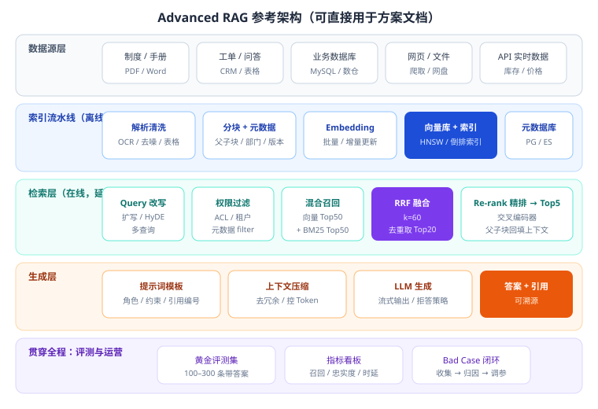
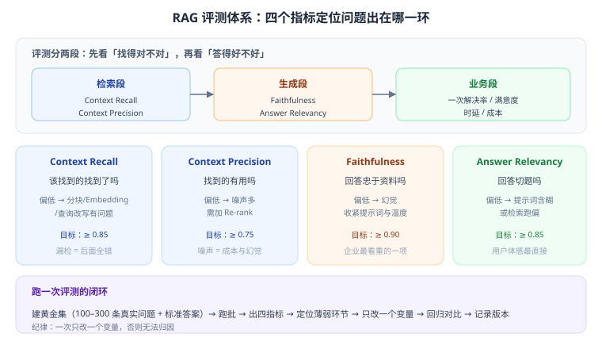
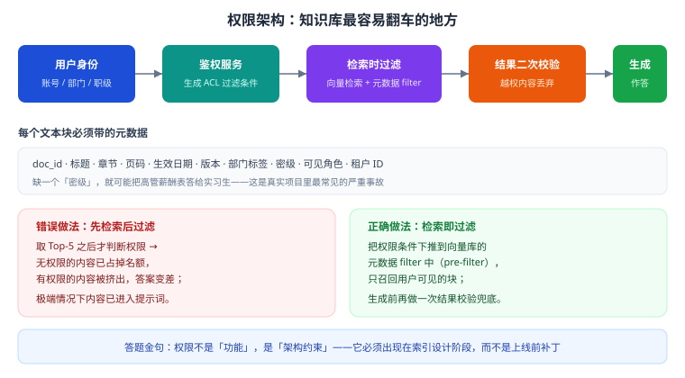

# 第 10 章 RAG 工程实践

> 返回 [全书目录](../00-全书导读与目录.md)。上一篇：[09-文档解析与数据工程](09-文档解析与数据工程.md)；下一篇：[11-检索进阶与GraphRAG](11-检索进阶与GraphRAG.md)。

> [!NOTE]
> **本章解决什么问题**
>
> RAG 是考核权重最高、也是企业项目最常做的模块。本章不止讲「链路有几步」，而是讲**每一步的参数怎么定、效果怎么量、坏了怎么修**——这才是 FDE 与「看过几篇文章的人」的差别。
>
> 读完你应该能做到：拿到一个知识库需求，独立出方案、定参数、建评测、调效果、算成本。

---

## 10.1 为什么是 RAG，以及它的三代演进

### 一句话定义

RAG（Retrieval-Augmented Generation，检索增强生成）：**先从知识库检索相关资料，再把资料和问题一起交给大模型生成答案。**

事实依据：Lewis 等，2020（Facebook AI），《Retrieval-Augmented Generation for Knowledge-Intensive NLP Tasks》。原始动机是让模型处理「知识密集型」任务时，不依赖参数记忆，而是动态检索外部文档。

### 四个不可替代的价值

| 价值 | 说明 | 客户最在意什么 |
| --- | --- | --- |
| 知识可更新 | 改文档即改知识，无需重训 | 「政策下个月改，你们能跟上吗？」 |
| 答案可溯源 | 附来源、页码、原文 | 「答错了谁负责？」 |
| 数据可私有 | 知识留在自己库里 | 「我们的资料不能出内网」 |
| 成本可控 | 无训练成本，按调用付费 | 「一年要花多少钱？」 |

### 三代演进（答题时能拉开层次）

| 代际 | 特征 | 典型问题 |
| --- | --- | --- |
| Naive RAG | 切块 → 向量检索 → 拼接 → 生成 | 召回不准、切块断裂、噪声多 |
| Advanced RAG | 加查询改写、混合检索、重排、元数据过滤、父子块 | 工程复杂度上升，需评测支撑 |
| Modular / Agentic RAG | 模块化编排，按问题动态决定检索策略、多轮检索、调用工具 | 成本与延迟上升，需护栏 |

> [!TIP]
> **答题加分点**
>
> 说「我们做的是 Advanced RAG：混合检索 + 重排 + 父子块 + 元数据权限过滤 + 黄金评测集」，比说「我们用了 RAG」高一个档次。

---

## 10.2 索引阶段：垃圾进，垃圾出



索引阶段是**离线**做的，做一次、定期增量。它决定了效果的天花板——**检索不到的东西，模型再强也答不出**。

### 10.2.1 文档解析：最难也最容易被低估

| 文档类型 | 难点 | 处理方式 |
| --- | --- | --- |
| 原生 PDF | 双栏、页眉页脚、脚注干扰 | 版面分析（按区块抽取），剔除页眉页脚 |
| 扫描件 PDF / 图片 | 无文字层 | OCR（识别率决定上限，务必抽检） |
| Word | 样式混乱、批注、修订痕迹 | 按标题层级转 Markdown，保留结构 |
| Excel / 表格 | 表格语义丢失，一行变乱码 | 转 Markdown 表格或「字段: 值」文本；保留表头 |
| PPT | 图文混排，要点碎片化 | 按页抽取，标注页码 |
| 网页 | 导航栏、广告噪声 | 正文抽取算法，保留标题与发布时间 |
| 代码仓库 | 需要按函数/类切分 | 用 AST 感知的切分器 |

> [!WARNING]
> **真实项目教训**
>
> 客户给 3000 份 PDF，其中 40% 是扫描件。直接跑解析，OCR 错字率 8%，检索全乱。**必须在方案里写「文档质量抽检 + OCR 校对」这一项工时**，否则后期返工。

### 10.2.2 清洗规则清单

1. 去页眉页脚、页码、水印；
2. 合并被换行打断的句子（中文尤其严重）；
3. 去掉重复段落（同一制度多个版本重复入库）；
4. 统一全半角、标点、单位；
5. 表格转结构化文本，保留表头；
6. 保留标题层级，作为分块依据；
7. 剔除空页、目录页、广告页。

### 10.2.3 元数据设计（决定权限与可追溯）

每个文本块至少要带：

| 字段 | 用途 |
| --- | --- |
| `doc_id` / `chunk_id` | 唯一标识、引用定位 |
| `title` / `section` | 回答时展示「出自哪一章」 |
| `page` | 引用页码，便于人工核对 |
| `source_type` | 制度/手册/工单/网页，影响权重 |
| `effective_date` / `version` | 新旧版本冲突时取新 |
| `dept` / `visibility` / `tenant_id` | **权限过滤（最关键）** |
| `hash` | 增量更新时判断是否变更 |

> [!IMPORTANT]
> **一句话**
>
> **没有元数据的知识库，是一个不能上线给企业用的知识库。** 权限、引用、增量更新、版本冲突，全都靠它。

---

## 10.3 分块（Chunking）：效果的第一个关键旋钮



### 为什么必须分块

三个硬约束：Embedding 模型有输入长度上限；上下文窗口有限；检索粒度越细定位越准（但语义越碎）。

### 五种策略与取舍

| 策略 | 做法 | 优点 | 缺点 | 适用 |
| --- | --- | --- | --- | --- |
| 固定长度 | 每 N 字切一刀 | 简单、均匀 | 切断句子/表格 | 无结构纯文本 |
| 固定长度 + 重叠 | 相邻块重叠 10–20% | 缓解切断 | 存储与检索冗余 | 通用兜底 |
| 按结构切分 | 按标题、段落、列表切 | 语义完整、可溯源 | 依赖文档结构质量 | **首选（制度/手册）** |
| 语义分块 | 按句子向量相似度找断点 | 主题完整 | 计算贵、实现复杂 | 高质量要求场景 |
| 父子块（Small-to-Big） | 小子块检索、父块回填 | 检索准 + 上下文全 | 需两级存储 | **推荐进阶方案** |

### 参数怎么定（经验值，需实测微调）

| 参数 | 建议 | 理由 |
| --- | --- | --- |
| 块大小 | 中文 300–500 字（约 300–500 Token） | 太小语义不全，太大噪声多 |
| 重叠 | 50–100 字（10–20%） | 防止答案落在切缝 |
| 单块最大 Token | ≤ Embedding 模型上限的 80% | 留余量，避免截断 |
| Top-K（召回） | 向量 30–50 + BM25 30–50 | 先多召回 |
| Top-N（重排后） | 3–5 块送入生成 | 少而精，控成本 |
| 单块注入上限 | 总上下文不超过窗口 50% | 留空间给对话与输出 |

### 父子块：解决「检索要准、上下文要全」的矛盾

做法：

1. 把文档切成**小片**（200 字）用于向量检索——定位精准；
2. 每个小片记录其**父块**（如整节 1500 字）；
3. 命中若干小片后，**回填它们的父块**（去重合并）再交给模型。

效果：检索精度接近小片，生成上下文接近整节。代价：多一级存储与合并逻辑。

### 特殊内容怎么切

| 内容 | 处理 |
| --- | --- |
| 表格 | 整表作为一个块，或按行 + 表头拼接；绝不按字数硬切 |
| 条款 / 法条 | 一条一块，保留条号（检索时条号是强特征） |
| 问答对（FAQ） | 一问一答一块，问题也入向量 |
| 代码 | 按函数/类切，保留签名与注释 |
| 长列表 | 按 10–20 项一组，保留列表标题 |

> [!NOTE]
> **小节自测**
>
> 「客户反馈：问某个流程要几步，答案总是缺最后一步。」最可能的原因？

<details>
<summary><b>点击看答案</b></summary>

> 分块切断了流程列表，最后一步落在下一个块里，而召回只取到了前一块。解法：按结构切分（整节不切）、增大重叠、或用父子块回填父块。这类「答案被切断」是分块问题最典型的表现。

</details>

---

## 10.4 向量库：选型与索引原理

### 四类方案对比

| 方案 | 类型 | 优势 | 局限 | 适用 |
| --- | --- | --- | --- | --- |
| FAISS | 检索库（非数据库） | 极快、轻量、Meta 开源 | 无持久化/权限/分布式，需自己封装 | 单机、离线批处理、原型 |
| Chroma | 轻量向量库 | 上手极快、API 友好 | 大规模与高并发弱 | 原型、小团队 |
| Milvus | 分布式向量数据库 | 海量数据、高并发、多索引、标量过滤强 | 部署运维较重 | 企业级知识库 |
| pgvector | PostgreSQL 扩展 | 与业务库同源、事务一致、SQL 过滤方便 | 超大规模性能不及专用库 | 已有 PG、中等规模 |
| 云托管向量服务 | SaaS | 免运维、弹性 | 数据出域、成本随量上升 | 已上云、快速上线 |

### 索引原理：为什么能「快」

暴力比对要遍历全部向量，O(N)。近似最近邻（ANN）索引牺牲极小精度换巨大速度：

| 索引 | 原理 | 关键参数 | 调参直觉 |
| --- | --- | --- | --- |
| **HNSW** | 多层图，上层稀疏跳跃、下层密集精搜 | `M`（每节点连接数）、`efConstruction`（建索引搜索宽度）、`efSearch`（查询宽度） | M↑ 更准更占内存；efSearch↑ 更准更慢 |
| **IVF** | 先聚类分桶，查询只搜最近的 n 个桶 | `nlist`（桶数）、`nprobe`（查几个桶） | nprobe↑ 更准更慢 |
| **PQ 量化** | 向量分段压缩，省内存 | 分段数、码本大小 | 压缩率高但精度降 |

经验值（HNSW，百万级）：`M=16~32`，`efConstruction=200`，`efSearch=64~128`。**这些参数必须用评测集验证**，不能照抄。

### 标量过滤：权限与业务筛选的落点

企业场景几乎一定要「先按部门/密级/时间过滤，再做向量检索」。选型时要确认：

- 是否支持 **pre-filter**（先过滤再检索，结果准）；
- 还是 **post-filter**（先检索再过滤，可能召回不足）。

> [!WARNING]
> **高频坑**
>
> 用「先检索后过滤」的库做权限，会出现「Top-5 里 4 条无权限 → 只剩 1 条可用」的尴尬，答案质量骤降。**选型时就要确认支持 pre-filter。**

---

## 10.5 检索层：决定「能不能找到」



检索层是在线的，每次提问都走一遍。目标只有一个：**在可接受的延迟内，把最有用的几块资料放进候选集。**

### 10.5.1 查询改写（Query Rewriting）

用户的问题往往不适合直接检索：「这个怎么弄」「上次那个流程」「报错了怎么办」。改写手段：

| 手段 | 做法 | 收益 | 成本 |
| --- | --- | --- | --- |
| 指代消解 | 把「它/这个」替换成上文实体 | 解决多轮对话检索跑偏 | 一次小模型调用 |
| 关键词扩写 | 补同义词、缩写全称、型号变体 | 提升召回 | 低 |
| 多查询（Multi-Query） | 生成 3–5 个不同问法分别检索再合并 | 召回显著提升 | 检索 ×N |
| HyDE | 先让模型「编一个假答案」，用假答案去检索 | 对短问题效果好 | 一次生成 |
| 子问题拆解 | 复杂问题拆成多个子问题分别检索 | 解决复合问题 | 多次检索 |

> [!TIP]
> **性价比排序**
>
> 大多数项目里，**指代消解 + 关键词扩写**就能解决 70% 的检索问题，成本极低。HyDE 与多查询留给「效果要求高、延迟不敏感」的场景。

### 10.5.2 混合检索：向量 + 关键词

| 维度 | 向量检索 | 关键词检索（BM25） |
| --- | --- | --- |
| 优势 | 懂语义、能处理同义改写 | 精确匹配、专有名词/编号/型号强 |
| 劣势 | 对精确串不敏感；对短查询易漂移 | 不理解语义，换个说法就找不到 |
| 典型失手 | 搜「E1007 报错」召回一堆泛泛的故障处理 | 搜「如何退款」找不到「退货流程」 |

**BM25 的核心思想**（了解即可，单选常考概念）：综合「词频（TF）」「逆文档频率（IDF）」「文档长度归一化」给相关性打分，参数通常 `k1≈1.2–2.0`、`b≈0.75`。

**融合算法 RRF（Reciprocal Rank Fusion）**——工程最常用，因为它只看排名、不看分数量纲：

> **RRF 分数 = Σ 1 / (k + rank_i)**，常取 **k = 60**

优点：无需把两路分数归一化，天然鲁棒。缺点：丢掉了分数差异信息（可用加权 RRF 缓解）。

### 10.5.3 元数据过滤

在检索时把业务条件带进去：

```text
filter = { dept in user.depts, visibility <= user.level, effective_date <= today }
```

这一步同时解决三个问题：**权限隔离、时效性（只用现行版本）、范围收敛（只搜本产品线）**。

---

## 10.6 重排（Re-rank）：从「召回多」到「选得准」

### 为什么需要重排

向量检索用的是**双塔模型**（问题和文档分别编码再算相似度），快但粗。重排用**交叉编码器**（把问题和文档一起编码），能看细粒度匹配，准但慢。

| 阶段 | 模型类型 | 输入规模 | 延迟 | 目标 |
| --- | --- | --- | --- | --- |
| 召回 | 双塔 / BM25 | Top 50–100 | 10–50ms | 不漏 |
| 重排 | 交叉编码器 | Top 20–50 | 100–300ms | 排准 |
| 生成 | LLM | Top 3–5 | 500ms+ | 答好 |

### 参数与取舍

| 参数 | 建议 | 说明 |
| --- | --- | --- |
| 重排输入数 | 20–50 | 太少没得选，太多延迟高 |
| 重排输出数 | 3–5 | 送进生成的块数 |
| 阈值 | 相关性分 < 阈值则丢弃 | 全丢则触发「未找到」拒答 |
| 部署 | 小模型本地部署（百 MB 级） | 比调 API 便宜且快 |

> [!WARNING]
> **常见误区**
>
> 「重排一定提升效果」——不一定。如果召回阶段就没找到正确块，重排无能为力。**先修召回，再上重排。**

---

## 10.7 生成层：把资料变成可信答案

### 10.7.1 生产级提示词模板

```text
你是{企业}的{角色}助手。请严格依据【参考资料】回答【问题】。

【参考资料】
[1] {chunk_1}（来源：{doc_title} 第{page}页）
[2] {chunk_2}（来源：{doc_title} 第{page}页）
...

【问题】
{question}

【回答要求】
1. 只使用参考资料，不得引入外部知识或推测；
2. 每个关键结论后用 [编号] 标注来源；
3. 资料不足时回答：「根据现有资料无法确定，建议咨询{责任部门}」，不要编造；
4. 涉及数字、日期、金额、条款号，必须原文照抄；
5. 用中文回答，控制在 300 字内，先给结论再给依据。
```

### 10.7.2 引用对齐：让答案「可核对」

| 做法 | 说明 |
| --- | --- |
| 编号注入 | 每块资料带 [n]，要求模型引用编号 |
| 后置校验 | 生成后检查每个引用编号是否真实存在于资料中（防编造引用） |
| 原文高亮 | 前端展示引用块的原文片段，用户一键核对 |
| 置信提示 | 检索分数低时，前端提示「以下回答依据较少，请谨慎参考」 |

### 10.7.3 拒答策略：比答错更有价值

| 情形 | 处理 |
| --- | --- |
| 检索结果为空 | 直接回复「知识库中未找到」，并给出转人工/工单入口 |
| 重排分数低于阈值 | 同上，或给「相关但不完全匹配」的提示 |
| 问题超出业务范围 | 明确边界，不硬答 |
| 高风险问题（医疗/法律/财务） | 给参考信息 + 强制免责声明 + 建议专业咨询 |

> [!IMPORTANT]
> **一句话**
>
> **企业场景里，「不知道」是可接受的答案，「编一个」是不可接受的。** 这句话写进方案，评审会认可你的成熟度。

### 10.7.4 上下文压缩

检索 5 块、每块 500 字 = 2500 字输入，成本与时延都上去了。压缩手段：

1. **句级筛选**：只保留与问题最相关的句子（用小模型打分）；
2. **去重合并**：多块内容重叠时合并；
3. **摘要**：长块先摘要再注入（注意：摘要有信息损失，高风险场景慎用）；
4. **按需展开**：先给摘要，用户点开再看原文（交互层解决）。

---

## 10.8 评估：没有评测集的 RAG 就是玄学



### 四个核心指标（RAGAS 体系，事实标准）

| 指标 | 回答的问题 | 低说明什么 | 目标（经验） |
| --- | --- | --- | --- |
| **Context Recall** | 该找到的资料找到了吗 | 分块/Embedding/查询改写有问题 | ≥ 0.85 |
| **Context Precision** | 找到的资料有用吗 | 噪声多，需重排/降 K | ≥ 0.75 |
| **Faithfulness** | 回答忠于资料吗 | 幻觉，需收紧提示词/降温度 | ≥ 0.90 |
| **Answer Relevancy** | 回答切题吗 | 提示词含糊或检索跑偏 | ≥ 0.85 |

事实依据：RAGAS（Es 等，2023）提出用 LLM 作为评判者，自动计算上述指标，已成为业界通用做法。工程上常补充业务指标：一次解决率、转人工率、用户满意度、P95 延迟。

### 评测集怎么建（决定一切）

| 要素 | 要求 |
| --- | --- |
| 来源 | 真实用户问题（从客服记录、工单、销售问答里捞），不要自己编 |
| 规模 | 起步 100 条，稳定期 300–500 条 |
| 分布 | 覆盖高频问题、长尾问题、易错问题、越界问题各若干 |
| 标注 | 每条标注：标准答案 + 应命中的文档块 ID（黄金上下文） |
| 维护 | 每次线上 Bad Case 都回灌进评测集 |

### 评测纪律（写进方案会显得很专业）

1. **一次只改一个变量**（改分块就別同时改提示词），否则无法归因；
2. 固定随机性：`temperature=0`，跑 3 次取均值；
3. 记录版本：分块参数、Embedding 模型、提示词版本、Top-K 全部落表；
4. 回归门槛：新版本任一核心指标下降 > 3%，不予上线。

---

## 10.9 权限：知识库最容易翻车的地方



| 层级 | 控制点 |
| --- | --- |
| 文档级 | 谁能看这份文档（部门、角色、密级） |
| 块级 | 同一文档内是否有分级段落（如薪酬表附在制度里） |
| 字段级 | 检索结果中的敏感字段脱敏（手机号、身份证） |
| 租户级 | SaaS 场景下不同客户数据完全隔离 |
| 操作级 | 导出、分享、复制是否允许 |

三条工程铁律：

1. **pre-filter**：权限条件下推到检索，不是检索完再筛；
2. **双保险**：生成前对注入的每一块再校验一次权限；
3. **可审计**：谁在什么时候问了什么、命中了哪些文档，全部留痕。

---

## 10.10 Bad Case 排查与调参顺序

### 排查表（按现象定位环节）

| 现象 | 首要怀疑 | 验证方法 | 修法 |
| --- | --- | --- | --- |
| 完全答不上 | 文档没入库 / 解析失败 | 直接搜原文关键词 | 补数据、修解析 |
| 答非所问 | 召回错块 | 看 Context Recall | 混合检索、查询改写、换 Embedding |
| 答案缺一半 | 分块切断 | 看命中块边界 | 增大重叠、按结构切、父子块 |
| 答案夹带无关内容 | 噪声块进 Top-K | 看 Context Precision | 加重排、降 K、设阈值 |
| 编造内容 | 检索空仍硬答 | 看 Faithfulness | 拒答策略、引用约束、降温度 |
| 引用错乱 | 编号与块不对应 | 抽查引用 | 后置校验、重新编号 |
| 新旧版本混答 | 元数据缺失 | 查 effective_date | 时效过滤、旧版下线 |
| 时快时慢 | 并发/长文本 | 看 P95 延迟分布 | 流式输出、缓存、限流 |
| 换了模型效果崩 | 向量空间不一致 | 检查查询侧模型 | 全量重建索引 |
| 某些部门查不到 | 权限过滤过严/过松 | 用不同角色账号试 | 修 ACL 映射 |

### 调参优先级（省钱又有效）

> **1 数据质量 → 2 分块 → 3 检索（混合/改写）→ 4 重排 → 5 提示词 → 6 换模型 → 7 微调**

理由：越靠前，收益越大、成本越低。很多人一上来就换更强的模型，其实文档解析错了 20%，换什么模型都救不回来。

---

## 10.11 最小可用代码骨架（Python 伪代码）

```python
# 1) 建索引（离线，一次性/增量）
def build_index(docs):
    for doc in docs:
        text = parse(doc)                      # 解析（含 OCR）
        text = clean(text)                     # 去页眉页脚、合并断行
        chunks = split_by_structure(text,      # 优先按标题/段落
                                    max_len=450, overlap=80)
        vectors = embed_batch([c.text for c in chunks])
        vdb.upsert(ids=[c.id for c in chunks],
                   vectors=vectors,
                   meta=[{**c.meta, "dept": c.dept,
                          "effective_date": c.date,
                          "hash": c.hash} for c in chunks])

# 2) 在线问答
def answer(question, user):
    q = rewrite(question, history)             # 指代消解 + 扩写
    qv = embed(q)
    flt = {"dept": {"$in": user.depts},        # 权限 pre-filter
           "visibility": {"$lte": user.level},
           "effective_date": {"$lte": today()}}
    dense = vdb.search(qv, top_k=40, filter=flt)
    sparse = bm25.search(q, top_k=40, filter=flt)
    fused = rrf([dense, sparse], k=60)[:20]    # 融合
    ranked = rerank(q, fused)[:5]              # 精排
    if not ranked or ranked[0].score < 0.3:
        return refuse("知识库中未找到相关内容")
    ctx = "\n".join(f"[{i+1}] {r.text}（{r.title} 第{r.page}页）"
                    for i, r in enumerate(ranked))
    return llm(PROMPT.format(context=ctx, question=question),
               temperature=0.2, stream=True)
```

> [!TIP]
> **面试/答辩时的加分表述**
>
> 「我们的检索是 pre-filter + 混合召回 + RRF + 交叉编码器重排，生成侧强制引用编号并做后置校验，拒答阈值 0.3，评测集 300 条，核心指标纳入上线门禁。」——每一句都是可验证的工程事实。

---

## 10.12 成本与延迟预算


| 环节 | 典型延迟 | 优化手段 |
| --- | --- | --- |
| 查询改写 | 50–150ms | 小模型、仅多轮时启用 |
| Embedding | 20–60ms | 本地部署、批量 |
| 向量 + BM25 | 30–80ms | HNSW 调参、限制候选集 |
| 重排 | 100–300ms | 本地小模型、控制候选数 |
| LLM 首 Token | 300–800ms | 流式输出、就近部署、减少输入 |
| 生成 | 按输出长度 | 限制 max_tokens |

**端到端 P95 目标 3 秒内**是常见体验红线；超过 5 秒用户会明显流失。流式输出能把「感知等待」压到 1 秒内，是性价比最高的优化。

---

## 10.13 简答题必考：企业私有知识库完整落地方案

**标准答案结构（背这个框架，不要背范文）：**

**一、需求与现状**
- 知识范围（制度/手册/工单）、使用人群与频次、更新频率、安全等级、现有系统。

**二、总体架构**
- 数据源 → 解析清洗 → 分块 + 元数据 → Embedding → 向量库 → 混合检索 + 重排 → 生成 + 引用 → 应用端。
- 数据敏感则私有化部署；Embedding 与重排本地化。

**三、实施步骤（6 步）**
1. 数据盘点与质量抽检（含 OCR 校对）；
2. 清洗分块与元数据设计（含权限字段）；
3. 向量化入库，建 BM25 索引；
4. 检索调优（混合 + RRF + 重排 + 阈值）；
5. 提示词与拒答策略，建 100–300 条黄金评测集；
6. 灰度上线（先 1 个部门），收集 Bad Case 迭代。

**四、效果与验收**
- Context Recall ≥ 0.85、Faithfulness ≥ 0.90、P95 延迟 ≤ 3s、一次解决率 ≥ 60%。

**五、风险与应对**
- 幻觉 → 引用 + 拒答 + 人审；权限 → pre-filter + 双校验 + 审计；数据质量 → 抽检 + 校对；成本 → 重排降 K + 缓存。

> [!NOTE]
> **本章考点速记**
>
> 1. RAG 四价值：可更新、可溯源、可私有、成本低；三代：Naive → Advanced → Agentic。
> 2. 索引：解析（OCR 是坑）→ 清洗 → 分块 → Embedding → 入库；元数据决定权限与追溯。
> 3. 分块：中文 300–500 字、重叠 10–20%、优先按结构切；父子块解决「准 + 全」。
> 4. 向量库：FAISS（库）/ Chroma（轻）/ Milvus（分布式）/ pgvector（PG 扩展）；HNSW 参数 M、efConstruction、efSearch。
> 5. 检索：查询改写（消解/扩写/多查询/HyDE）+ 混合检索 + RRF（k=60）+ 元数据 pre-filter。
> 6. 重排：双塔召回（快粗）→ 交叉编码器精排（慢准），Top20–50 → Top3–5。
> 7. 生成：引用编号、后置校验、拒答策略；宁可说不知道，不可编。
> 8. 评估：Recall / Precision / Faithfulness / Relevancy；黄金集 100–300 条；一次只改一个变量。
> 9. 调参顺序：数据 → 分块 → 检索 → 重排 → 提示词 → 模型 → 微调。
> 10. 权限：pre-filter + 双校验 + 审计，是架构约束不是功能。

---

**上一篇**：[第 9 章 文档解析与数据工程](09-文档解析与数据工程.md)　|　**下一篇**：[第 11 章 检索进阶与 GraphRAG](11-检索进阶与GraphRAG.md)
