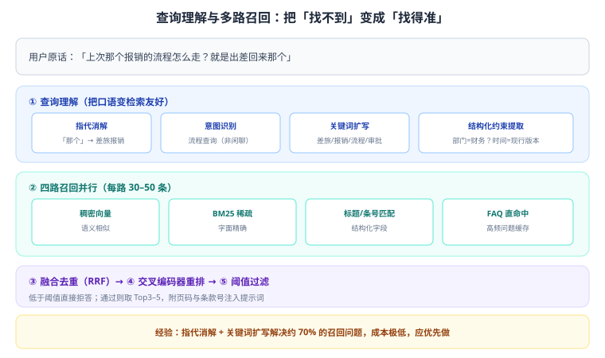
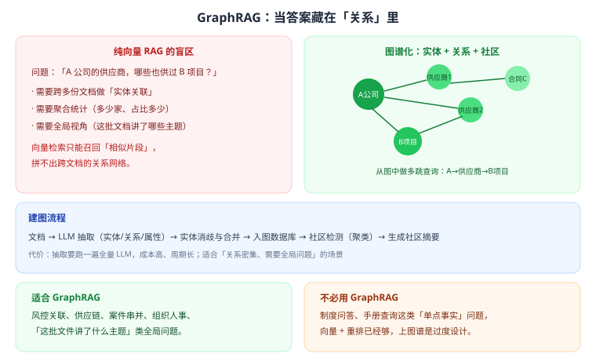

# 第 11 章 检索进阶与 GraphRAG

> 返回 [全书目录](../00-全书导读与目录.md)。上一篇：[10-RAG工程实践](10-RAG工程实践.md)；下一篇：[12-RAG评测与实验设计](12-RAG评测与实验设计.md)。

> [!NOTE]
> **本章解决什么问题**
>
> 基础 RAG 会「找不到、找不准、找不全」。本章讲三类进阶手段：**查询理解、多路召回、结构化知识（图谱）**，并给出该用与不该用的判断。

---

## 11.1 检索失败的三类原因

| 现象 | 本质 | 对应手段 |
| --- | --- | --- |
| 找不到 | 查询与文档表述差异大 | 查询改写、同义扩展、HyDE |
| 找不准 | 召回了相似但不相关的内容 | 重排、阈值、元数据过滤 |
| 找不全 | 答案分散在多处/需要关系推理 | 多查询、父子块、GraphRAG |

> [!IMPORTANT]
> **先诊断再动手**
>
> 不要一上来就换模型。先看「黄金集里没答对的题」：是没召回（Recall 低），还是召回了但没排上来（Precision 低）。**Recall 低修查询与索引，Precision 低修重排与阈值。**

---

## 11.2 查询理解：把口语变检索友好



| 手段 | 做法 | 效果 | 成本 |
| --- | --- | --- | --- |
| 指代消解 | 「那个流程」→「差旅报销流程」 | 解决多轮跑偏 | 一次小模型调用 |
| 关键词扩写 | 同义词、缩写、型号变体 | 提升召回 | 极低（词典即可） |
| 意图识别 | 判断是流程查询/数据查询/闲聊 | 决定走哪条链路 | 低 |
| 多查询（Multi-Query） | 生成 3–5 个问法分别检索 | 召回明显提升 | 检索 ×N |
| HyDE | 先生成「假答案」再检索 | 短问题效果好 | 一次生成 |
| 子问题拆解 | 复合问题拆成多个子问题 | 解决多跳 | 多次检索 |
| 结构化抽取 | 抽出型号、部门、时间做过滤 | 精度大幅提升 | 低 |

> [!TIP]
> **性价比排序（工程实践）**
>
> 1. 关键词扩写（词典）：几乎免费，先做；
> 2. 指代消解：多轮场景必做；
> 3. 结构化抽取 + 元数据过滤：强结构化领域必做；
> 4. 多查询 / HyDE：效果要求高、延迟不敏感时再上。

---

## 11.3 多路召回与融合

### 四路召回

| 路径 | 擅长 | 典型场景 |
| --- | --- | --- |
| 稠密向量 | 语义相似、同义改写 | 「怎么退货」→「退货流程」 |
| BM25 稀疏 | 精确词、编号、型号 | 「E1007」「A123 订单」 |
| 标题/条号匹配 | 结构化定位 | 「第 3.2 条」「GB/T 19001」 |
| FAQ 直命中 | 高频问题 | 客服 Top100 问题 |

### 融合：RRF 与加权

> **RRF = Σ 1/(k + rank_i)，k 常取 60**

| 融合方式 | 优点 | 缺点 |
| --- | --- | --- |
| RRF | 无需归一化，鲁棒 | 丢失分数差异信息 |
| 加权 RRF | 可调各路口径权重 | 需调参 |
| 分数归一化后加权 | 保留分差 | 不同路分数量纲难统一 |

工程建议：**先用 RRF，再用评测集调权重**（例如结构化字段命中权重 1.5，向量 1.0）。

---

## 11.4 重排工程化

| 决策点 | 建议 | 理由 |
| --- | --- | --- |
| 重排候选数 | 20–50 | 太少没得选，太多延迟高 |
| 重排模型 | 本地小模型（百 MB 级） | 比 API 便宜且延迟低 |
| 输出数量 | 3–5 | 控制上下文成本 |
| 阈值 | 0.3 左右（需实测） | 低于阈值拒答 |
| 批处理 | 一次编码多条 | 提升吞吐 |

> [!WARNING]
> **重排不是万能药**
>
> 如果召回阶段就没找到正确块，重排只能在错误候选里挑「最不差的」。**先保证 Recall，再优化 Precision。**

---

## 11.5 GraphRAG：当答案藏在关系里



### 它解决什么问题

普通 RAG 是「找相似片段」，GraphRAG 是「在关系网络里查询」。适合：

- 多跳关系：「A 的供应商，哪些也供过 B 项目」
- 聚合统计：「这批合同涉及多少家供应商、总额多少」
- 全局主题：「这 500 份文件主要讲了哪几类问题」

### 建图流程

```text
文档 → LLM 抽取实体/关系/属性 → 实体消歧合并 → 入图数据库
→ 社区检测（聚类）→ 生成社区摘要 → 查询时按图检索 + 摘要检索
```

### 代价与判断

| 维度 | 普通 RAG | GraphRAG |
| --- | --- | --- |
| 建库成本 | 低（一次 Embedding） | 高（全量跑 LLM 抽取） |
| 更新成本 | 增量即可 | 实体关系需重算 |
| 适合问题 | 单点事实 | 关系、聚合、全局 |
| 实现复杂度 | 低 | 高 |

> [!IMPORTANT]
> **判断口诀**
>
> **问「是什么」用向量，问「和谁有关」用图谱。** 制度问答、手册查询用 GraphRAG 是过度设计；风控、供应链、案件串并才是它的主场。

---

## 11.6 Agentic RAG：让模型自己决定怎么查

| 模式 | 说明 | 适用 |
| --- | --- | --- |
| 单次检索 | 一问一检索 | 80% 的常规问题 |
| 多轮检索 | 根据中间结果继续查 | 复合问题 |
| 自反思检索 | 检索后判断「够不够」，不够换查询 | 高准确要求 |
| 工具组合 | 检索 + 数据库 + 计算器 | 需要计算或实时数据 |

代价：延迟从 1–2 秒涨到 5–15 秒，成本翻倍。**只有当单次检索明确无法解决时才上。**

---

## 11.7 检索参数速查表

| 参数 | 建议值 | 调大效果 | 调小效果 |
| --- | --- | --- | --- |
| 向量召回 K | 30–50 | 更全但更慢更噪 | 更快但可能漏 |
| BM25 召回 K | 30–50 | 同上 | 同上 |
| 重排输入 | 20–50 | 更准但更慢 | 更快但可能漏 |
| 重排输出 | 3–5 | 上下文更全但更贵 | 更省但可能缺信息 |
| 相关性阈值 | 0.3（实测） | 更少拒答、更多噪声 | 更多拒答、更少噪声 |
| HNSW efSearch | 64–128 | 更准更慢 | 更快更糙 |

---

## 11.8 查询改写的四种方式：效果与代价

同一个问题，问法不同，检索结果差很多。改写是投入产出比最高的优化之一。

| 方式 | 做法 | 收益（经验） | 代价 | 适用 |
| --- | --- | --- | --- | --- |
| **同义词/术语映射** | 建「口语 → 标准表述」映射表 | 召回 +10–25 pt | 需人工维护表 | 有行业黑话（政务、医疗、制造） |
| **多查询扩展（Multi-Query）** | 让模型生成 3–5 个不同问法，分别检索后合并 | 召回 +8–15 pt | 成本 ×3–5，延迟 +1 s | 问题模糊、表述多样 |
| **HyDE（假设性答案）** | 让模型先编一个「假答案」，用它去检索 | 召回 +5–12 pt | 可能被幻觉带偏 | 短问题、术语缺失 |
| **查询分解（Decomposition）** | 把复合问题拆成子问题分别检索 | 复合问题准确率 +20–35 pt | 成本 ×N，需合并逻辑 | 多条件、跨文档问题 |

> [!WARNING]
> **HyDE 的隐藏风险**
>
> HyDE 用「模型编的答案」去检索，如果模型对这个领域完全不懂，编出来的假答案会把检索带偏——**比不改写更差**。
> 判断标准：如果模型在你这个领域的基础问答准确率 <60%，不要用 HyDE。

**成本敏感场景的推荐组合**：

```text
第一层（必做）：同义词表 + 拼写纠错        ← 成本几乎为零，收益最大
第二层（选做）：多查询扩展（仅对低置信度查询触发）
第三层（慎用）：HyDE、查询分解（仅对复杂查询触发）
```

> [!TIP]
> **一个关键的工程细节**
>
> **改写不要对所有查询都做，只对「低置信度」的查询做。**
> 判据：首次检索的 Top1 分数低于阈值（如 0.6）才触发改写重查。这样 80% 的查询走快路径，20% 走慢路径，平均延迟只增加 0.2 s，成本增加不到 10%。

---

## 11.9 检索失败的分层排查流程

「答得不准」是最模糊的反馈。必须能快速定位到哪一层。按这个顺序查，每层 10 分钟：

```text
① 看命中块（最优先）
   把检索到的 Top5 原文打印出来看。
   ├─ 命中的内容里根本没有答案 → 问题在「索引或召回」，往下走 ②
   └─ 命中的内容里有答案，但答案没用上 → 问题在「生成」，跳到 ⑤

② 查是不是分块切坏了
   答案是不是被切到两个块里？表格是不是被拆散？
   → 是：改分块策略（结构感知 + 父子块）
   → 否：往下走 ③

③ 查是不是召不回来
   用答案里的原句直接搜，能搜到吗？
   ├─ 搜不到 → 索引缺失或 Embedding 不匹配（换模型没重建？）
   └─ 搜得到但排名很低 → 往下走 ④

④ 查排序问题
   BM25 与向量的权重是否合适？是否该加重排？
   → 加交叉编码器重排（召回 50 → 重排 Top5）

⑤ 查生成问题
   上下文里有答案但模型没用：提示词是否要求「只依据资料」？
   上下文太长被截断？答案在中间被忽略（lost in the middle）？
   → 调整上下文顺序（重要内容放首尾）+ 压缩上下文
```

> [!IMPORTANT]
> **这个流程的价值**
>
> 90% 的人一遇到「不准」就开始调提示词。**但提示词只影响第 ⑤ 层，而问题往往在第 ①–④ 层。**
> 按这个流程走一遍，能在半小时内定位，而不是盲调三天。

---

## 11.10 混合检索的权重怎么调：一次 alpha 扫描

向量检索与 BM25 融合时，通常用一个权重 α 控制配比：

```text
最终分数 = α × 向量分数 + (1 − α) × BM25 分数     （α ∈ [0, 1]）
```

α 的取值没有通用答案，必须扫一遍。做法很简单：

| α | Context Recall | Context Precision | 观察 |
| --- | --- | --- | --- |
| 0.0（纯 BM25） | 0.71 | 0.74 | 术语精确匹配好，语义泛化差 |
| 0.3 | 0.80 | 0.78 | 明显提升 |
| **0.5** | **0.86** | **0.79** | **最优区间** |
| 0.7 | 0.84 | 0.74 | 语义偏重，精确匹配丢失 |
| 1.0（纯向量） | 0.78 | 0.68 | 同义词好，编号/术语差 |

**不同场景的 α 经验值**：

| 场景 | 建议 α | 理由 |
| --- | --- | --- |
| 通用问答 | 0.5 | 平衡 |
| 有强标识符（型号、条款号、报错码） | 0.2–0.35 | 精确匹配更重要 |
| 口语化提问、同义词多 | 0.6–0.75 | 语义更重要 |
| 多语言 / 跨语言 | 0.7+ | 关键词几乎无效 |

> [!WARNING]
> **调 α 的三个纪律**
>
> ① **在固定的黄金集上扫**，不能凭感觉；
> ② **一次只改 α**，不要同时改分块和重排（否则归因不了）；
> ③ **α 的最优点会随数据变化漂移**，建议每季度重扫一次。

---

## 11.11 本章考点速记

<details>
<summary><b>必背 7 条（点击展开自测）</b></summary>

> 1. 检索失败三类：找不到（查询）、找不准（重排）、找不全（多跳）。
> 2. 查询理解四招：指代消解、关键词扩写、意图识别、结构化抽取。
> 3. 多路召回四路：向量、BM25、标题条号、FAQ；融合用 RRF（k=60）。
> 4. 重排：候选 20–50，输出 3–5，阈值 0.3 左右。
> 5. 先保证 Recall 再优化 Precision，重排救不了没召回。
> 6. GraphRAG 适合关系/聚合/全局问题，建库成本高。
> 7. Agentic RAG 延迟成本高，单次检索解决不了才用。

</details>

---

**上一篇**：[第 10 章 RAG 工程实践](10-RAG工程实践.md)　|　**下一篇**：[第 12 章 RAG 评测与实验设计](12-RAG评测与实验设计.md)
