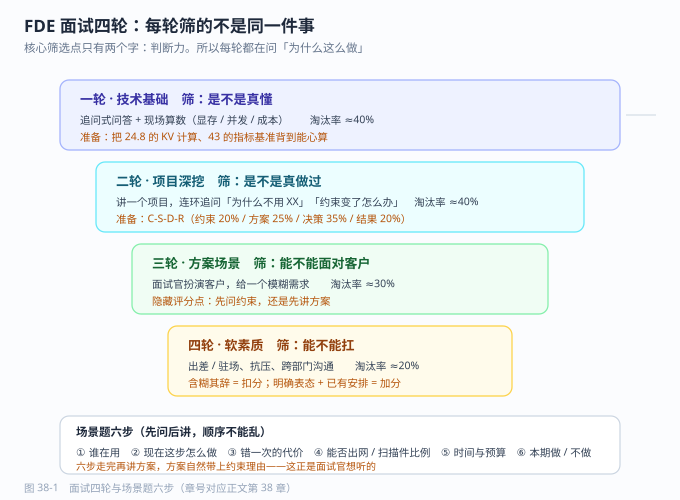

# 第 38 章 面试与职业跃迁

> 返回 [全书目录](../00-全书导读与目录.md)。上一篇：[37-考前速记册](../第八篇-应试/37-考前速记册.md)；下一篇：[39-个人知识体系与持续学习](39-个人知识体系与持续学习.md)。

> [!NOTE]
> **本章解决什么问题**
>
> 同样做过三个项目，为什么别人讲得像专家，你讲得像流水账？
>
> - 用四轮筛选逻辑判断每轮在考什么
> - 用 C-S-D-R 把项目讲出判断力（决策段占 35%）
> - 用反问与谈判把最后 10 分钟用足
>
> **产出**：一份能讲 40 分钟的项目叙事稿　|　预计 12 分钟


## 38.1 FDE 面试考什么：四轮，四种筛子

FDE 的面试结构与纯研发岗不同，因为岗位本身横跨技术、交付、商务。典型四轮：

| 轮次 | 面试官 | 在筛什么 | 常见形式 | 淘汰率（经验） |
| --- | --- | --- | --- | --- |
| **一轮 技术基础** | 技术负责人 | 是不是真懂，不是只会调 API | 追问式问答、现场算数 | 40% |
| **二轮 项目深挖** | 交付负责人 | 是不是真做过，判断力如何 | 讲一个项目，连环追问 | 40% |
| **三轮 方案 / 场景** | 解决方案负责人 / 销售 | 能不能面对客户、能不能落地 | 现场出题：客户提需求你怎么答 | 30% |
| **四轮 软素质** | HR / 部门总 | 能不能扛、能不能沟通 | 行为面试、抗压、出差意愿 | 20% |

> [!IMPORTANT]
> **一句话抓住重点**
>
> **FDE 面试最核心的筛选点是「判断力」，不是「知识量」。**
> 所以面试官会反复问「为什么这么做」「如果约束变了怎么办」——他们在测你能不能做取舍。

---



---

## 38.2 高频题分类与答题要点

### 技术类（20 题，摘 8 题给答法）

| 题 | 答题骨架 | 加分点 |
| --- | --- | --- |
| RAG 和微调怎么选 | 先问「是知识问题还是行为问题」→ 知识用 RAG、风格/格式用微调 → 两者可叠加 | 说出「RAG 解决不知道，微调解决不会做」 |
| 分块怎么定 | 按语义单元切（条款/步骤/函数）→ 300–500 字 + 10–20% 重叠 → 父子块回填 | 举一个「按字数切断步骤」的反例 |
| 检索不准怎么排查 | 分三因：没召回（查询/分块/索引）、召回了没排上（融合/重排）、排上了没用（提示词/上下文） | 给出排查顺序，不是给一堆技巧 |
| 幻觉怎么治 | 四层：机制（RAG/引用）、提示（只依据资料）、校验（引用对齐/一致性）、兜底（拒答+人审） | 说「幻觉不能消除，只能控制」 |
| 显存怎么算 | 权重 = 参数×字节 + KV Cache + 运行时 1–2 GB | 当场算 7B FP16 ≈ 20 GB |
| 并发怎么估 | 日活×人均次数÷集中时段 → QPS → 并发 = QPS×平均延迟 → 卡数×1.3 | 说出「按峰值不按均值」 |
| Agent 怎么防它乱来 | 工具分级 + 权限最小化 + 幂等 + 二次确认 + 审计 + 循环上限 | 举一个「写操作无护栏」的事故 |
| 怎么证明效果 | 建黄金集（50–100 题）→ 四指标 → 基线 → 门禁 | 说「指标必须可复现」 |

### 项目类（15 题，核心 5 题）

```text
① 讲一个你做得最成功的项目        → 用 33.6 的 3 分钟脚本
② 讲一个失败或没做成的项目        → 必答，讲归因与改进（不甩锅）
③ 你和客户意见不一致时怎么办      → 认可目标 + 给约束 + 给路径（20.6 三句式）
④ 数据拿不到你怎么办              → 七策略（20.4）
⑤ 你的方案被评审否了怎么办        → 问清否决理由 → 分类（合规/成本/效果）→ 给替代方案
```

> [!WARNING]
> **关于「失败项目」这道题**
>
> 面试官问这题，**不是想听你成功，是想听你的归因能力**。
> 差的答法：「客户不配合 / 领导换了 / 需求太乱」——全是外部归因。
> 好的答法：「我们低估了数据工程量（占 40%），立项时没人问『多少是扫描件』，后来我把这个问题加进了必问清单。」——**有归因、有机制、有沉淀。**

### 方案 / 场景类（15 题，最能拉开差距）

这类题的典型形式：**面试官扮演客户，给你一个模糊需求**。

```text
客户：「我们有 5000 份制度，想让员工能问。」
```

**不要立刻讲方案。** 按这个顺序走：

| 步 | 你问 / 你说 | 目的 |
| --- | --- | --- |
| 1 | 「谁在用？在哪个环节用？」 | 定位用户与场景 |
| 2 | 「现在这一步怎么做？一次多久？」 | 量化现状 |
| 3 | 「答错一次的代价是什么？」 | 定准确率与拒答策略 |
| 4 | 「数据能出内网吗？有多少是扫描件？」 | 定部署与工作量 |
| 5 | 「期望什么时候上线？预算量级？」 | 定范围 |
| 6 | 给「本期做 / 本期不做」两栏 | 显专业 |

> [!TIP]
> **这一步的隐藏评分点**
>
> 面试官在看你**先问还是先讲**。先讲方案的人，会被判定为「售前话术型」；先问约束的人，会被判定为「做过项目」。
> 六步问完再讲方案，你的方案自然就带上了约束理由——这正是他们想要的。

### 行为类（10 题）

| 题 | 答题要素 |
| --- | --- |
| 出差 / 驻场能接受吗 | 明确表态 + 说明家庭安排已沟通（含糊=扣分） |
| 客户半夜打电话怎么办 | 分级响应机制，不是「随叫随到」 |
| 同时三个项目怎么排 | 按影响面与不可逆性排，不是按谁催得急 |
| 你怎么学新技术 | 给具体动作（读论文/搭环境/建评测集），不给态度 |
| 为什么想做 FDE | 说清「喜欢靠近结果」的具体证据 |

---

## 38.3 项目叙事：用 C-S-D-R，不用 STAR

STAR（Situation-Task-Action-Result）适合通用岗位，但对 FDE 不够，因为它缺了最重要的「约束」和「决策」。改用四段：

| 段 | 内容 | 时长占比 |
| --- | --- | --- |
| **C 约束**（Constraint） | 客户、规模、四条硬约束 | 20% |
| **S 方案**（Solution） | 分层讲，每层一句话 | 25% |
| **D 决策**（Decision） | 2–3 个关键取舍 + 为什么 + 放弃了什么 | **35%** |
| **R 结果**（Result） | 数字 + 一个坑 + 改进 | 20% |

**D 段是决定成败的一段**。示例：

> 「检索层我们放弃了纯向量方案，改成型号硬过滤 + 向量 + BM25 混合。原因是设备型号是强标识符，纯语义会把相似型号的答案混进来——我们试过，Top5 里有 3 条是隔壁型号的。这个改动让一次解决率从 58% 提到 71%。代价是要维护一张型号词表，增加了数据维护成本，我们把它做成了自动抽取。」

这段话里有：**取舍、证据、量化、代价**。四样齐了，面试官会认为你真的做过。

---

## 38.4 简历：三条硬规矩

| 规矩 | 差 | 好 |
| --- | --- | --- |
| **每条都带数字** | 「负责 RAG 系统优化」 | 「将检索命中率从 62% 提升到 84%（黄金集 100 题）」 |
| **每条都带约束** | 「完成私有化部署」 | 「在仅 1 台 8 卡 24G 服务器约束下完成 14B 模型私有化，支撑 200 人并发」 |
| **写清你的角色** | 「参与 XX 项目」 | 「作为技术负责人，主导方案设计与数据工程，带 3 人」 |

**结构建议**（一页，最多两页）：

```text
① 一句话定位：X 年 AI 交付经验，擅长【私有化 RAG / Agent 落地 / 某行业】
② 核心能力：3–5 条，每条一个可验证证据
③ 项目经历：3 个，每个 C-S-D-R 四行
④ 技术栈：模型 / 框架 / 部署 / 评测（不要列 30 个名词）
⑤ 教育与证书
```

> [!WARNING]
> **简历最常见的两个致命问题**
>
> ① **列了一堆框架名但没有一个项目细节**——面试官无法提问，只能判定为「了解过」。
> ② **项目里全是「参与」「协助」**——无法判断你的贡献，直接降级。

---

## 38.5 反问环节：问什么显得专业

面试最后的「你有什么想问的」，是最后一次加分机会。按这个顺序挑 2–3 个：

| 好问题 | 它传递的信号 |
| --- | --- |
| 「团队现在交付的项目，平均周期多长？卡点主要在技术还是数据？」 | 你关心真实交付，不是只关心技术 |
| 「这个岗位的成功标准是什么？6 个月后你们希望我做到什么？」 | 结果导向 |
| 「售前和交付的分工怎么划？FDE 要不要背数字？」 | 你理解岗位边界 |
| 「现在用的模型和部署形态大概是什么？有私有化项目吗？」 | 你有技术判断 |
| 「上一个做这个岗位的人，做得好的和做不好的分别是什么？」 | 你敢问真问题 |

**不要问**：加班多不多（改问「项目节奏大概是什么样」）、能不能远程、什么时候涨薪。

---

## 38.6 薪资谈判：三个准备 + 三条纪律

**三个准备**：① 你的「可替代成本」（同类候选人市场价）；② 你的「差异化证据」（行业经验、私有化经验、能背数字）；③ 你的底线（低于这个数不来）。

**三条纪律**：

| 纪律 | 说明 |
| --- | --- |
| 让对方先出价 | 「我更关心岗位和成长，薪资想先听听你们的区间」 |
| 谈总包不谈月薪 | 月薪 × 12 + 年终 + 补贴 + 期权，避免「月薪高年终低」 |
| 用证据抬价，不用情绪 | 「我上一个项目带来年省 100 万的效果，所以我期望在 X 区间」 |

> [!TIP]
> **一个反常识建议**
>
> **FDE 岗位的薪资弹性往往在「能不能背商务指标」上。**
> 愿意承担部分售前/回款指标的 FDE，议价空间通常比纯交付岗高 20–30%。如果你能接受，明确说出来。

---

## 38.7 三条职业路径与跃迁节奏

| 路径 | 3 年后的位置 | 需要补的能力 | 适合 |
| --- | --- | --- | --- |
| **交付专家** | 高级 FDE / 交付负责人 | 复杂项目管理、多团队协同、行业纵深 | 喜欢把事做成 |
| **方案架构** | 解决方案架构师 / 售前总监 | 商务、报价、竞品、演讲 | 喜欢面对客户 |
| **产品化** | AI 产品经理 / 平台负责人 | 抽象能力、产品设计、数据运营 | 喜欢复用与规模 |

**能力跃迁的三个台阶**（每级约 12–18 个月）：

```text
L1 能独立完成一个模块（会做）
  ↓ 关键跨越：从「做完」到「做对」——开始关心指标而不只是功能
L2 能独立负责一个项目（会判断）
  ↓ 关键跨越：从「做对」到「选对」——开始在多个方案间取舍并承担后果
L3 能定义一类问题的解法（会抽象）
  ↓ 关键跨越：从「项目」到「产品/方法」——把经验变成可复用的东西
```

> [!IMPORTANT]
> **跃迁的真正标志**
>
> 不是职级，是**「你能不能在信息不全时做出可辩护的决定」**。
> L1 等人给方案，L2 自己给方案，L3 给的是「判断框架」——别人拿你的框架就能解新问题。这本书整本都在往 L3 上推。

---

## 38.8 本章考点速记

<details>
<summary><b>折叠背诵版</b></summary>

> **四轮面试**：技术基础（真懂？）→ 项目深挖（真做过？）→ 方案场景（能面对客户？）→ 软素质。
> **核心筛选点**：判断力，不是知识量。
>
> **项目叙事用 C-S-D-R**：约束 20% / 方案 25% / **决策 35%** / 结果 20%。决策段必须有取舍、证据、量化、代价。
>
> **场景题六步**：谁在用 → 现在怎么做 → 答错代价 → 能否出网/扫描件比例 → 时间预算 → 本期做/不做。
> **隐藏评分点：先问还是先讲。**
>
> **简历三规矩**：带数字、带约束、写清角色。
> **反问三问**：项目卡点、6 个月成功标准、售前交付分工。
>
> **薪资三纪律**：让对方先出价、谈总包、用证据抬价。
>
> **三条路径**：交付专家 / 方案架构 / 产品化。
> **三级跃迁**：会做 → 会判断 → 会抽象。标志是「信息不全时能做可辩护的决定」。

</details>

---

**上一篇**：[第 37 章 考前速记册](../第八篇-应试/37-考前速记册.md)　|　**下一篇**：[第 39 章 个人知识体系与持续学习](39-个人知识体系与持续学习.md)
