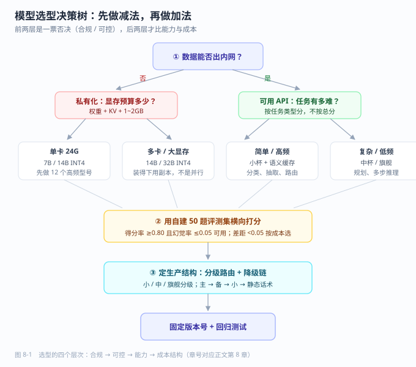

# 第 8 章 模型选型与能力评测

> 返回 [全书目录](../00-全书导读与目录.md)。上一篇：[07-多模态与前沿技术](07-多模态与前沿技术.md)；下一篇：[09-文档解析与数据工程](../第三篇-数据与RAG工程/09-文档解析与数据工程.md)。

> [!NOTE]
> **本章解决什么问题**
>
> 客户问「为什么不用最强的模型」，你怎么用 5 分钟给出有理由、有数字、有成本的答案？
>
> - 用五维（合规/能力/成本/性能/可控）先做减法
> - 自建 50 题评测集并算出得分率与幻觉率
> - 设计分级路由与降级链
>
> **产出**：一份能过评审的选型表（含「理由」列）　|　预计 13 分钟


## 8.1 选型不是「挑最强」，是「排除不能用的」

新手选型的典型动作：打开某个榜单，按分数从高到低排，选第一名。这个动作在真实项目里几乎必然翻车，因为榜单只回答了一个问题——**在公开题上谁分数高**；而项目要回答的是另外五个问题。

| 维度 | 要问的问题 | 不合格的后果 | 谁能一票否决 |
| --- | --- | --- | --- |
| **合规** | 数据能不能出境 / 出内网？模型许可证允许商用吗？ | 项目直接停摆，且无法补救 | 法务、客户安全部门 |
| **能力** | 在你的任务类型上够不够？（不是综合分） | 效果差，靠提示词救不回来 | 业务方 |
| **成本** | 五年 TCO 多少？单价 × 用量是多少？ | 上线即亏损，越用越亏 | 财务、老板 |
| **性能** | P95 延迟、并发、上下文长度够吗？ | 用户不用，或体验崩 | 用户 |
| **可控** | 能不能私有化？能不能微调？版本会不会突然变？ | 被供应商锁死，升级即事故 | 架构、运维 |

> [!IMPORTANT]
> **选型的第一原则**
>
> **先做减法，再做加法。** 先用「合规 + 可控」砍掉一大半候选（往往只剩 3–5 个），再在剩下的里面比能力和成本。
> 反过来做（先挑最强的，再想办法合规）在 90% 的政企项目里会走进死胡同。



### 五个维度的量化方法

**合规**——查三件事：模型许可证（是否允许商用、是否要求署名、是否有用户量上限）、训练数据来源声明、部署形态（SaaS / VPC / 私有化）。开源不等于可商用，详见 8.4 的许可证陷阱。

**能力**——不要用综合分，用**你自己的 50 道题**。方法见 8.5。

**成本**——必须算五年 TCO，不是算每千 Token 单价。同一份用量下，API 与私有化的成本差可能是 5–10 倍，交叉点算法见 22.1。

**性能**——两个数：**首 Token 延迟（TTFT）** 和 **P95 端到端延迟**。RAG 场景里 TTFT 决定「感觉快不快」，端到端决定「能不能用」。经验值：交互式问答 TTFT ≤ 1.5 s、端到端 ≤ 6 s；后台批处理可放宽到 30 s 以上。

**可控**——三个问题：版本会不会被供应商下线？输出格式会不会变？能不能拿到 logprobs / 能不能固定 seed？做过生产的都知道，**供应商一次静默升级就能让你的提示词全部失效**。

---

## 8.2 榜单怎么读：三个必须知道的陷阱

| 陷阱 | 表现 | 应对 |
| --- | --- | --- |
| **数据污染** | 新模型在旧榜单上「突然暴涨」，因为训练集里含测试题 | 看榜单是否用**私有保留集**（如 LiveCodeBench 按时间滚动出新题） |
| **综合分掩盖短板** | MMLU 高但中文长文档抽取差 | 按**任务类型**看分项：抽取、摘要、代码、多轮、长上下文 |
| **评测设置不一致** | 别人测 0-shot，你测 few-shot；别人开 CoT，你没开 | 只在自己可控的条件下横向对比，别混用不同来源的分数 |

### 常见榜单的适用边界

| 榜单 | 测什么 | 什么时候有用 | 什么时候没用 |
| --- | --- | --- | --- |
| MMLU / MMLU-Pro | 学科知识广度 | 粗筛，判断是不是「同一代」 | 判断业务效果，几乎无用 |
| C-Eval / CMMLU | 中文知识与推理 | 中文场景粗筛 | 判断行业术语理解 |
| GPQA | 研究生级难题推理 | 判断复杂推理上限 | 简单抽取任务 |
| LiveCodeBench | 代码，按时间防污染 | 代码类 Agent 选型 | 非代码场景 |
| RAGAS 类指标 | 检索增强链路质量 | 选 RAG 方案时 | 选基座模型时 |
| 自建 50 题集 | **你的任务** | 决策的唯一依据 | 无 |

> [!WARNING]
> **一句能救你的事**
>
> **公开榜单用来「排除明显不行的」，自建题集用来「做最终决定」。**
> 只拿榜单分数写进方案，评审一句「这些题和我们的业务有什么关系」就哑了。

---

## 8.3 闭源 API 的能力与成本量级

不写具体单价（变化太快），只给**能力特征**和**成本量级**，方便你做初筛。单价请在签约前用供应商官网计算器实测。

| 类别 | 代表 | 能力特征 | 成本量级（相对） | 适合 |
| --- | --- | --- | --- | --- |
| 旗舰通用 | 各家 top 模型 | 复杂推理、长文档、多步指令最稳 | 100（基准） | 方案演示、复杂 Agent 决策 |
| 中杯 | 各家 mid 档 | 80% 场景够用，速度快 | 10–25 | 生产主力（多数项目应落在这里） |
| 小杯 / 轻量 | 各家 small / flash | 分类、抽取、改写、路由 | 1–3 | 高频简单任务、预处理 |
| 推理专用 | 带思考链的模型 | 数学、代码、多步规划强 | 50–150（含思考 Token） | 难题兜底，不适合高频 |
| 长上下文专用 | 1M 级上下文 | 整本文档一次读入 | 按 Token 线性增长，很贵 | 合同比对、超长报告 |

**一条实用的成本结构判断**：一个 RAG 问答请求通常 3–8k 输入 Token（检索片段 + 系统提示）、300–800 输出 Token。按中杯模型算，单次成本约在「分级」到「角级」之间。**决定总成本的不是单价，是调用次数与上下文长度**——这也是为什么 10.9 的上下文压缩能直接省钱。

> [!TIP]
> **议价与稳定性**
>
> 企业采购 API 通常可谈年度框架价与预留吞吐（Provisioned Throughput）。**预留吞吐买的是「延迟稳定性」，不是折扣**。客户对 P95 有承诺要求时，预留是唯一可靠手段。

---

## 8.4 开源 / 可私有化模型：比能力更重要的是许可证

私有化场景只有开源权重可选。选的时候按这个顺序看：

1. **许可证**（一票否决）→ 2. **中文与长上下文能力** → 3. **显存能否落在客户硬件上** → 4. **生态（量化、推理框架、微调工具支持）**

### 许可证陷阱（真实会卡住项目的地方）

| 许可证类型 | 典型限制 | 项目影响 |
| --- | --- | --- |
| Apache-2.0 / MIT | 几乎无限制 | 最安全，优先选 |
| 社区许可（带用户量条款） | 月活超过阈值需另谈商业授权 | 客户规模大时法务会卡 |
| 非商用 / 研究许可 | 禁止商用 | 直接排除 |
| 「开源但限地域/用途」 | 条款模糊 | 需法务出书面意见，工期风险 |

> [!WARNING]
> **三个常见误判**
>
> ①「能在 HuggingFace 下载 = 能商用」——错，权重可下载但许可证可能限商用。
> ②「改了名字的微调版 = 自有模型」——错，衍生模型仍受原许可证约束。
> ③「客户内部使用不算商用」——多数许可证把「内部业务使用」也算商用，必须逐条读。

### 参数规模与硬件的对应关系

这张表决定「客户那台服务器能跑什么」，是方案里最常被追问的一页：

| 参数量 | FP16 权重 | INT8 权重 | INT4 权重 | 单卡可行性（含 KV Cache 余量） | 典型用途 |
| --- | --- | --- | --- | --- | --- |
| 3–4B | 6–8 GB | 3–4 GB | 2 GB | 单卡 16G 轻松 | 分类、抽取、路由 |
| 7–8B | 14–16 GB | 7–8 GB | 4–5 GB | 单卡 24G（FP16 紧、INT4 宽裕） | 主力问答 |
| 14B | 28 GB | 14 GB | 8 GB | 单卡 48G / 双卡 24G（INT4 单卡 24G 可） | 高质量问答、复杂指令 |
| 32B | 64 GB | 32 GB | 17 GB | 双卡 48G 起（INT4） | 接近旗舰的中文能力 |
| 70–72B | 140 GB | 70 GB | 36 GB | 4×80G（INT4）或 8 卡 | 私有化里的「天花板」 |
| MoE 大模型 | 按总参数算显存 | — | — | 显存看总参数，速度看激活参数 | 有条件时的最优解 |

完整显存公式与算例见 24.2。这里只需要记住一条：**报硬件时要按「权重 + KV Cache + 运行时 1–2 GB」算，只报权重一定会不够。**

---

## 8.5 自建 50 题评测集：半天做完，管一整个项目

这是全书投入产出比最高的动作。做法极简：

**第一步：从真实业务里抽 50 个问题**（不是编题）

| 类型 | 数量 | 例子 |
| --- | --- | --- |
| 高频简单问 | 15 | 「报销标准是多少」 |
| 需要多段拼接 | 10 | 「A 制度和 B 制度对同一件事的规定差异」 |
| 需要精确数字/条款 | 10 | 「第 3.2 条规定的时限是几天」 |
| 表格/附件类 | 5 | 「这张报价单里的含税单价」 |
| 术语/缩写 | 5 | 「FDE 在你们内部指什么」 |
| **答不上来才对** | 5 | 问一个库里根本没有的东西 |

最后一类是**最容易被忽略、又最能体现专业度**的：模型该拒答时是否拒答。

**第二步：给每题写「标准答案要点」**，不写完整答案，只写「必须命中哪 3 个点」。

**第三步：跑候选模型，人工打分**，用三档：2 分（完全正确且要点齐）、1 分（部分对或有小错）、0 分（错 / 编造 / 该拒答没拒答）。

**第四步：算两个数**

```text
得分率 = 总分 / (2 × 题数)
幻觉率 = 0 分且属于「编造」的题数 / 题数
```

> [!TIP]
> **决策阈值（经验值）**
>
> 得分率 ≥ 0.80 且幻觉率 ≤ 0.05 → 可用；得分率 0.65–0.80 → 需配 RAG 或微调；低于 0.65 → 换模型，别硬调提示词。
> 两个候选模型得分率差 < 0.05 时，**按成本与可控性选**，不要按分数选——这个差距在统计上不显著（判断方法见 12.4）。

### 一个真实的选型算例

> 需求：内网合同问答，200 人使用，日均 300 次，P95 ≤ 8 s，预算硬件 1 台服务器。

| 候选 | 50 题得分率 | 幻觉率 | 硬件需求 | 结论 |
| --- | --- | --- | --- | --- |
| A：14B INT4 | 0.84 | 0.04 | 1×24G | **选中** |
| B：32B INT4 | 0.88 | 0.03 | 2×48G，超预算 | 淘汰（分数高但不划算） |
| C：7B FP16 | 0.71 | 0.11 | 1×24G | 淘汰（幻觉偏高） |
| D：API 中杯 | 0.86 | 0.03 | 无（但数据出网） | 淘汰（合规否决） |

注意 B 的分数更高却被淘汰——**这就是「约束优先」的具体形态**。方案里要这样写：「B 方案效果优 4 个百分点，但硬件成本增加约 2.3 倍，且超出客户机房机柜功率上限，故本期采用 A，B 作为二期升级路径。」

---

## 8.6 混合路由：不要用一个模型解决所有事

生产系统里最省钱、最稳的结构是**分级路由**：

```text
请求 → 轻量模型分类/难度判定
        ├─ 简单（60–70%）：小杯模型直接答       成本 1
        ├─ 中等（25–35%）：中杯模型 + RAG       成本 10
        └─ 困难（5–10%）：旗舰/推理模型 + 工具   成本 100
```

| 收益 | 代价 |
| --- | --- |
| 成本可降 40–70% | 多一次路由调用（+100–300 ms） |
| 简单请求延迟显著下降 | 路由错判会伤体验，需要监控 |
| 难题用强模型，效果不牺牲 | 两套提示词要分别维护与评测 |

> [!WARNING]
> **路由的两个坑**
>
> ① **路由本身也会错**：把难题判成简单，用户直接感受到「答得敷衍」。要设「用户点踩即升级重答」的兜底。
> ② **不要按模型名字路由，要按任务类型路由**：分类、抽取、改写、问答、规划，五类任务的最优模型往往不同。

### 降级链（必须有）

```text
主模型 → 同规格备选（不同供应商/不同实例）→ 小模型兜底 → 静态话术
```

客户问「供应商挂了怎么办」时，这张图比任何承诺都有说服力。设计要点：降级要**自动**、要**留痕**、要**告知用户**（如「当前为简化模式」），而不是静默降质。

---

## 8.7 选型翻车的四个真实形态

| 翻车形态 | 现场表现 | 根因 | 正确做法 |
| --- | --- | --- | --- |
| **演示用旗舰，生产用小杯** | POC 惊艳，上线后被投诉「变笨了」 | 两阶段用了不同模型，且未重测 | POC 就用生产模型，或明确标注差异并给出预期降幅 |
| **只测了平均值** | 平均延迟 3 s，用户仍抱怨慢 | 长尾请求（长文档）拖垮 P95 | 按请求长度分桶测 P95 |
| **忽略版本漂移** | 某天开始答案格式全乱 | 供应商静默升级 | 固定模型版本号 + 输出格式校验 + 回归测试 |
| **许可证事后发现** | 交付前法务卡住 | 选型时没人看 LICENSE | 选型表里加「许可证」一列，法务签字 |

---

## 8.8 选型表模板（可直接放进方案）

| 项 | 候选 A | 候选 B | 候选 C |
| --- | --- | --- | --- |
| 模型 / 版本号 | | | |
| 部署形态（SaaS/VPC/私有化） | | | |
| 许可证与商用限制 | | | |
| 参数 / 精度 / 显存占用 | | | |
| 上下文长度（有效，非宣称） | | | |
| 自建 50 题得分率 | | | |
| 幻觉率 | | | |
| TTFT / P95 端到端（实测） | | | |
| 单次调用成本 / 五年 TCO | | | |
| 中文与行业术语表现（主观） | | | |
| 可微调性 | | | |
| 版本稳定性承诺 | | | |
| **结论（选 / 备 / 淘汰 + 理由）** | | | |

> [!TIP]
> **这张表的用法**
>
> 评审最想看的是最后一行的**理由**，而不是分数。理由里必须出现「约束」二字：因为数据不能出网所以排除 X，因为机柜功率上限所以排除 Y。**只有分数没有约束的选型表，一看就是没做过项目的人写的。**

---

## 8.9 本章考点速记

<details>
<summary><b>折叠背诵版（考前 3 分钟）</b></summary>

> **选型五维**：合规、能力、成本、性能、可控。**先减法（合规+可控）后加法。**
>
> **榜单三陷阱**：数据污染、综合分掩盖短板、评测设置不一致。
> **榜单定位**：公开榜排除不行，自建题集做决定。
>
> **自建评测**：50 题、六类型（含 5 道该拒答的）、三档打分（2/1/0）、两个指标（得分率、幻觉率）。
> **决策阈值**：得分率 ≥0.80 且幻觉率 ≤0.05 可用；差距 <0.05 按成本选。
>
> **显存口径**：权重 = 参数 × 字节数（FP16=2 / INT8=1 / INT4≈0.5），再加 KV Cache 与 1–2 GB 运行时。
> **7B FP16 ≈ 14 GB**、**14B INT4 ≈ 8 GB**、**70B INT4 ≈ 36 GB**。
>
> **生产结构**：分级路由（小/中/旗舰）+ 降级链（主 → 备 → 小 → 静态话术）+ 固定版本号。
>
> **一句话**：选型表的价值在「理由」，理由里必须有「约束」。

</details>

---

**上一篇**：[第 7 章 多模态与前沿技术](07-多模态与前沿技术.md)　|　**下一篇**：[第 9 章 文档解析与数据工程](../第三篇-数据与RAG工程/09-文档解析与数据工程.md)
