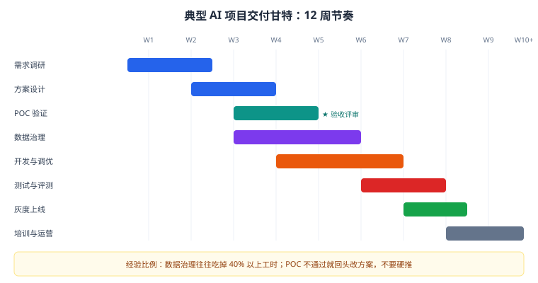

# 第 19 章 POC 与交付管理

> 返回 [全书目录](../00-全书导读与目录.md)。上一篇：[18-售前方法论与价值量化](18-售前方法论与价值量化.md)；下一篇：[20-项目推进与干系人沟通](20-项目推进与干系人沟通.md)。

> [!NOTE]
> **本章解决什么问题**
>
> POC 是「用最小成本证明能做」，交付是「把承诺变成可验收的系统」。
> 两件事都栽在同一个地方：**范围失控**。本章给可执行的范围、指标与变更管理方法。

---

## 19.1 POC 的四条铁律

| 铁律 | 具体要求 | 违反后果 |
| --- | --- | --- |
| 范围小 | 一个部门、一类文档、20–50 个高频问题 | 工期失控，永远做不完 |
| 数据真 | 客户真实数据（脱敏），不用演示数据 | 演示很漂亮，上线全崩 |
| 指标前置 | 开始前书面约定验收指标 | 结束时各说各话 |
| 可退出 | 不达标即停，书面确认 | 越陷越深 |

> [!IMPORTANT]
> **一句话**
>
> **POC 的目的不是「证明我们技术牛」，而是让客户内部形成共识**：业务认可效果、IT 认可架构、财务认可成本、法务认可合规。少一个，项目都推不动。

---

## 19.2 POC 计划模板（4–6 周）

| 周 | 工作 | 交付物 | 客户配合 |
| --- | --- | --- | --- |
| W1 | 数据抽样（100–200 份）、需求确认、指标约定 | POC 方案书 | 提供数据、确认指标 |
| W2 | 解析清洗、分块入库、基础检索 | 可检索 demo | 指定对接人 |
| W3 | 混合检索 + 重排 + 提示词调优 | 内部测试版 | 试用反馈 |
| W4 | 建 50–100 条评测集，跑指标 | 评测报告 | 参与评审 |
| W5 | 用户试用（5–10 人），收集 Bad Case | 试用反馈 | 组织试用 |
| W6 | 修复、复测、评审 | POC 结项报告 | 签字确认 |

### 验收指标示例（写进合同附件）

| 指标 | 目标 | 测量方法 |
| --- | --- | --- |
| 高频问题准确率 | ≥ 85% | 100 条评测集人工判分 |
| 答案可溯源率 | 100% | 抽查引用是否真实存在 |
| P95 响应时延 | ≤ 3 秒 | 压测 + 埋点 |
| 拒答正确率 | ≥ 90% | 越界问题集 |
| 权限违规 | 0 次 | 多角色账号交叉测试 |

---

## 19.3 POC 常见失败原因

| 原因 | 表现 | 预防 |
| --- | --- | --- |
| 范围蔓延 | 「顺便也把 XX 做了」 | 书面范围 + 变更流程 |
| 数据没准备好 | 等客户给数据等到第 3 周 | 第一周就锁定数据责任人 |
| 指标没定义 | 结束时争论「算不算达标」 | 开工前签字确认 |
| 只做 demo 不做评测 | 演示惊艳，一问细节就崩 | 第 4 周必须出评测报告 |
| 没有业务方参与 | IT 满意但业务不用 | 每周一次业务演示 |
| 过度承诺 | 承诺 95% 准确率 | 给区间，写明前提条件 |

---

## 19.4 交付的八个阶段



| 阶段 | 关键动作 | 交付物 |
| --- | --- | --- |
| 启动 | 项目组、沟通机制、风险登记册 | 项目计划 |
| 需求确认 | 需求基线、范围说明 | 需求规格 |
| 设计 | 架构、接口、数据方案 | 设计文档 |
| 开发 | 迭代开发、周报 | 可运行版本 |
| 测试 | 功能 + 效果 + 性能 + 安全 | 测试报告 |
| 验收 | 按合同指标逐条验证 | 验收报告 |
| 移交 | 文档、账号、培训 | 移交清单 |
| 运营 | 监控、Bad Case 闭环、复盘 | 运营月报 |

---

## 19.5 范围与变更管理（保命机制）

```text
变更请求 → 影响评估（工期/成本/风险）→ 客户书面确认 → 排期 → 实施 → 记录
                ↓ 不接受
            维持原范围
```

| 变更类型 | 处理 |
| --- | --- |
| 新增场景 | 走变更，评估工期与费用 |
| 数据范围扩大 | 评估治理工时 |
| 指标提高 | 评估是否可行，必要时重新 POC |
| 替换技术栈 | 评估重构成本 |

> [!WARNING]
> **一句话**
>
> **「顺便再加个小功能」是项目死亡的第一步。** 所有变更必须评估并书面确认——这不是不配合，是专业。

---

## 19.6 风险登记册（模板）

| 风险 | 概率 | 影响 | 应对 | 责任人 |
| --- | --- | --- | --- | --- |
| 数据质量差 | 高 | 高 | 提前抽检、留返工工时 | 数据负责人 |
| 客户对接人变动 | 中 | 中 | 双联系人机制 | 项目经理 |
| 指标不达标 | 中 | 高 | POC 前置验证、设退出机制 | 技术负责人 |
| 合规审批延迟 | 中 | 中 | 提前启动等保/备案 | 客户 IT |
| 上线后无人运营 | 高 | 中 | 培训 + 指定运营人 | 客户业务 |

---

## 19.7 验收与移交

### 验收原则

1. **按合同指标逐条验证**，不凭感觉；
2. **双方共同见证**，签字留档；
3. **遗留问题列清单**，约定修复期限。

### 移交清单

- [ ] 架构文档、部署文档、接口文档
- [ ] 提示词与配置（版本号、变更记录）
- [ ] 索引重建脚本与操作手册
- [ ] 评测集与评测脚本
- [ ] 监控看板与告警规则
- [ ] 账号、密钥、证书（安全渠道移交）
- [ ] 培训记录（管理员 / 运营 / 最终用户）
- [ ] 运维交接会议纪要 + 责任人

---

## 19.8 项目复盘的五个问题

```text
① 哪些判断是对的？（可复用的经验）
② 哪些判断是错的？（下次怎么避免）
③ 哪个环节耗时超预期？（排期怎么改）
④ 客户最不满的是什么？（产品/交付怎么改）
⑤ 如果重做，哪三件事会不一样？
```

> [!TIP]
> **复盘的价值**
>
> 一个项目做完，最有价值的不是交付物，而是「下次能少踩的坑」。**把复盘写成一页纸，比写十页总结有用。**

---

## 19.9 交付团队怎么配：六个角色，最小三人

AI 项目的团队结构和传统软件项目不同，多了一个「数据工程」角色，少不了一个「业务翻译」。

| 角色 | 职责 | 是否可兼 | 备注 |
| --- | --- | --- | --- |
| **项目负责人（FDE）** | 对结果负责，对接客户，做取舍 | 不可兼 | 一人最多带 2 个项目 |
| **数据工程师** | 解析、清洗、切分、元数据、抽检 | 不可兼 | **最容易被省掉，也最容易导致失败** |
| **应用开发** | 检索链路、提示词、工具、前端 | 可兼 | 1–2 人 |
| **算法/调优** | 模型选型、微调、评测设计 | 可兼（小项目） | 大项目必须专岗 |
| **测试** | 黄金集建设、回归、压测 | 可兼 | 不能由开发自己测 |
| **业务专家（客户侧）** | 定标准答案、验收判定 | 客户出人 | **必须写进合同** |

**最小可行配置（3 人）**：FDE + 数据工程师 + 应用开发，测试由 FDE 兼，业务专家由客户出。

> [!WARNING]
> **一个反复出现的错误**
>
> 项目里不配数据工程师，让开发「顺手把数据搞一下」。
> 结果：开发花两周写了个解析脚本，产出质量 70 分，后面所有调优都在补这个洞。
> **数据工程占实施 30–45% 的工作量（见 43.6），必须有人专职。**

---

## 19.10 一个 16 周交付排期实例

以「私有化知识库，8000 份文档，200 人使用」为例，这是可以直接改数字复用的排期：

| 周 | 里程碑 | 主要工作 | 交付物 | 客户配合 |
| --- | --- | --- | --- | --- |
| W1 | 启动 | 三方会、需求确认、环境申请 | 需求基线 + 约束清单 | 业务+IT 参加 |
| W2–W3 | 数据摸底 | 文档清点、抽 100 份试解析、质量评估 | 数据评估报告（含工作量） | 提供样本与台账 |
| W4 | 环境就绪 | 硬件到位、模型部署、基线压测 | 环境清单 + 性能基线 | IT 开权限 |
| W5–W6 | 主链路 | 解析流水线、索引、检索、生成 | 可问答原型（覆盖 20% 文档） | 业务抽 20 题试问 |
| W7 | 评测基线 | 建 50 题黄金集、跑基线指标 | 评测报告 v1 | **业务出人标注** |
| W8–W10 | 全量数据 | 全量解析、抽检、返工 | 数据质量报告（≥98%） | 抽检确认 |
| W11–W12 | 调优 | 分块/检索/重排/提示词迭代 | 指标提升记录 | 每周 1 次反馈 |
| W13 | 试点 | 1 个部门 20 人 | 试点反馈清单 | 组织培训 |
| W14 | 整改 | 修 bad case、补内容 | 整改报告 | 确认关闭 |
| W15 | 压测与演练 | 压测、降级演练、安全测试 | 压测报告 + 红队记录 | IT 参与 |
| W16 | 验收 | 全量上线、验收测试、移交 | 验收报告 + 移交清单 | 签字 |

> [!TIP]
> **排期的两个技巧**
>
> ① **W2–W3 的数据摸底必须单独成阶段**，它的产出决定后面所有排期是否可信。跳过它，W8 一定延期。
> ② **每个里程碑都写「客户配合」那一列**。这一列是免责依据：客户没配合导致的延期，责任不在你。

---

## 19.11 上线当天的检查与应急

上线日是最容易出事的一天。准备一份「上线日清单」，逐项打勾：

| 类别 | 检查项 |
| --- | --- |
| **回滚** | 上一版本可一键回滚？回滚演练做过？数据能否回滚？ |
| **容量** | 当前 GPU 利用率、队列长度、限流阈值是否配置？ |
| **监控** | 延迟、错误率、拒答率、工具调用失败率 四个看板是否就绪？告警发到谁？ |
| **降级** | 模型不可用 → 小模型 → FAQ → 人工，链路是否演练过？ |
| **数据** | 索引版本号记录？增量更新任务是否启动？ |
| **权限** | 高密级内容抽测（用低权限账号搜）是否通过？ |
| **人员** | 谁值班？客户侧联系人是谁？升级路径？ |
| **沟通** | 出问题时对客户的统一话术准备好了吗？ |

> [!TIP]
> **完整版清单**
>
> 这里只是上线日的 10 项。**立项前、需求、数据、选型、护栏、评测、合规、验收、投标**九张清单共 120 项，见 [44-附录E-交付检查清单总汇](../附录/44-附录E-交付检查清单总汇.md)，可直接打印打勾。

> [!IMPORTANT]
> **「统一话术」这一项常被忽略**
>
> 出事时最怕的是：技术团队在群里说「模型有点问题」，客户业务方看到后直接向上汇报「系统崩了」。
> 提前约定：**任何对外沟通由项目负责人统一出口**，技术细节不外传。这不是掩盖问题，是避免信息失真。

---

## 19.12 本章考点速记

<details>
<summary><b>必背 6 条（点击展开自测）</b></summary>

> 1. POC 四铁律：范围小、数据真、指标前置、可退出。
> 2. POC 六周节奏：抽样 → 建库 → 调优 → 评测 → 试用 → 结项。
> 3. 验收指标五项：准确率、溯源率、P95、拒答正确率、越权 0。
> 4. 交付八阶段：启动、需求、设计、开发、测试、验收、移交、运营。
> 5. 变更必须评估 + 书面确认，否则范围必然失控。
> 6. 移交八项：文档、配置、脚本、评测集、监控、账号、培训、纪要。

</details>

---

**上一篇**：[第 18 章 售前方法论与价值量化](18-售前方法论与价值量化.md)　|　**下一篇**：[第 20 章 项目推进与干系人沟通](20-项目推进与干系人沟通.md)
