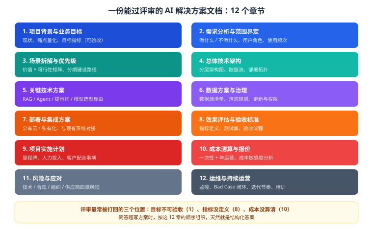

# 第 21 章 方案文档写作

> 返回 [全书目录](../00-全书导读与目录.md)。上一篇：[20-项目推进与干系人沟通](20-项目推进与干系人沟通.md)；下一篇：[22-商务报价与招投标](22-商务报价与招投标.md)。

> [!NOTE]
> **本章解决什么问题**
>
> 方案是 FDE 的核心产出物。它要同时说服四类人：业务（有用）、IT（能接）、财务（划算）、法务（合规）。
> 本章给结构、给写法、给避坑，并附可套用的章节模板。

---

## 21.1 方案文档的 12 章结构



| 章节 | 写什么 | 页数 | 常见问题 |
| --- | --- | --- | --- |
| 1 项目背景与目标 | 现状、痛点（带数字）、可验收目标 | 2–3 | 目标写成「提升效率」 |
| 2 需求分析与范围 | 做什么、**不做什么**、角色与频次 | 3–4 | 不敢写「不做」 |
| 3 场景拆解与优先级 | 价值×可行性矩阵、分期路径 | 2–3 | 一次全上 |
| 4 总体技术架构 | 分层图、数据流、降级路径 | 4–6 | 只有框图没数据流 |
| 5 关键技术方案 | RAG/Agent/提示词/选型理由 | 6–10 | 只说「用了 RAG」 |
| 6 数据方案与治理 | 数据源清单、清洗规则、更新、权限 | 4–6 | 低估治理工时 |
| 7 部署与集成 | 部署拓扑、接口、网络要求 | 3–5 | 没写客户要准备什么 |
| 8 效果评估与验收 | 指标定义、测试集、验收流程 | 3–4 | 指标不可测 |
| 9 实施计划 | 里程碑、人力、客户配合事项 | 2–3 | 没有客户侧任务 |
| 10 成本与报价 | 一次性 + 年运营 + 敏感度 | 2–3 | 漏项、无缓冲 |
| 11 风险与应对 | 技术/合规/组织/供应商 | 2–3 | 只写技术风险 |
| 12 运维与运营 | 监控、Bad Case 闭环、迭代、培训 | 3–4 | 上线即结束 |

---

## 21.2 每章怎么写（要点 + 句式）

### 第 1 章：背景与目标

**写法**：三段——现状（客观）、痛点（量化）、目标（可验收）。

```text
现状：集团现有制度文件 5000 余份，分散在 OA、网盘与部门本地。
痛点：员工平均每天花 25 分钟查找制度；合规部每月重复答疑约 600 次；
      因引用过期制度导致的返工，去年发生 12 起。
目标：上线后 80% 常见制度问题可自助查询；答案 100% 可溯源；
      P95 响应 ≤ 3 秒；首年覆盖 3 个部门。
```

> [!WARNING]
> **反例**
>
> 「提升员工效率，降低沟通成本」——这句话任何方案都能写，等于没写。

### 第 2 章：范围界定

**必须有一张「不做什么」的表：**

| 本期做 | 本期不做 | 原因 |
| --- | --- | --- |
| 制度问答 | 合同审查 | 风险等级高，需专门方案 |
| 3 个部门 | 全集团 | 先试点验证 |
| 中文 | 多语言 | 二期规划 |

> [!TIP]
> **为什么敢写「不做」**
>
> 敢写「不做」的方案，才显得可信。客户会想：这人连不做的都敢写，说明他真的评估过。

### 第 3 章：场景优先级

用「价值 × 可行性」四象限（见 [17 章](17-解决方案设计与售前.md#173-场景优先级：先做哪一块)），并给出分期：

```text
一期（0–3 月）：制度问答（右上象限）
二期（3–6 月）：流程指引 + 表单填写辅助
三期（6–12 月）：跨系统数据查询（需打通 ERP）
```

### 第 4 章：技术架构

**三段式说明（评审最看重）：**

1. **数据怎么流**：文档 → 解析 → 分块 → 向量化 → 入库 → 检索 → 重排 → 生成 → 展示；
2. **为什么这么分层**：哪层可替换（换模型不改业务）、哪层是瓶颈（重排）、哪层要扩容（推理）；
3. **降级怎么做**：模型超时 → 小模型/FAQ；检索失败 → 人工；服务不可用 → 兜底页。

### 第 5 章：关键技术方案

不要只写「采用 RAG」，要写**参数与理由**：

| 决策点 | 选择 | 理由 |
| --- | --- | --- |
| 分块 | 按章节 400 字，重叠 15% | 制度有明确章节结构；避免条款被切断 |
| Embedding | 本地部署 1024 维 | 数据不出内网；中文效果经测试达标 |
| 向量库 | Milvus | 支持 pre-filter；百万级规模 |
| 检索 | 向量 + BM25 + RRF | 制度名称/文号需精确匹配 |
| 重排 | 本地交叉编码器，Top20 → Top5 | 控制上下文成本 |
| 生成 | 7B 私有化 + 引用约束 | 合规要求；引用可核 |

### 第 6 章：数据方案

必须回答：数据在哪、多少、什么格式、谁维护、怎么更新、权限怎么分。
并给出**治理工时估算**（通常占实施 40%）。

### 第 7 章：部署与集成

给客户一份「你需要准备什么」的清单（见 [23 章](../第六篇-工程与合规/23-工程落地与合规运维.md#232-部署架构)）：
GPU、CPU/内存、存储、网络、操作系统、中间件、账号。

### 第 8 章：效果与验收

指标要「可测」，每条都写清测量方法：

| 指标 | 目标 | 测量方法 |
| --- | --- | --- |
| 高频问题准确率 | ≥ 85% | 100 条评测集人工判分 |
| 溯源率 | 100% | 抽查引用 |
| P95 延迟 | ≤ 3s | 压测 |
| 越权 | 0 次 | 多角色测试 |

### 第 9 章：实施计划

**必须包含客户侧任务**，否则延期全是你的责任：

| 周 | 我方 | 客户方 |
| --- | --- | --- |
| W1 | 调研、抽检 | 提供数据、指定对接人 |
| W2–3 | 解析入库 | 确认权限规则 |
| W4–5 | 调优、评测 | 参与评审 |
| W6 | 灰度上线 | 组织试点用户 |

### 第 10 章：成本与报价

| 项 | 一次性 | 年运营 |
| --- | --- | --- |
| 软件与模型 | — | X 万 |
| 硬件/云资源 | X 万 | X 万 |
| 实施服务 | X 万 | — |
| 运维支持 | — | X 万 |
| 缓冲（15–20%） | X 万 | — |

### 第 11 章：风险与应对

四类风险，每类至少一条：

| 类型 | 风险 | 应对 |
| --- | --- | --- |
| 技术 | 效果不达标 | POC 前置、设退出机制 |
| 合规 | 数据合规 | 私有化、脱敏、备案 |
| 组织 | 员工不用 | 嵌入现有入口、培训、标杆 |
| 供应商 | 模型涨价/停服 | 多模型适配层、合同约束 |

### 第 12 章：运维与运营

监控四类指标 + Bad Case 闭环 + 迭代节奏 + 培训计划。

---

## 21.3 写作技巧：让高管三分钟看懂

| 技巧 | 做法 |
| --- | --- |
| 每章开头一句话结论 | 「本章结论：采用私有化部署，年成本约 42 万元」 |
| 关键数字加粗 | 让扫读者一眼抓到 |
| 每章配一张图 | 架构图、甘特图、矩阵图 |
| 用表格替代长段落 | 决策对比、风险清单 |
| 附录放细节 | 参数、接口、测试用例 |

> [!TIP]
> **一条硬规则**
>
> **方案是给决策者看的，不是给技术同行看的。** 技术细节放附录，正文只留「结论 + 理由 + 数字」。

---

## 21.4 评审最常被打回的五个地方

| 位置 | 问题 | 修法 |
| --- | --- | --- |
| 第 1 章 | 目标不可验收 | 改成「准确率 ≥85%、P95 ≤3s」 |
| 第 2 章 | 范围没有边界 | 加「本期不做」表 |
| 第 5 章 | 只写技术名词，没理由 | 每个选型写「为什么选它、为什么不选另一个」 |
| 第 8 章 | 指标没定义测量方法 | 每条指标加测量方法与数据来源 |
| 第 10 章 | 成本漏项 | 按五个口袋逐项列，留缓冲 |

---

## 21.5 一页纸方案（Pitch 版）

给高管或初次接触用，控制在一页：

```text
【问题】5000 份制度分散，员工每天花 25 分钟查找，合规部月均重复答疑 600 次。
【方案】私有化 RAG 知识库：混合检索 + 重排 + 强制引用；数据不出内网。
【效果】自助率 80%，P95 3 秒，答案 100% 可溯源。
【投入】一次性 60 万，年运营 15 万；年节省约 48 万，回收期 1.8 年。
【风险】幻觉（引用 + 拒答 + 人审）；权限（检索前过滤 + 审计）。
【下一步】2 周 POC，验证 100 条真实问题的准确率。
```

> [!IMPORTANT]
> **用法**
>
> 一页纸讲不清的项目，二十页也讲不清。**先写一页纸，再展开成 12 章。**

---

## 21.6 三张必备图：不会画图就没有方案

文字讲架构永远讲不清。方案里必须有三张图，缺一张评委会觉得「没想清楚」。

| 图 | 画什么 | 常见错误 | 加分细节 |
| --- | --- | --- | --- |
| **① 总体架构图** | 分层：接入 / 应用 / 检索 / 数据 / 基础设施 / 安全 | 把所有组件堆平，看不出层次 | 每层标注**关键技术选型与版本** |
| **② 数据流图** | 一份文档从入库到被引用的完整路径 | 只画「用户→答案」，中间全略 | 标注**每一步的耗时与失败点** |
| **③ 部署拓扑图** | 网络区域、服务器、卡数、端口、边界设备 | 只画服务器，不画网络边界 | 标注**内外网边界与数据流向** |

**架构图的三条画法纪律**：

```text
① 分层不超五层，每层不超过 6 个框——超了就再拆一张图
② 所有框必须有名字，不许出现「其他」「等等」
③ 箭头必须有方向，双向要标明「请求 / 响应」
```

> [!TIP]
> **一个细节能显著提升专业度**
>
> 在架构图旁边加一句「本图对应第 3.2 节的选型说明」，让图和文互相对得上。
> 评审最常见的质疑是「图和文对不上」——这一句话能省掉一轮返工。

---

## 21.7 附录怎么组织：附录决定方案的可信度

正文讲「是什么」，附录证明「你真的做过」。四类附录按顺序放：

| 附录 | 内容 | 作用 |
| --- | --- | --- |
| **A 需求响应对照表** | 招标/客户需求逐条 → 本方案对应章节 | 让评委能打勾 |
| **B 技术参数与配置清单** | 硬件型号、软件版本、许可数量 | 支撑报价 |
| **C 实施计划与人力投入** | 甘特表 + 角色 + 人月 | 支撑工期 |
| **D 指标定义与测试方法** | 每个指标怎么算、谁判定 | **支撑验收，最容易被忽略** |

> [!IMPORTANT]
> **附录 D 是验收阶段的护身符**
>
> 方案正文写「准确率 ≥85%」，附录 D 写清「以 100 题测试集为基准，业务专家判定，命中 3 个要点即正确，首次不通过整改 15 个工作日」。
> **签约时没人看附录 D，验收时所有人都在看它。**

---

## 21.8 投标文件与方案不是一回事

很多人把方案直接当标书交，结果该拿分的地方没拿到。

| 维度 | 方案（给客户看的） | 投标文件（给评委看的） |
| --- | --- | --- |
| 目的 | 说服客户「这事能做」 | 在评分表上**拿分** |
| 结构 | 按逻辑（背景→方案→价值） | 按**招标文件章节顺序** |
| 语言 | 可读性优先 | 关键词优先（对齐评分点） |
| 篇幅 | 30–60 页 | 常常被限定（如 ≤200 页） |
| 关键动作 | 讲清取舍 | **逐条响应 + 偏离表** |
| 谁看 | 业务负责人、决策者 | 评委（每人看 20 分钟） |

**投标文件的三个实操要点**：

1. **章节标题直接抄招标文件的措辞**，让评委一眼找到对应内容。
2. **每一章开头写一句「本章响应招标文件第 X 条要求」**，减少评委的寻找成本。
3. **偏离表放在最前面**（如果格式允许），让评委先看到「无偏离/正偏离」。

> [!WARNING]
> **一个真实教训**
>
> 某项目技术方案写得极好，但章节顺序与招标文件不一致，评委找不到对应内容，技术分被打了 70%。
> **投标文件的第一原则不是「写得好」，是「好找」。**

---

## 21.9 本章考点速记

<details>
<summary><b>必背 6 条（点击展开自测）</b></summary>

> 1. 方案 12 章：背景、范围、场景、架构、技术、数据、部署、验收、计划、成本、风险、运维。
> 2. 目标必须可验收；范围必须写「不做什么」。
> 3. 技术方案要写参数与理由，不只写名词。
> 4. 实施计划必须含客户侧任务。
> 5. 成本按五口袋列，留 15–20% 缓冲。
> 6. 每章一句话结论，技术细节进附录。

</details>

---

**上一篇**：[第 20 章 项目推进与干系人沟通](20-项目推进与干系人沟通.md)　|　**下一篇**：[第 22 章 商务报价与招投标](22-商务报价与招投标.md)
