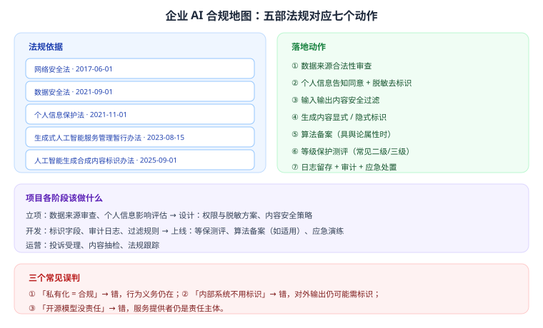

# 第 25 章 安全与合规体系

> 返回 [全书目录](../00-全书导读与目录.md)。上一篇：[24-部署与容量规划](24-部署与容量规划.md)；下一篇：[26-数据治理与知识运营](26-数据治理与知识运营.md)。

> [!NOTE]
> **本章解决什么问题**
>
> 合规是硬门槛，不是加分项。一个没过合规的项目，效果再好也上不了线。
> 本章给法规地图、落地动作、检查清单，以及最容易被忽略的三个误判。

---

## 25.1 合规地图



| 法规 | 生效 | 与 AI 项目的关系 |
| --- | --- | --- |
| 网络安全法 | 2017-06-01 | 网络运营者基础安全义务、等级保护 |
| 数据安全法 | 2021-09-01 | 数据分类分级、重要数据出境评估 |
| 个人信息保护法 | 2021-11-01 | 告知同意、最小必要、自动化决策透明 |
| 生成式人工智能服务管理暂行办法 | 2023-08-15 | 训练数据合法、内容安全、算法备案、投诉机制 |
| 人工智能生成合成内容标识办法 | 2025-09-01 | 生成内容需显式/隐式标识 |

> [!IMPORTANT]
> **记忆方法**
>
> 三条主线：**数据（安全法、个保法）→ 内容（生成式办法）→ 标识（标识办法）**；网安法是底座。

---

## 25.2 七个落地动作

| # | 动作 | 具体做法 | 责任方 |
| --- | --- | --- | --- |
| 1 | 数据来源合法性审查 | 文档是否有权使用、是否含他人著作权内容 | 客户 + 供应商 |
| 2 | 个人信息保护 | 告知同意、最小必要、脱敏去标识 | 客户 |
| 3 | 内容安全 | 输入输出双向过滤、敏感话题拒答 | 供应商 |
| 4 | 生成内容标识 | 显式标识（页面/水印）+ 隐式标识（元数据） | 供应商 |
| 5 | 算法备案 | 具舆论属性或社会动员能力的服务 | 客户 |
| 6 | 等级保护 | 按行业要求做等保测评（常见二/三级） | 客户 |
| 7 | 日志与应急 | 访问/操作日志留存、投诉渠道、应急预案 | 双方 |

---

## 25.3 三个常见误判

> [!WARNING]
> **误判一：私有化 = 合规**
>
> 错。私有化只解决「数据不出域」，内容安全、个人信息保护、内容标识、日志留存这些**行为义务仍然存在**。

> [!WARNING]
> **误判二：内部系统不用标识**
>
> 错。只要对外输出（如员工把回答截图发到外部、或系统对接外部渠道），就可能需要标识。稳妥做法是**默认加标识**。

> [!WARNING]
> **误判三：开源模型没责任**
>
> 错。服务提供者仍是责任主体，模型来源不影响你的合规义务。

---

## 25.4 安全五查（技术侧）

| 风险 | 场景 | 措施 |
| --- | --- | --- |
| 提示注入 | 用户输入/检索文档夹带指令 | 分隔符隔离、内容标注为数据、输出过滤 |
| 越权访问 | 检索到无权文档、工具越权 | pre-filter、工具最小权限、二次校验 |
| 敏感信息泄露 | 回答带出手机号/薪酬 | 入库脱敏、输出正则过滤、字段级权限 |
| 输出注入下游 | 模型输出直接拼 SQL/HTML | 参数化、转义、Schema 校验 |
| 供应链风险 | 第三方模型/插件/依赖 | 供应商评估、依赖锁定、私有仓库 |

---

## 25.5 对照 OWASP LLM Top 10（2025）

| 编号 | 风险 | 在企业项目里的表现 | 对策 |
| --- | --- | --- | --- |
| LLM01 | 提示注入 | 文档夹带恶意指令 | 输入隔离、内容标注 |
| LLM02 | 敏感信息泄露 | 回答带出他人数据 | 权限过滤、输出脱敏 |
| LLM03 | 供应链 | 第三方模型/插件风险 | 供应商评估、依赖锁定 |
| LLM04 | 数据与模型投毒 | 恶意文档入库 | 入库审核、来源可信 |
| LLM05 | 输出处理不当 | 输出拼进 SQL/HTML | 参数化、转义 |
| LLM06 | 过度代理 | 工具权限过大 | 最小权限、人审 |
| LLM07 | 系统提示泄露 | 被套出内部规则 | 提示隔离、输出过滤 |
| LLM08 | 向量与嵌入弱点 | 越权检索、投毒向量 | pre-filter、入库校验 |
| LLM09 | 错误信息 | 幻觉被当真 | RAG + 引用 + 拒答 |
| LLM10 | 资源滥用 | 无限循环烧钱 | 轮次/Token 预算上限 |

---

## 25.6 项目各阶段的合规动作

| 阶段 | 动作 |
| --- | --- |
| 立项 | 数据来源审查、个人信息影响评估、合规责任人 |
| 设计 | 权限模型、脱敏方案、内容安全策略、标识方案 |
| 开发 | 审计日志、过滤规则、标识字段 |
| 上线前 | 等保测评、算法备案（如适用）、红队测试、应急演练 |
| 运营 | 投诉受理、内容抽检、法规跟踪、年度复审 |

---

## 25.7 上线合规检查清单

- [ ] 数据来源合法（有授权/自有/公开可用）
- [ ] 个人信息已脱敏，必要时取得同意
- [ ] 输入输出内容安全过滤生效
- [ ] 生成内容标识已添加（显式 + 隐式）
- [ ] 算法备案（如适用）已完成
- [ ] 等保测评（如适用）已通过
- [ ] 日志留存 ≥ 法规要求期限
- [ ] 投诉与应急渠道已建立
- [ ] 供应商安全评估完成
- [ ] 员工使用规范已培训

---

## 25.8 合同里的合规条款（容易被忽略）

| 条款 | 作用 |
| --- | --- |
| 数据处理协议 | 明确双方数据角色与责任 |
| 数据不出境条款 | 跨境场景的关键约束 |
| 安全事件响应 | 多长时间内通知、谁负责 |
| 分包与再委托限制 | 防止数据二次流转 |
| 模型来源与许可 | 开源协议合规（如商用限制） |
| 退出与数据删除 | 合同结束时数据如何处置 |

> [!TIP]
> **一句话**
>
> **技术方案决定能不能上线，合规条款决定上线后能不能睡得着。**

---

## 25.9 数据分类分级：合规落地的第一步

所有合规动作（权限、加密、审计、出境）都依赖一个前提：**你知不知道自己有哪些数据、什么级别**。没有分级，后面全是空谈。

**三级分类（通用模板，可按行业调整）**：

| 级别 | 定义 | 典型内容 | 管控要求 |
| --- | --- | --- | --- |
| **一级（公开）** | 可对外公开 | 宣传材料、公开制度 | 无特殊要求 |
| **二级（内部）** | 仅限内部使用 | 内部制度、流程文档、培训材料 | 身份认证 + 访问日志 |
| **三级（敏感）** | 泄露会造成实质损失 | 客户名单、合同、财务数据、个人信息 | 加密存储 + 最小权限 + 全量审计 + 禁止出境 |

**分级落地的四个动作**：

```text
① 建清单：文档 ID → 级别 → 责任人（Owner）→ 依据
② 定规则：级别 → 谁能看（角色矩阵）→ 谁能导出 → 留存多久
③ 打标签：入库时写入元数据，作为检索过滤条件
④ 常校验：季度抽检，确认标签与实际内容一致
```

> [!WARNING]
> **分级最常见的三个错误**
>
> ① **只分级不打标**：文档分好了级，但元数据里没有，检索时无法过滤 → 等于没分。
> ② **级别只到文档不到块**：一份「二级」制度里夹着「三级」名单附件 → 必须支持块级覆盖。
> ③ **没人负责级别判定**：让 IT 定级别，IT 不懂业务 → 必须由业务 Owner 定，IT 只负责执行。

---

## 25.10 数据出境：一张判断树走完

出境是红线问题，判断必须严格按顺序，不能跳步。

```text
① 数据是否包含个人信息或重要数据？
   ├─ 否 → 一般可直接处理（仍需看行业规定）
   └─ 是 → 往下
② 是否真的「出境」？（境外服务器、境外主体可访问、境外员工运维都算）
   ├─ 否 → 不构成出境
   └─ 是 → 往下
③ 是否属于「重要数据」或达到申报门槛的数量？
   ├─ 是 → 必须申报安全评估
   └─ 否 → 往下
④ 是否已取得个人单独同意（告知境外接收方、目的、方式、范围）？
   ├─ 否 → 补齐同意，或改用境内方案
   └─ 是 → 可走标准合同/认证路径
```

**工程上最省事的答案**：**不出境**。私有化部署、境内云、境内模型服务，直接绕过整棵判断树。

> [!IMPORTANT]
> **三个常被误判为「不出境」的情形**
>
> ① 用境外 API 但「数据只是过一下不存储」——**传输即处理，仍属出境**。
> ② 境外总部 IT 远程运维境内系统——**可访问即算**。
> ③ 境外开源模型的权重下载——**权重不是数据，但训练数据来源要审**（见 8.4 许可证陷阱）。

---

## 25.11 一次合规整改记录（真实结构）

合规检查发现问题后，整改要留痕。这张表是标准格式，也是应对复查的核心材料：

| # | 问题 | 依据条款 | 风险等级 | 整改措施 | 完成时间 | 验证方式 |
| --- | --- | --- | --- | --- | --- | --- |
| 1 | 生成内容未标识 | 标识办法第 4 条 | 高 | 前端加角标 + 接口加字段 + 元数据写入 | 3 日 | 截图 + 接口返回抽查 |
| 2 | 日志留存仅 30 天 | 等保三级要求 | 中 | 调整为 180 天，扩容存储 | 7 日 | 查询 6 个月前日志 |
| 3 | 权限仅到文档级 | 内控要求 | 高 | 补块级 ACL + 三类账号交叉测试 | 14 日 | 越权测试报告 |
| 4 | 未做数据分类分级 | 数据安全法第 21 条 | 中 | 建三级清单 + 打标 | 21 日 | 抽检 50 份标签一致性 |
| 5 | 用户未告知 AI 生成 | 暂行办法第 12 条 | 中 | 首屏提示 + 帮助页说明 | 3 日 | 页面截图 |

> [!TIP]
> **整改记录的两个用途**
>
> ① **复查时直接出示**，比口头解释有效；
> ② **下一个项目复用**：这五条几乎是所有 AI 项目的通病，提前做掉能省一轮返工。

---

## 25.12 本章考点速记

<details>
<summary><b>必背 6 条（点击展开自测）</b></summary>

> 1. 五部法规与生效日：网安 2017-06-01、数安 2021-09-01、个保 2021-11-01、生成式 AI 2023-08-15、标识办法 2025-09-01。
> 2. 七动作：来源审查、个人信息、内容安全、标识、备案、等保、日志应急。
> 3. 三个误判：私有化≠合规、内部系统也要标识、开源不免责。
> 4. 安全五查：注入、越权、泄露、输出注入、供应链。
> 5. OWASP LLM Top 10 覆盖注入、泄露、供应链、投毒、输出、过度代理、提示泄露、向量弱点、错误信息、资源滥用。
> 6. 合同六条款：数据处理、不出境、事件响应、分包、模型许可、退出删除。

</details>

---

**上一篇**：[第 24 章 部署与容量规划](24-部署与容量规划.md)　|　**下一篇**：[第 26 章 数据治理与知识运营](26-数据治理与知识运营.md)
