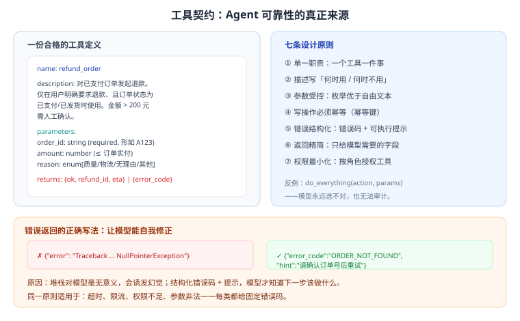

# 第 14 章 工具设计与集成工程

> 返回 [全书目录](../00-全书导读与目录.md)。上一篇：[13-Agent工程实践](13-Agent工程实践.md)；下一篇：[15-Agent评测与安全](15-Agent评测与安全.md)。

> [!NOTE]
> **本章解决什么问题**
>
> Agent 的效果，一半取决于模型，另一半取决于**工具设计得好不好**。
> 同一个模型，工具描述含糊就会乱调；错误码不结构化就会瞎猜；权限不收口就会出事。本章讲工程侧的硬功夫。

---

## 14.1 工具契约：Agent 的接口文档



一份合格的工具定义包含六部分：

| 部分 | 内容 | 写不好的后果 |
| --- | --- | --- |
| 名称 | 动词 + 名词，语义明确 | 模型分不清相似工具 |
| 描述 | 做什么、何时用、何时不用 | 乱选工具 |
| 参数 | 类型、必填、枚举、取值范围 | 传错参数 |
| 返回 | 成功结构、错误码 | 无法处理异常 |
| 副作用 | 是否写、是否可回滚 | 误操作 |
| 权限 | 哪些角色可调用 | 越权 |

### 描述怎么写（对比示例）

```text
✗ 差：
query_order — 查询订单

✓ 好：
query_order — 根据订单号查询订单状态与物流信息。
  使用时机：用户询问「我的订单到哪了」「什么时候发货」。
  不要用于：查询商品库存（用 query_stock）、查询退款进度（用 query_refund）。
  限制：只能查询当前用户名下订单。
```

> [!IMPORTANT]
> **关键洞察**
>
> 模型选错工具，90% 是描述没写「何时不用」。**把易混工具的区别写进描述，是最便宜的优化。**

---

## 14.2 七条设计原则

| 原则 | 说明 | 反例 |
| --- | --- | --- |
| 单一职责 | 一个工具一件事 | `do_everything(action, params)` |
| 描述精确 | 何时用/何时不用 | 只写「查询订单」 |
| 参数受控 | 枚举优于自由文本 | 参数是任意 SQL |
| 幂等安全 | 写操作带幂等键 | 无幂等的扣款 |
| 错误结构化 | 错误码 + 可执行提示 | 抛原始堆栈 |
| 返回精简 | 只给模型需要的字段 | 返回 500 行 JSON |
| 权限最小 | 按角色授权工具集 | 所有人可用全部工具 |

---

## 14.3 错误处理：让模型能自我修正

| 错误类型 | 错误码 | 给模型的提示 |
| --- | --- | --- |
| 参数缺失 | `MISSING_PARAM` | 「缺少 order_id，请向用户确认订单号」 |
| 参数非法 | `INVALID_PARAM` | 「订单号格式应为 A + 6 位数字」 |
| 不存在 | `NOT_FOUND` | 「未找到该订单，请确认订单号是否正确」 |
| 无权限 | `FORBIDDEN` | 「当前用户无权操作该订单，请转人工」 |
| 限流 | `RATE_LIMITED` | 「请求过于频繁，请稍后重试」 |
| 超时 | `TIMEOUT` | 「服务暂时不可用，建议稍后重试或转人工」 |
| 业务规则拒绝 | `RULE_VIOLATION` | 「该订单已超过退款期限，无法退款」 |

> [!WARNING]
> **反模式**
>
> 把 `Traceback (most recent call last): ...` 直接回传给模型。模型看不懂，只会开始编造「已为您处理」。**错误也要产品化。**

---

## 14.4 幂等与重试

| 场景 | 做法 |
| --- | --- |
| 读操作 | 可重试（指数退避） |
| 写操作 | 必须带幂等键（如 `order_id + action + 时间窗`） |
| 重复请求 | 服务端识别幂等键，返回同一结果 |
| 超时未知结果 | 先查状态，再决定是否重试 |

```python
def refund(order_id, amount, idem_key):
    if cache.has(idem_key):
        return cache.get(idem_key)          # 幂等返回
    result = core.refund(order_id, amount)
    cache.set(idem_key, result, ttl=86400)
    return result
```

---

## 14.5 与企业系统集成

| 系统类型 | 集成方式 | 注意 |
| --- | --- | --- |
| 内部 HTTP API | 直接封装为工具 | 超时、重试、熔断 |
| 数据库 | 只读视图 / 存储过程 | 禁止模型生成 SQL 直连 |
| 消息队列 | 异步任务 + 状态查询 | 不要长时间阻塞 |
| 老旧系统（无 API） | RPA / 中间表 | 稳定性差，需兜底 |
| 第三方 SaaS | OAuth 授权 | Token 管理与刷新 |

> [!WARNING]
> **绝对禁止**
>
> 让模型「生成 SQL 并执行」。这是最危险的集成方式：一次幻觉就可能 `DELETE`。正确做法是**预定义查询 + 参数化**，模型只能选查询、填参数。

---

## 14.6 工具的可观测性

| 记录项 | 用途 |
| --- | --- |
| 调用时间、耗时 | 定位慢工具 |
| 入参（脱敏） | 复现问题 |
| 返回码与结果摘要 | 统计失败率 |
| 调用者与会话 ID | 审计与归因 |
| 重试次数 | 发现不稳定依赖 |

指标看板建议：**工具成功率、P95 耗时、错误码分布、Top 慢工具**。

---

## 14.7 工具测试：上线前必做

| 测试类型 | 内容 |
| --- | --- |
| 单元测试 | 参数校验、边界值、错误码 |
| 契约测试 | 返回结构是否符合 Schema |
| 幂等测试 | 重复调用结果一致 |
| 权限测试 | 不同角色调用结果 |
| 混沌测试 | 超时、限流、下游 500 |
| 端到端 | Agent 能否在 6 轮内完成任务 |

> [!TIP]
> **一个实用的验收标准**
>
> 用 20 条真实任务跑 Agent：**任务完成率 ≥ 80%、平均轮次 ≤ 4、误操作 0 次**，才算可上线。

---

## 14.8 工具数量与粒度：多了会变笨，少了会变残

工具不是越多越好。经验数据：**工具数超过 12–15 个后，模型选错工具的概率明显上升**。

| 工具数 | 选对率（经验） | 现象 |
| --- | --- | --- |
| 3–5 | 0.95+ | 稳定 |
| 6–10 | 0.90–0.95 | 需要清晰描述 |
| 11–15 | 0.82–0.90 | 开始出现「相近工具混淆」 |
| 16–25 | 0.70–0.82 | 必须分组或分层 |
| 25+ | <0.70 | 不可用，需重构 |

**三个解决方向**（按成本从低到高）：

| 方向 | 做法 | 适用 |
| --- | --- | --- |
| **合并** | 把「查订单状态」「查订单详情」「查订单物流」合成 `query_order(order_id, fields)` | 同一资源的多种查询 |
| **分组** | 用 Router 先分域（订单域 / 售后域 / 财务域），每域只暴露 5–8 个工具 | 域之间界限清晰 |
| **分层** | 一级工具是「菜单」（如 `after_sales`），调用后返回二级工具列表 | 工具极多且长尾 |

> [!TIP]
> **合并工具的判断标准**
>
> **如果两个工具的参数有 80% 重叠，就合并。**
> 典型反例：`get_user_name(user_id)`、`get_user_email(user_id)`、`get_user_phone(user_id)` —— 应该合成 `get_user(user_id, fields)`。
> 合并的直接收益是减少模型的选择负担，间接收益是**减少一次工具调用 = 少一轮往返 = 少 1–2 秒延迟**。

---

## 14.9 工具描述的三层写法

同一个工具，描述写得好坏，选对率能差 20 个百分点。按三层写：

```text
第一层：一句话说「做什么」（模型用它做初筛）
   「查询订单的当前状态与物流信息。」

第二层：说「什么时候用 / 什么时候不要用」（模型用它排除误选）
   何时用：用户提供订单号，问发货、签收、退款进度。
   何时不用：用户问的是退换货政策（用 query_policy），
             或没有订单号（先用 search_order_by_phone）。

第三层：给参数说明与一个调用示例（模型用它填对参数）
   order_id: 订单号，18 位数字字符串，不是商品 ID。
   示例：{"order_id": "202603150012345678"}
```

> [!IMPORTANT]
> **第二层是大多数团队缺失的**
>
> 只写「做什么」的工具，模型遇到相近场景就会乱选。
> **「何时不要用」这一句，是降低误调用最有效的一行字**——它把「排除逻辑」从模型的推理里搬到了描述里。

---

## 14.10 一份完整的工具清单示例（工单系统，8 个工具）

这张表可以直接当模板改。注意「风险级」与「幂等」两列，它们决定护栏怎么配。

| # | 工具名 | 作用 | 参数 | 风险级 | 幂等 | 备注 |
| --- | --- | --- | --- | --- | --- | --- |
| 1 | `search_order` | 按手机号/单号模糊查订单 | keyword, limit | L0 只读 | 是 | 返回候选列表，不返回明细 |
| 2 | `query_order` | 查订单详情 | order_id, fields | L0 只读 | 是 | fields 控制返回字段，省 Token |
| 3 | `query_logistics` | 查物流轨迹 | order_id | L0 只读 | 是 | 上游超时 2 s |
| 4 | `query_policy` | 查售后政策（走 RAG） | question, category | L0 只读 | 是 | 必须返回条款号 |
| 5 | `create_ticket` | 创建工单 | order_id, type, desc | L1 可撤销 | 是 | 30 分钟内可撤销 |
| 6 | `update_address` | 修改收货地址 | order_id, address, idem_key | L2 影响他人 | **必填幂等键** | 保留原值，30 分钟可回滚 |
| 7 | `refund` | 发起退款 | order_id, amount, reason, idem_key | L3 涉钱 | **必填幂等键** | ≤200 元直通，>200 转人工 |
| 8 | `escalate_to_human` | 转人工 | reason, summary, priority | L1 | 是 | 必须带 summary，否则人工要重问 |

**设计要点回顾**：

- 工具 1 和 2 分开，是因为「模糊查」和「精确查」的调用时机不同（合并会让模型在没订单号时也去查明细）。
- 工具 5–8 都有幂等要求，因为「重试」在这些场景会造重复副作用。
- 工具 8 强制 `summary` 参数，是为了**避免人工接手时从零开始**——这个细节能显著提升转人工的用户体验。

> [!WARNING]
> **一个常见的错误设计**
>
> 把「查政策」做成 Agent 直接调模型回答（不接 RAG）。结果模型凭记忆编造政策条款，用户按错的办。
> **凡是有「标准答案在文档里」的问题，都必须走检索工具，不能靠模型记忆。**

---

## 14.11 本章考点速记

<details>
<summary><b>必背 6 条（点击展开自测）</b></summary>

> 1. 工具契约六要素：名称、描述、参数、返回、副作用、权限。
> 2. 描述必须写「何时用 + 何时不用」，这是最便宜的优化。
> 3. 七原则：单一职责、描述精确、参数受控、幂等、错误结构化、返回精简、权限最小。
> 4. 错误要产品化：错误码 + 可执行提示，不要回传堆栈。
> 5. 写操作必须幂等键；禁止模型生成 SQL 直连。
> 6. 上线标准：完成率 ≥80%、平均轮次 ≤4、误操作 0。

</details>

---

**上一篇**：[第 13 章 Agent 工程实践](13-Agent工程实践.md)　|　**下一篇**：[第 15 章 Agent 评测与安全](15-Agent评测与安全.md)
