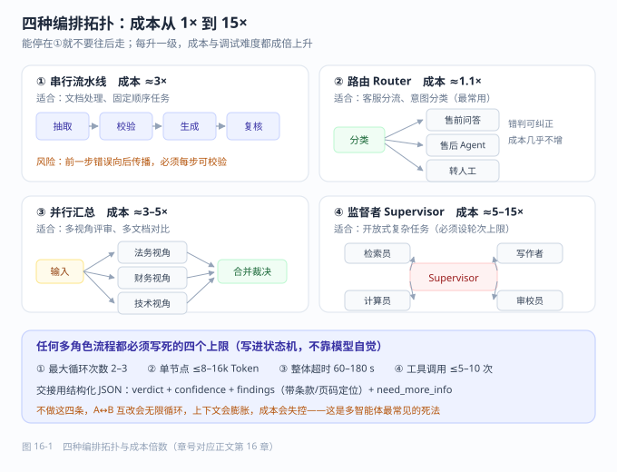

# 第 16 章 多智能体与工作流编排

> 返回 [全书目录](../00-全书导读与目录.md)。上一篇：[15-Agent评测与安全](15-Agent评测与安全.md)；下一篇：[17-解决方案设计与售前](../第五篇-方案与商务/17-解决方案设计与售前.md)。

> [!NOTE]
> **本章解决什么问题**
>
> 有人要求「上多智能体」，你怎么判断该不该拆、拆了成本会涨多少？
>
> - 用三条判断（职责冲突 / 上下文隔离 / 可独立验证）决定拆不拆
> - 记住四种拓扑的成本倍数（1.1× 到 15×）
> - 把四个上限写进状态机
>
> **产出**：一个不会失控、成本可控的多角色流程　|　预计 10 分钟


## 16.1 先回答一个前提：你真的需要多个 Agent 吗

「多智能体」是过去两年被过度营销的概念。真实项目里的经验是：**80% 的需求，一个模型 + 若干工具 + 一段好的提示词就够了**。多智能体的引入会带来三倍以上的调试成本、成倍的成本与延迟，以及一个非常难受的问题——**出错时你不知道该怪谁**。

判断是否需要拆成多角色，看这三条，**三条全中才拆**：

| 判断条件 | 说明 | 反例 |
| --- | --- | --- |
| **职责确实冲突** | 两个角色的目标天然对立，用同一段提示词会自我矛盾 | 「既要严格审查又要尽量通过」——这是真冲突 |
| **上下文必须隔离** | 两类信息不能混在一个上下文里（保密、长度、干扰） | 面试官不能看到候选人的内部评分 |
| **可独立验证** | 每个角色的输出能单独判断对错 | 「写得好不好」不可验证 → 不该拆 |

> [!IMPORTANT]
> **一句话判断**
>
> **能用一个 Agent 加清晰的流程解决，就不要用两个 Agent 对话。**
> 多智能体不是「更先进」，它是「用更多成本换取职责分离」——只有当职责分离本身值钱时才划算。

---

## 16.2 四种编排拓扑：从简单到复杂

| 拓扑 | 结构 | 适合 | 主要风险 | 成本倍数（相对单 Agent） |
| --- | --- | --- | --- | --- |
| **串行流水线** | A → B → C，固定顺序 | 文档处理、ETL 式任务 | 前一步错误向后传播 | 3× |
| **路由（Router）** | 入口分类 → 分发到不同处理器 | 客服分流、意图分类 | 路由错判 | 1.1× |
| **并行 + 汇总** | 多路同时处理 → 合并 | 多视角评审、多文档对比 | 汇总时信息丢失 | 3–5× |
| **监督者（Supervisor）** | 一个调度者决定下一步叫谁 | 开放式复杂任务 | 调度死循环、成本失控 | 5–15× |

```text
① 串行          [抽取] → [校验] → [生成] → [复核]
② 路由                   ┌→ [退款流程]
              [分类器] ──┼→ [物流流程]
                          └→ [转人工]
③ 并行汇总      ┌→ [法务视角] ┐
              [输入] ┼→ [财务视角] ┼→ [合并裁决]
                          └→ [技术视角] ┘
④ 监督者        [Supervisor] ⇄ [检索员]
                        ⇄ [计算员]
                        ⇄ [写作者]
```

> [!TIP]
> **生产建议**
>
> **按 ①②③④ 的顺序逐级尝试，能停在 ① 就不要上 ③。**
> 我们做过的项目里，最终稳定上线的多数是「路由 + 串行」的组合，监督者模式只在两个开放式研究型任务里成功过，且都配了硬性轮次上限。

---



---

## 16.3 把流程画成状态机，而不是靠模型自由发挥

多智能体最常见的失败形态是「对话式协作」——两个 Agent 互相聊，聊着聊着跑偏、重复、或者互相客套。解决办法很朴素：**用状态机约束，模型只在节点内做判断，不做流程判断**。

### 状态机设计模板

```yaml
states:
  intake:         # 入口：抽取要素
    next: route
  route:          # 分类：决定走哪条支线
    next: {A: review_legal, B: review_finance, C: escalate}
  review_legal:   # 节点内允许模型自由推理
    next: merge
  review_finance:
    next: merge
  merge:          # 汇总：冲突时按规则裁决
    next: human_approve
  human_approve:  # 人工审批点
    next: {approved: emit, rejected: revise, timeout: escalate}
  revise:
    next: merge
    max_loops: 2   # 必须有上限
  emit:
    terminal: true
```

**四个必须写进状态机的硬约束**：

| 约束 | 值（经验） | 为什么必须有 |
| --- | --- | --- |
| 最大循环次数 | 2–3 | 防止 A↔B 无限互改 |
| 单节点最大 Token | 8k–16k | 防止上下文膨胀 |
| 整体超时 | 60–180 s | 用户不会等更久 |
| 最大工具调用次数 | 5–10 | 防止「再查一次」成瘾 |

---

## 16.4 上下文怎么在角色之间传递（最容易被做错的地方）

三种方式，各有代价：

| 方式 | 机制 | 优点 | 缺点 | 适用 |
| --- | --- | --- | --- | --- |
| **全量传递** | 把上游全部输出塞给下游 | 信息不丢 | Token 爆炸、下游被干扰 | 短流程（≤2 跳） |
| **结构化摘要** | 上游输出 JSON（字段固定） | 可控、可校验 | 摘要会丢细节 | **推荐默认** |
| **共享黑板** | 所有角色读写同一份状态对象 | 灵活 | 难以复现、难调试 | 复杂研究型任务 |

> [!WARNING]
> **上下文膨胀的真实代价**
>
> 4 个角色串行、每个角色输出 1500 Token，最后一个角色要读 4500 Token 的「历史」。这 4500 Token 里 80% 与当前决策无关，却**每次调用都要付费、都要增加延迟、都可能干扰判断**。
> 用结构化摘要后，同样的流程上下文能压到 800 Token 以内，成本降 70%，准确率反而上升——因为干扰项少了。

### 结构化交接协议（可直接抄）

```json
{
  "from": "review_legal",
  "verdict": "reject",
  "confidence": 0.82,
  "findings": [
    {"clause": "第 7.2 条", "issue": "违约责任上限未约定", "severity": "high"}
  ],
  "need_more_info": ["是否已有主合同框架协议"],
  "tokens_used": 1240
}
```

约定三条：**① 每个角色必须给 verdict 与 confidence；② findings 必须是列表且带定位（条款号/页码）；③ 必须有 need_more_info，否则下游只能猜。**

---

## 16.5 人机协同：审批点放在哪里

Agent 一旦能写数据，就必须有人工介入点。放错位置会毁掉整个产品体验。

| 审批点位置 | 用户体验 | 风险 | 建议 |
| --- | --- | --- | --- |
| 每个动作前都审批 | 极差，等于没用 Agent | 无 | 只在**不可逆动作**前设 |
| 只在最后审批 | 好 | 中间错了要整体重来 | 适合只读流程 |
| **按风险分级审批** | 好 | 需准确定义风险 | **推荐** |

**风险分级规则（可直接用）**：

```text
L0 只读（检索、查询）      → 不审批，只记录
L1 可撤销写（草稿、暂存）  → 事后通知，可一键回滚
L2 影响他人（发消息、派单）→ 提交前确认（一次点击）
L3 不可逆 / 涉钱（付款、删除、对外承诺）→ 强制人工审批 + 双人复核
```

> [!TIP]
> **审批设计的一个细节**
>
> 审批界面**必须展示「Agent 想做什么 + 依据是什么 + 影响谁」**，而不是只给一个「同意/拒绝」。
> 让审批人 3 秒内能判断，是审批点能不能落地的关键；否则审批人会一律点同意，护栏形同虚设。

---

## 16.6 成本与延迟的放大效应（必须提前算）

多智能体的成本不是加法，是乘法。公式：

```text
总成本 ≈ Σ(每个角色的调用次数 × 单次 Token × 单价)
总延迟 ≈ Σ(每跳延迟) + 并行分支的最大值 + 汇总开销
```

**一个真实算例**：合同审查工作流，4 个角色（抽取 / 法务 / 财务 / 汇总），平均 1.6 次调用/角色。

| 项 | 单 Agent 方案 | 多 Agent 方案 |
| --- | --- | --- |
| 调用次数 | 1.2 | 6.4 |
| 平均输入 Token | 6k | 4.5k（结构化后更短） |
| 平均输出 Token | 0.6k | 0.5k |
| 相对成本 | 1.0 | **≈ 3.4×** |
| 平均延迟 | 6 s | 19 s（并行分支可降到 13 s） |

结论：**多智能体换来的是「可解释的分工」，代价是 3 倍成本与 2–3 倍延迟**。这笔交易只有在「错一次的代价远高于 3 倍调用费」时才值得——合同审查、合规审核、医疗建议属于这类；客服闲聊不属于。

---

## 16.7 可观测性：出问题时你要能看见

多智能体系统上线后 90% 的时间在排查「为什么这次答错了」。没有 trace，这件事无法进行。

**必须记录的字段（每个节点一行）**：

| 字段 | 说明 |
| --- | --- |
| trace_id / span_id / parent_span_id | 串起整条链路 |
| role | 哪个角色 |
| input_tokens / output_tokens | 成本归因 |
| tool_calls | 调了哪些工具、参数、返回码 |
| latency_ms | 定位瓶颈 |
| verdict / confidence | 决策质量趋势 |
| error_code | 结构化错误码（见 14.3） |

> [!IMPORTANT]
> **一条硬性要求**
>
> **同一个 trace_id 必须能还原出「模型看到了什么、决定了什么、做了什么」。**
> 做不到这一点，多智能体系统在客户现场就是黑盒，出一次事故就再也拿不回信任。

---

## 16.8 什么时候该退回单 Agent（反模式清单）

| 反模式 | 症状 | 处理 |
| --- | --- | --- |
| **角色空转** | 某个角色的输出从不改变最终结果 | 删掉它，省 25% 成本 |
| **互相客套** | 「感谢您的分析，我认为…」占了大半 Token | 改为结构化 JSON 交接 |
| **调度震荡** | Supervisor 反复在两个角色间来回 | 加循环上限 + 强制收敛规则 |
| **责任稀释** | 出错后每个角色都说「不是我的问题」 | 每个节点必须有可验证的输出契约 |
| **调试不可能** | 同一输入两次结果差异巨大 | 降温度、固定流程、减少自由对话 |

<details>
<summary><b>一条经验法则</b></summary>

> 如果一个多智能体流程**连续两周**都在调提示词而没有稳定下来，问题几乎一定不在提示词，而在**流程设计**——回到状态机，把「模型该判断什么、不该判断什么」重新划一遍。

</details>

---

## 16.9 本章考点速记

<details>
<summary><b>折叠背诵版</b></summary>

> **要不要多智能体**：三条全中才拆——职责冲突、上下文必须隔离、可独立验证。否则单 Agent + 工具。
>
> **四种拓扑**：串行（3×）、路由（1.1×）、并行汇总（3–5×）、监督者（5–15×）。**能停在前面的不要往后走。**
>
> **状态机四硬约束**：最大循环 2–3 次、单节点 ≤8–16k Token、整体超时 60–180 s、工具调用 ≤5–10 次。
>
> **上下文传递**：默认用**结构化摘要**（verdict + confidence + findings 带定位 + need_more_info），不要全量传递。
>
> **审批分级**：L0 只读不审批 / L1 可撤销事后通知 / L2 提交前确认 / L3 不可逆强制审批 + 双人复核。
>
> **成本规律**：多智能体成本是乘法，4 角色 ≈ 3.4 倍成本、2–3 倍延迟。只有当「错一次代价 ≫ 3 倍调用费」时才划算。
>
> **可观测**：trace_id 必须能还原「看到了什么、决定了什么、做了什么」。

</details>

---

**上一篇**：[第 15 章 Agent 评测与安全](15-Agent评测与安全.md)　|　**下一篇**：[第 17 章 解决方案设计与售前](../第五篇-方案与商务/17-解决方案设计与售前.md)
