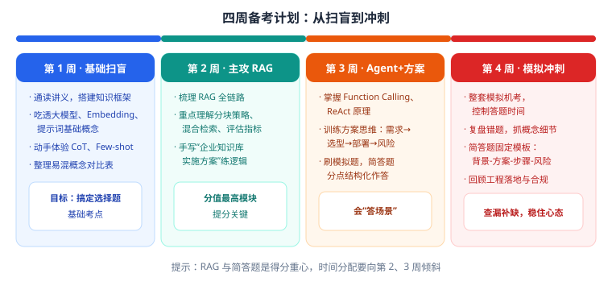
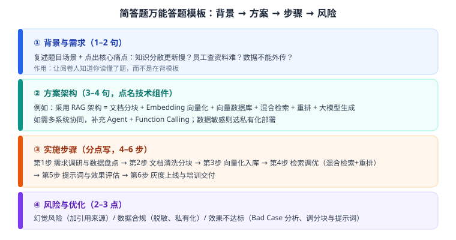

# 第 3 章 备考策略与答题方法

> 返回 [全书目录](../00-全书导读与目录.md)。上一篇：[02-考试大纲与评分规则](02-考试大纲与评分规则.md)；下一篇：[04-大模型原理与工程参数](../第二篇-技术基础/04-大模型原理与工程参数.md)。

> [!abstract] 本章解决什么问题
> 把「学过」变成「考过」。三档计划 + 30 组易混点 + 简答四段式 + 满分范文拆解 + 50 张记忆卡。
>
> 这一章不新增知识，只做三件事：**排序、纠错、模板化**。

---

## 3.1 三档备考计划

### 4 周档（零基础 / 想真学懂）

| 周 | 主线 | 每日动作 | 周末产出 |
| --- | --- | --- | --- |
| W1 | 01 + 02 章 | 读 2 节 + 5 道单选 | 一张「概念对比表」（Token/Embedding/提示词/幻觉） |
| W2 | 03 章（重点） | 读 1 节 + 手画一次 RAG 链路 | 手写 1 份知识库方案（1200 字） |
| W3 | 04 + 05 章 | 读 2 节 + 1 道简答 | 手写 1 份 Agent 方案 + 1 份 TCO 测算 |
| W4 | 06 + 07 + 题库 | 每天 20 单选 + 1 简答 | 2 套限时模拟 + 错题本 |

### 2 周档（有技术底子）

| 天 | 内容 |
| --- | --- |
| D1–D2 | 02 章通读 + 考点速记背一遍 |
| D3–D5 | 第 10 章精读，重点 10.3 / 10.5 / 10.8 / 10.13 |
| D6–D8 | 04 章 + 05 章，各手写 1 份方案 |
| D9–D10 | 06 章（显存公式 + 合规清单必背） |
| D11–D12 | 09 题库全刷，错题回原文 |
| D13–D14 | 2 套模拟 + 简答限时训练 |

### 5–7 天档（冲刺）

| 天 | 任务 |
| --- | --- |
| D1 | 各章「考点速记」全过一遍，圈出不熟的 |
| D2 | 02 + 03 易混点表 + 20 单选 |
| D3 | 04 + 05 简答模板默写 3 遍 |
| D4 | 06 公式与合规清单（手抄一遍） |
| D5 | 09 题库单选全刷，错题归因 |
| D6 | 6 道简答限时（每题 12 分钟） |
| D7 | 一套完整模拟 + 只看错题 |

> [!tip] 冲刺期唯一有效的事
> **默写简答框架 + 刷错题**。这个阶段再看新知识，收益极低、焦虑极高。

---

## 3.2 30 组易混点（单选题的命门）

单选题不难，难在「长得像」。下表左边是常见错误理解，右边是正确表述。

| # | 易混点 | 错误理解 | 正确表述 |
| --- | --- | --- | --- |
| 1 | Token vs 词 | 一个词就是一个 Token | 一个词可能拆成多个 Token；1 汉字 ≈ 1 Token |
| 2 | 上下文窗口 vs 训练数据 | 窗口大 = 知识多 | 窗口是单次输入上限，与知识量无关 |
| 3 | temperature vs top_p | 两个都要调大才好 | 一般只调一个；同时调大输出极不稳定 |
| 4 | Embedding vs 向量库 | Embedding 就是向量库 | Embedding 是模型（把文本变向量），向量库是存储与检索系统 |
| 5 | 语义检索 vs 关键词检索 | 语义检索全面优于关键词 | 各有短板：语义弱于精确匹配，关键词弱于同义改写 |
| 6 | RAG vs 微调 | 微调能灌知识 | 微调改风格/格式；知识更新用 RAG |
| 7 | RAG vs 长上下文 | 窗口够大就不用 RAG | 长上下文每次付全量成本，且中间内容易被忽略 |
| 8 | 分块越大越好 | 大块上下文完整 | 太大噪声多、成本高；需按结构与评测调优 |
| 9 | 重叠越多越好 | 重叠多不会漏 | 重叠多带来冗余与成本，10–20% 足够 |
| 10 | Top-K 越大越好 | 多召回总没错 | K 过大会引入噪声、推高成本，需重排收敛到 3–5 |
| 11 | 重排能救一切 | 效果不好就加重排 | 召回没找到，重排无能为力；先修召回 |
| 12 | 向量维度越高越好 | 高维更准 | 高维更贵；需与效果权衡 |
| 13 | 换 Embedding 直接替换 | 换个更强的就行 | 必须全量重建索引，否则向量空间不一致 |
| 14 | 幻觉可以消除 | 上了 RAG 就没幻觉 | 只能约束与兜底：引用、拒答、人审 |
| 15 | 引用 = 准确 | 有引用就不会错 | 引用可能张冠李戴，需后置校验 |
| 16 | Function Calling = 模型执行 | 模型自己调接口 | 模型只输出调用请求，执行在业务代码 |
| 17 | ReAct = 一定要多轮 | 轮次越多越聪明 | 轮次多则慢且易死循环，需上限 |
| 18 | 多 Agent 一定更强 | 多角色协作更好 | 增加成本与不确定性，任务可拆才用 |
| 19 | Agent 记忆越多越好 | 全塞进去更懂我 | 上下文膨胀、信息淹没，要摘要与检索 |
| 20 | 提示词越长越好 | 写详细点更听话 | 过长会稀释重点、增加成本；要结构化 |
| 21 | 提示注入靠模型防 | 让模型拒绝就行 | 模型不是安全边界，代码层校验权限 |
| 22 | 私有化就合规 | 数据不出内网没事 | 内容安全、个人信息、标识、日志仍要合规 |
| 23 | 量化无损 | 4bit 和 FP16 一样 | 通常有 1–3% 精度损失，需评测验证 |
| 24 | 量化省显存=省 KV | 量化后并发随便开 | 主要省权重；KV Cache 随上下文与并发增长 |
| 25 | 显存 = 权重 | 14GB 卡能跑 7B FP16 | 还要加 KV Cache 与运行时开销，需留余量 |
| 26 | 容器化 = 上 K8s | Docker 就是 K8s | Docker 打包，K8s 编排调度，两回事 |
| 27 | 公有云一定便宜 | 按量付费更省 | 量大时私有化更划算，有成本拐点 |
| 28 | POC 通过就能上线 | 效果达标即可 | 还要过安全、合规、性能、组织接受度 |
| 29 | 上线即结束 | 交付完成项目就完了 | 需运营与 Bad Case 闭环，否则效果衰减 |
| 30 | 证书 = 执业资格 | 拿证就能上岗执业 | 是职业能力培训证书，非准入类资格 |

> [!tip] 用法
> 考前一周每天过 10 组，遮住右列自测。这 30 组覆盖了单选题 70% 以上的「坑」。

---

## 3.3 简答题：四段式 + 满分范文拆解

### 评分逻辑（想清楚再动笔）

阅卷是「找点给分」，不是「读作文」。所以你要做的是**把点摆出来、让阅卷人一眼看见**。

| 得分维度 | 权重感受 | 怎么拿 |
| --- | --- | --- |
| 结构完整 | 高 | 四段齐全，分点编号 |
| 术语准确 | 高 | 用对 RAG / 重排 / pre-filter / 评测指标 |
| 场景贴合 | 中高 | 结合题干行业与约束，不写通用模板 |
| 可执行性 | 中 | 步骤有顺序、有产出 |
| 风险意识 | 中 | 至少 2 条风险 + 对策 |

### 四段式框架

| 段 | 篇幅 | 内容 | 常用句式 |
| --- | --- | --- | --- |
| ① 背景与目标 | 2–3 句 | 复述场景 + 量化目标 | 「该场景核心痛点是……，目标是……」 |
| ② 方案架构 | 4–6 句 | 技术路线 + 关键组件 + 选型理由 | 「采用……架构，由……组成，因……选择私有化」 |
| ③ 实施步骤 | 4–6 步 | 有顺序、有产出 | 「第一步……，第二步……」 |
| ④ 风险与优化 | 2–3 点 | 风险 + 对策 + 指标 | 「主要风险为……，通过……缓解」 |

### 满分范文（题干：5000 份制度文件，员工查询难，数据不能出内网）

> **① 背景与目标**
>
> 集团 5000 份制度文件分散在多个系统，版本混乱，员工查询依赖问人，平均一次耗时 20 分钟。目标：实现制度问答助手，80% 常见问题可自助解决，答案可溯源，数据全程不出内网。
>
> **② 总体方案**
>
> 采用 Advanced RAG 架构并私有化部署。文档经解析（含扫描件 OCR）与结构分块（按章节切分，300–500 字，重叠 15%），每块携带部门、密级、生效日期等元数据；使用本地 Embedding 模型向量化后存入 Milvus；在线检索采用「权限 pre-filter + 向量与 BM25 混合召回 + RRF 融合 + 本地交叉编码器重排」，取 Top5 注入提示词；由私有化大模型生成答案，强制标注引用编号，并做引用后置校验。选择私有化因数据不得出内网，且日均请求量稳定，长期成本更优。
>
> **③ 实施步骤**
>
> 1）数据盘点与质量抽检，统计扫描件比例并做 OCR 校对；
>
> 2）清洗去重、统一格式，按章节分块并写入元数据与权限标签；
>
> 3）向量化入库，同时建立 BM25 索引；
>
> 4）检索调优：混合召回 + RRF + 重排，设定拒答阈值；
>
> 5）设计提示词与引用规则，构建 200 条黄金评测集；
>
> 6）灰度上线一个部门，收集 Bad Case 迭代后全量推广。
>
> **④ 效果与风险**
>
> 验收指标：Context Recall ≥ 0.85、Faithfulness ≥ 0.90、P95 延迟 ≤ 3 秒、溯源率 100%、越权访问 0 次。
>
> 主要风险：一是幻觉，通过强制引用、拒答策略与高风险场景人审控制；二是权限越界，采用检索前过滤 + 生成前二次校验 + 全量审计日志；三是文档质量差，通过 OCR 校对与入库抽检把关；四是成本上升，通过重排收敛 Top-K、语义缓存与模型分级优化。

**这篇为什么能拿高分：**

- 四段齐全，每段都有「可验证的东西」（参数、指标、组件名）；
- 术语密度高但不堆砌，每个术语都跟着用途；
- 风险不是泛泛而谈，每条都有对应手段；
- 结合了题干约束（不能出内网 → 私有化 + 本地模型）。

### 三种题型的应对差异

| 题型 | 题干特征 | 答题侧重 |
| --- | --- | --- |
| 流程题 | 「请说明……的流程」 | 步骤完整、顺序正确、每步产出 |
| 方案题 | 「某企业要……请设计方案」 | 架构 + 选型理由 + 指标 + 风险 |
| 分析题 | 「效果不好，如何排查/优化」 | 归因框架（数据→分块→检索→重排→提示词→模型）+ 验证方法 |

### 时间分配（简答共 4–6 题时）

| 动作 | 时间 |
| --- | --- |
| 读题 + 列提纲（关键词） | 2 分钟 |
| 写正文（分点） | 8–10 分钟 |
| 检查（补指标、补风险） | 1–2 分钟 |

> [!warning] 三个丢分动作
> 1. 不分点，一大段文字（阅卷找不到点）；
> 2. 只写名词不写用途（「用了 RAG、向量库、重排」——等于没说）；
> 3. 不结合题干（任何题都写同一套模板，场景分全丢）。

---

## 3.4 线上机考注意事项

| 事项 | 建议 |
| --- | --- |
| 设备 | 提前测试摄像头、麦克风、浏览器；准备备用设备 |
| 网络 | 有线优先；手机热点备用；提前关闭下载/更新 |
| 环境 | 安静、光线充足、桌面清空（防误判） |
| 软件 | 关闭即时通讯与弹窗软件 |
| 时间 | 单选控制在 40% 时间内，留足简答 |
| 答题 | 简答先在草稿区列提纲；不确定的题标记后回看 |
| 提交 | 留 5 分钟检查是否有漏答 |

---

## 3.5 50 张记忆卡（遮住答案自测）

**基础（1–15）**

| # | 问 | 答 |
| --- | --- | --- |
| 1 | LLM 生成文字的本质 | 逐 Token 预测概率并采样 |
| 2 | Transformer 核心机制 | 自注意力（2017） |
| 3 | 训练三阶段 | 预训练 → SFT → RLHF/DPO |
| 4 | 1 汉字约几个 Token | 约 1 个 |
| 5 | 一页 A4 约多少 Token | 800–1000 |
| 6 | 事实问答的 temperature | 0–0.3 |
| 7 | 上下文管理四法 | 截断、摘要、分段、检索替代 |
| 8 | Embedding 的核心性质 | 语义近 → 向量近 |
| 9 | 三种提示范式 | Zero-shot / Few-shot / CoT |
| 10 | CoT 论文年份 | 2022（Wei 等） |
| 11 | 幻觉三类 | 事实性 / 忠实性 / 逻辑性 |
| 12 | 幻觉五成因 | 生成机制、数据、知识截止、上下文不足、提示含糊 |
| 13 | 技术路线顺序 | 提示词 → RAG → Agent → 微调 |
| 14 | 微调改什么 | 风格/格式/领域语感，不是知识 |
| 15 | 降本四招 | 精简输入、模型分级、语义缓存、控输出 |

**RAG（16–30）**

| # | 问 | 答 |
| --- | --- | --- |
| 16 | RAG 论文年份与作者 | 2020，Lewis 等 |
| 17 | RAG 两阶段 | 离线索引 / 在线检索生成 |
| 18 | 索引五步 | 加载、清洗、分块、向量化、入库 |
| 19 | 在线五步 | 问题向量化、检索、重排、拼接、生成 |
| 20 | 分块建议 | 300–500 字，重叠 10–20%，优先按结构 |
| 21 | 父子块解决什么 | 检索要准 + 上下文要全 |
| 22 | 混合检索两路 | 向量（语义）+ BM25（字面） |
| 23 | RRF 公式 | Σ 1/(k+rank)，k 常取 60 |
| 24 | 重排用什么模型 | 交叉编码器 |
| 25 | 召回→重排→生成数量 | 50–100 → 20–50 → 3–5 |
| 26 | RAG 四指标 | Recall、Precision、Faithfulness、Relevancy |
| 27 | 调参顺序 | 数据→分块→检索→重排→提示词→模型→微调 |
| 28 | 权限为什么 pre-filter | 后过滤会占名额、降质量、有泄露风险 |
| 29 | 换 Embedding 要做什么 | 全量重建索引 |
| 30 | 向量库四选 | FAISS / Chroma / Milvus / pgvector |

**Agent（31–40）**

| # | 问 | 答 |
| --- | --- | --- |
| 31 | Agent 五要素 | 模型、工具、记忆、规划、护栏 |
| 32 | ReAct 三拍 | Thought → Action → Observation |
| 33 | ReAct 论文年份 | 2022（Yao 等） |
| 34 | Function Calling 谁执行 | 业务代码执行，模型只发起请求 |
| 35 | 五种失败模式 | 死循环、幻觉工具、参数错、过早收敛、过度行动 |
| 36 | 四种编排 | ReAct / Plan-Execute / Router / Reflection |
| 37 | 记忆四类 | 短期、长期语义、情景、程序 |
| 38 | MCP 是什么 | 标准化工具接入协议（Anthropic，2024） |
| 39 | 护栏五层 | 输入、决策、执行、输出、审计 |
| 40 | Agent 上限与下限 | 上限看模型，下限看护栏 |

**工程与合规（41–50）**

| # | 问 | 答 |
| --- | --- | --- |
| 41 | 7B FP16 显存 | 约 14GB |
| 42 | 7B INT4 显存 | 约 4GB |
| 43 | 显存公式 | 权重 + KV Cache + 1–2GB |
| 44 | 生产显存余量 | 15–20% |
| 45 | 量化代价 | 精度损失 1–3% |
| 46 | vLLM 关键技术 | PagedAttention（2023） |
| 47 | 生成式 AI 管理办法生效日 | 2023-08-15 |
| 48 | 内容标识办法生效日 | 2025-09-01 |
| 49 | 私有化是否等于合规 | 不等于，行为仍需合规 |
| 50 | 运维四监控 | 效果、性能、资源、成本 |

---

## 3.6 本章考点速记

> [!success]- 必背 6 条（点击展开自测）
> 1. 单选靠「30 组易混点」，简答靠「四段式」。
> 2. 简答评分是找点给分：结构、术语、场景、可执行、风险。
> 3. 三处最易丢分：不分点、只写名词、不结合题干。
> 4. 流程题重步骤，方案题重架构与理由，分析题重归因框架。
> 5. 时间：单选 40%，简答每题 12 分钟内。
> 6. 冲刺期只做两件事：默写框架 + 刷错题。

---

**上一篇**：[第 2 章 考试大纲与评分规则](02-考试大纲与评分规则.md)　|　**下一篇**：[第 4 章 大模型原理与工程参数](../第二篇-技术基础/04-大模型原理与工程参数.md)
