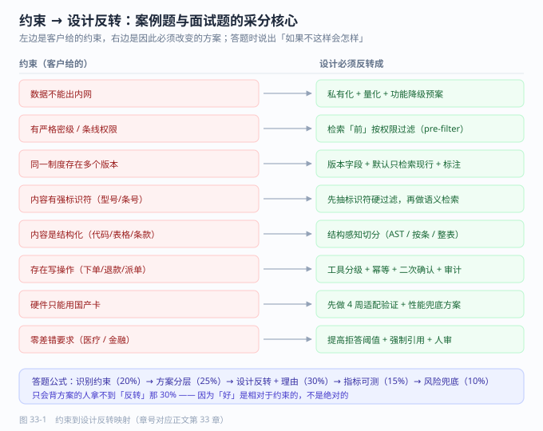

# 第 33 章 案例横向对比与复盘方法

> 返回 [全书目录](../00-全书导读与目录.md)。上一篇：[32-案例六-医疗与教育](32-案例六-医疗与教育.md)；下一篇：[34-单选题库](../第八篇-应试/34-单选题库.md)。

> [!abstract] 本章解决什么问题
> 七个案例记不住，遇到陌生行业也不知道从哪下手——怎么把案例变成可迁移的判断？
>
> - 用「迁移五问」把新行业映射到已知约束类型
> - 用「约束 → 设计反转」12 条推导方案
> - 用复盘五问产出清单（而不是感想）
>
> **产出**：一张可迁移的判断表 + 一套复盘模板　|　预计 12 分钟


## 33.1 七个案例，七句话

背案例不要背细节，背**「这个案例教会你哪一条判断」**。

| # | 案例 | 一句话记忆 | 它教你的判断 |
| --- | --- | --- | --- |
| 27 | 制造业设备维修 | 工人戴手套、车间没 Wi-Fi、步骤不能少一步 | **强标识符领域，过滤优先于语义** |
| 28 | 金融合规问答 | 一份制度三个版本，答错要担责 | **版本、权限、原文三铁律** |
| 29 | 电商客服 Agent | 退款能直接点，点错就是钱 | **写操作按风险分级开放** |
| 30 | 政务信创知识库 | 只能用国产卡，还得等保三级 | **先适配再谈效果** |
| 31 | 研发代码库 | 按字数切代码，函数被劈成两半 | **结构感知切分** |
| 32a | 医院导诊与病历质控 | 说错一句话就是医疗风险 | **拒答比答对更重要** |
| 32b | 职教智能助教 | 学生会问作业原题 | **对抗性输入是默认假设** |

> [!important] 这七条判断的共同结构
> 都是「**某个约束 → 某个设计反转**」。
> 普通人记住的是「我做过制造业项目」，专业的人记住的是「制造业意味着标识符优先」。**后者才能迁移到下一个行业。**

---

## 33.2 六维横向对比（背这张表应对一切案例题）

八列并排在一屏里会挤成一片，所以拆成三张表，每张以「案例」为行——**背的时候按案例竖着背，答题时按维度横着找**。

**表 33-1　约束与数据（决定「能做什么」）**

| 案例 | 核心约束 | 数据特点 | 分块策略 |
| --- | --- | --- | --- |
| 27 制造 | 弱网 + 私有化 + 步骤完整 | 800 份手册，含 300 份扫描件 | 按「型号→章节」，**步骤不切** |
| 28 金融 | 合规 + 块级权限 + 版本 | 制度多版本，密级分明 | 按条款，块级带密级 |
| 29 电商 | 峰值并发 + 写操作 | 商品库 + 订单库 + 话术 | 商品维度，短块 |
| 30 政务 | 信创 + 等保三级 | 公文格式多，含 OFD | 按公文结构（章/条） |
| 31 研发 | 代码结构 + 高频更新 | 多仓库、多分支代码 | **AST 按函数/类切** |
| 32a 医疗 | 零差错 + 可追溯 | 病历非结构化，隐私敏感 | 按病历段落 + 语义单元 |
| 32b 教育 | 对抗性提问 + 内容安全 | 教材 + 题库 + 学情 | 按知识点，题目整体不切 |

**表 33-2　检索与生成（决定「答得准不准」）**

| 案例 | 检索重点 | 生成约束 |
| --- | --- | --- |
| 27 制造 | 型号硬过滤 + 同义词扩写 | 结论 + ≤6 步 + 安全提示 + 页码 |
| 28 金融 | 版本过滤 + 权限 pre-filter | 必须原文引用 + 不确定即拒答 |
| 29 电商 | 多路召回 + 路由 | 话术合规 + 金额必须核对 |
| 30 政务 | 格式归一 + 条号匹配 | 不得超出文件表述 |
| 31 研发 | 符号检索 + 向量混合 | 必须给文件路径与行号 |
| 32a 医疗 | 症状→科室映射 + 指南匹配 | 不给诊断，只给指引 |
| 32b 教育 | 知识点定位 + 难度匹配 | 不给答案，只给思路 |

**表 33-3　部署、指标与坑（决定「能不能验收」）**

| 案例 | 部署形态 | 最关键指标 | 最大坑 |
| --- | --- | --- | --- |
| 27 制造 | 私有化 14B INT4 | 一次解决率、新人独立率 | 按字数切，步骤断 |
| 28 金融 | 私有化 + 审计留痕 | 引用准确率、越权率 0 | 多版本混答 |
| 29 电商 | 公有云弹性 + 降级链 | 自动解决率、误操作率 | 写操作无护栏 |
| 30 政务 | 信创私有化 | 自助率、标识覆盖率 | 适配工作量低估 |
| 31 研发 | 云服务 / 内网 | 检索耗时、引用准确率 | 按字数切代码 |
| 32a 医疗 | 院内私有化 | 拒答恰当率、零差错 | 模型越界给诊断 |
| 32b 教育 | 云 + 内容过滤 | 引导有效率、安全拦截率 | 学生套答案 |

---

## 33.3 「约束 → 设计反转」映射表（最值钱的一张表）

考试和面试里最高频的考法是：**给你一个新约束，问方案怎么变**。这张表就是答案库。

| 约束出现 | 设计必须反转成 | 不能这么做的原因 |
| --- | --- | --- |
| 数据不能出内网 | 私有化 + 量化 + 小参数模型 + 功能降级预案 | 用 API 的 demo 无法迁移 |
| 有严格密级/权限 | 检索**前**按权限过滤（元数据 pre-filter） | 检索后删会导致上下文错乱、越权泄露 |
| 同一制度多版本 | 版本字段 + 默认只检索现行版 + 答案标注版本 | 混答比不答更危险 |
| 内容有强标识符（型号/条号/零件号） | 先抽标识符做硬过滤，再做语义检索 | 纯语义会把相似设备的答案混进来 |
| 内容是结构化（代码/表格/条款） | 结构感知切分（AST / 表格整体 / 按条） | 按字数切会切断语义单元 |
| 存在写操作 | 工具分级 + 幂等 + 二次确认 + 审计 | 无护栏的写操作一次事故就终止项目 |
| 峰值并发高（大促/开学） | 弹性 + 队列 + 降级链 + 预热 | 按均值配容量必崩 |
| 硬件只能用国产卡 | 先做适配验证（算子/精度/性能），再谈效果 | 适配失败会让整个方案归零 |
| 用户零差错要求（医疗/金融） | 提高拒答阈值 + 强制引用 + 人工复核 | 追求「都答」必然出错 |
| 用户会恶意提问（学生/公开场景） | 对抗性测试 + 内容过滤 + 不直接给答案 | 默认用户善意会翻车 |
| 用户是戴手套的工人 | 语音输入 + 大按钮 + 离线缓存 | 精致 UI 在车间无法使用 |
| 交付后无人维护 | 运营方案 + owner 制 + 过期机制 | 系统三个月后自然死亡 |

> [!tip] 这张表怎么用
> 案例题的答题结构就是：**识别约束 → 在表里找到对应行 → 说出设计反转 → 补一句「如果不这样会怎样」**。
> 四句话一个采分点，八个采分点就是满分。

---



---

## 33.4 案例迁移矩阵：遇到陌生行业怎么定位

不要试图「懂所有行业」。用五个问题把新行业映射到已知约束类型：

| 问 | 若答案是 | 落到哪类约束 | 参考案例 |
| --- | --- | --- | --- |
| ① 数据能不能出内网？ | 不能 | 私有化 | 27、28、30、32a |
| ② 有没有强制合规等级？ | 等保/密评/行业监管 | 合规优先 | 28、30、32a |
| ③ 内容有没有强标识符？ | 型号/条号/编码/ICD | 标识符过滤 | 27、31 |
| ④ 要不要写数据？ | 要下单/派单/发消息 | 写操作护栏 | 29 |
| ⑤ 用户会不会恶意使用？ | 会（公开/学生/外部） | 对抗性输入 | 29、32b |

**映射完就能直接复用**：五个问题里命中 3 个以上，方案骨架基本可以照搬对应案例，只需替换领域知识与指标。

```text
例：新行业 = 保险理赔
① 数据不能出内网 → 是（客户信息）      → 私有化
② 合规等级 → 高（金融监管）             → 合规优先
③ 强标识符 → 是（保单号、条款号）        → 标识符过滤
④ 写操作 → 是（立案、赔付）             → 写操作护栏
⑤ 恶意使用 → 部分（骗保）               → 对抗性输入
→ 结论：28（金融合规）+ 29（写操作）+ 27（标识符）三者组合，参考 35 章案例题 8 的答法。
```

---

## 33.5 复盘方法：项目结束后必须做的一件事

复盘不是「写个总结」，是**把隐性经验变成可复用判断**。用五问结构，30 分钟能做完：

| 问 | 具体问法 | 产出 |
| --- | --- | --- |
| **① 目标达成了吗** | 当初承诺的指标，实际是多少？差距多少？ | 一张对比表（承诺 vs 实际） |
| **② 差距因为什么** | 技术？数据？协作？期望？逐条归因并给权重 | 归因列表（带百分比） |
| **③ 哪个决策是对的** | 现在回看，哪 2–3 个决策真正救了项目 | 可复用判断 |
| **④ 哪个决策是错的** | 如果重来，哪个节点会改？改成什么？ | 反模式清单 |
| **⑤ 下次怎么提前发现** | 错的决策当时有什么信号被忽略了？ | 早期预警信号 |

> [!important] 第 ⑤ 问才是复盘的真正价值
> 「我们低估了数据工程量」这是抱怨；「**立项时没人问『文档有多少是扫描件』，下次把它列进必问清单**」——这才是复盘产出。
> 复盘的产物应该是**清单**，不是感想。

### 复盘会怎么开（45 分钟）

```text
0–5 min   读指标对比表（只读事实，不解释）
5–15 min  逐条归因，每条给权重，写到白板上
15–25 min 只讨论「可复用的判断」与「反模式」，不追责个人
25–35 min 产出清单：必问清单 / 反模式清单 / 预警信号清单
35–45 min 指定每条清单的落地动作与责任人
```

**三条纪律**：不追责个人（只追流程）、必须产出清单、清单必须有人认领。

### 复盘报告模板（一页）

```markdown
## 项目：XXX         周期：2026-03 ~ 2026-09
## 一、承诺 vs 实际
| 指标 | 承诺 | 实际 | 达成 |
## 二、归因（带权重）
数据 40% / 协作 25% / 技术 20% / 期望 15%
## 三、做对的三个决策
## 四、做错的两个决策 + 当时被忽略的信号
## 五、沉淀清单（必问 / 反模式 / 预警信号）
## 六、对下一个项目的三条建议
```

---

## 33.6 同一个案例，三种讲法

| 场合 | 时长 | 结构 | 重点 |
| --- | --- | --- | --- |
| **面试** | 3 分钟 | 约束 → 我的关键决策 → 结果 → 学到什么 | 突出**你的判断**，不是团队成绩 |
| **技术答辩** | 10 分钟 | 背景 → 架构图 → 三个技术难点 → 指标 → 复盘 | 突出**取舍理由** |
| **销售陪访** | 5 分钟 | 客户同类问题 → 我们怎么解 → 数字结果 | 突出**可比性**，隐去客户名 |

**3 分钟版的标准脚本**（背下来，任何案例都能套）：

```text
「这个客户是【行业+规模】，最大的约束是【一句话约束】。
 所以我们没有用【常规做法】，而是改成了【关键设计】，原因是【约束导致的必然】。
 上线后【指标1】从 A 到 B，【指标2】从 C 到 D。
 最大的坑是【坑】，如果重来我会【改进】。」
```

> [!warning] 讲案例最常见的两个错误
> ① **只讲技术不讲约束**：听的人无法判断你的方案好不好，因为「好」是相对于约束的。
> ② **只讲成功不讲坑**：听起来像 PPT，不像做过项目。**主动讲一个坑，可信度立刻上一个台阶。**

---

## 33.7 案例题答题模板（考试直接用）

```text
【第一步 识别约束】（3–4 条，每条一句话）
  例：① 数据不能出内网 ② 存在多版本制度 ③ 用户要求零差错 ④ 硬件仅一台 8 卡机

【第二步 给出总体方案】（分层说，别混在一起）
  数据层：……    检索层：……    生成层：……    部署层：……    安全层：……

【第三步 说明关键设计反转】（这是采分核心）
  「因为约束①，所以采用私有化 14B INT4 + vLLM，而非 API；
    因为约束②，所以加版本字段并默认只检索现行版；
    因为约束③，所以把拒答阈值从 0.3 提高到 0.5，并强制原文引用；
    因为约束④，所以放弃 32B 方案，改用 14B + 量化。」

【第四步 给指标与验证方法】
  四个指标 + 黄金集规模 + 判定方式 + 上线门禁。

【第五步 给风险与兜底】
  两个主要风险 + 各自的缓解措施。
```

> [!success]- 阅卷视角：分在哪
> 约束识别（20%）+ 方案分层（25%）+ **设计反转与理由（30%）** + 指标可测（15%）+ 风险兜底（10%）。
> **「设计反转与理由」占三成**——这就是为什么只会背方案的人拿不到高分。

---

## 33.8 本章考点速记

> [!success]- 折叠背诵版
> **七句话**：标识符优先 / 版本权限原文 / 写操作分级 / 先适配再效果 / 结构感知切分 / 拒答比答对重要 / 对抗性输入是默认假设。
>
> **约束→反转 12 条**（33.3 表）：出不了网→私有化量化；有密级→检索前过滤；多版本→只检索现行；强标识符→先过滤再语义；结构化→结构感知切分；有写操作→分级+幂等+审计；高并发→弹性+队列+降级；国产卡→先适配；零差错→高拒答阈值+强制引用；恶意输入→对抗测试+过滤；手套工人→语音+离线；无人维护→运营方案+owner。
>
> **迁移五问**：能否出网 / 合规等级 / 强标识符 / 是否写数据 / 是否恶意使用。命中 3 条即可照搬骨架。
>
> **复盘五问**：目标达成否 / 差距因何 / 哪个决策对 / 哪个决策错 / 下次怎么提前发现。
> **复盘的产物是清单，不是感想。**
>
> **3 分钟讲法**：约束 → 关键设计反转 → 指标 → 坑与改进。
> **答题分权重**：约束 20% + 分层 25% + 反转理由 30% + 指标 15% + 风险 10%。

---

**上一篇**：[第 32 章 案例六 医疗与教育](32-案例六-医疗与教育.md)　|　**下一篇**：[第 34 章 单选题库](../第八篇-应试/34-单选题库.md)
