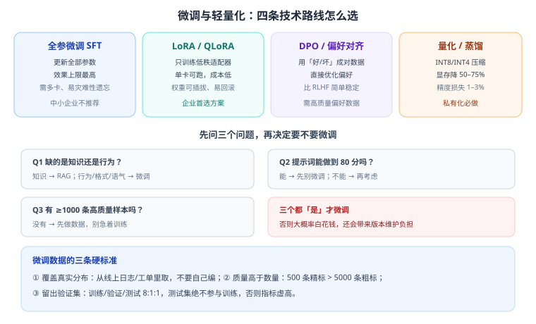

# 第 6 章 微调、对齐与模型轻量化

> 返回 [全书目录](../00-全书导读与目录.md)。上一篇：[05-提示词工程](05-提示词工程.md)；下一篇：[07-多模态与前沿技术](07-多模态与前沿技术.md)。

> [!abstract] 本章解决什么问题
> 客户提「能不能用我们自己的数据训练一下」，你要能回答：**该不该微调、微调什么、要多少数据、多少钱、有什么坑**。
> 同时把「量化 / 蒸馏 / 剪枝」这些私有化必用技术讲清楚，避免只会说「压缩一下模型」。

---

## 6.1 先搞清楚：微调到底改什么

| 微调能改 | 微调改不了 |
| --- | --- |
| 输出风格（正式/口语） | 知识事实（尤其是频繁变化的事实） |
| 输出格式（固定 JSON/模板） | 实时数据（库存、价格、订单） |
| 领域语感（医学术语表达） | 长尾知识的准确引用 |
| 指令遵循能力 | 模型的能力上限 |

> [!important] 一句话
> **微调是「教它怎么说」，RAG 是「告诉它说什么」。** 把两者搞反，是项目里最常见的浪费。



---

## 6.2 四条技术路线

| 路线 | 原理 | 资源 | 效果上限 | 适用 |
| --- | --- | --- | --- | --- |
| 全参微调（Full SFT） | 更新全部参数 | 多卡 A100/H100 | 最高 | 大厂、深度定制 |
| **LoRA** | 冻结原参数，训练低秩旁路矩阵 | 单卡 24–48GB | 高（接近全参） | **企业首选** |
| QLoRA | 基座量化到 4bit 再 LoRA | 单卡 24GB 可跑 7B–13B | 中高 | 显存受限 |
| DPO / 偏好对齐 | 用「好答案/坏答案」成对数据直接优化 | 中等 | 提升风格与安全性 | 已有偏好数据时 |

事实依据：LoRA 由 Hu 等人在 2021 年提出（《LoRA: Low-Rank Adaptation of Large Language Models》），核心洞察是微调时权重更新具有低秩特性，因此可以用两个小矩阵近似，参数量降到原来的 0.1%–1%。DPO 由 Rafailov 等人于 2023 年提出，用分类损失替代 RLHF 的强化学习流程，训练更稳定。

### LoRA 的关键参数

| 参数 | 含义 | 经验值 |
| --- | --- | --- |
| `r`（秩） | 旁路矩阵的秩，决定表达能力 | 8–64（常用 16/32） |
| `alpha` | 缩放系数 | 常取 2r |
| `dropout` | 防过拟合 | 0.05–0.1 |
| 学习率 | — | 1e-4 ~ 2e-4（比全参大一个量级） |
| epoch | 训练轮数 | 2–3（多了过拟合） |

> [!tip] 工程优势
> LoRA 权重只有几十到几百 MB，**可以像插件一样加载/卸载**——一个基座模型挂多个业务适配器，既省显存又便于回滚。这是企业多业务场景的最佳实践。

---

## 6.3 数据：微调成败的 90%

### 数据从哪来

| 来源 | 质量 | 说明 |
| --- | --- | --- |
| 线上真实日志 | 最高 | 用户真实问法，覆盖长尾 |
| 工单/客服记录 | 高 | 有「问题-解决」配对 |
| 专家手写 | 最高但贵 | 适合补充关键场景 |
| 大模型合成 | 中 | 可扩量，但必须人工抽检，否则放大错误 |

### 数据标准（三条硬指标）

1. **覆盖真实分布**：从日志里采样，别自己编「理想问题」；
2. **质量高于数量**：500 条精标 > 5000 条粗标；
3. **留出测试集**：训练/验证/测试 = 8:1:1，测试集**绝不参与训练**。

### 数据格式示例（指令微调）

```json
{
  "messages": [
    {"role": "system", "content": "你是设备维修助手，只回答维修问题。"},
    {"role": "user", "content": "液压泵异响怎么处理？"},
    {"role": "assistant", "content": "结论：多为进气或油位不足。\n步骤：1. 检查油位…\n2. 排气…\n风险提示：拆卸前必须泄压。"}
  ]
}
```

### 数据常见问题

| 问题 | 后果 | 处理 |
| --- | --- | --- |
| 答案风格不一致 | 模型学混 | 统一模板后重写 |
| 含错误答案 | 学会错误 | 专家复核，宁缺毋滥 |
| 长度极端（都极短/极长） | 输出长度失控 | 控制长度分布 |
| 全是一个场景 | 泛化差 | 按场景分层采样 |

---

## 6.4 训练与评估流程

```text
① 基线：先用提示词 + RAG 跑一遍，记录指标（这是对照）
② 数据：采集 → 清洗 → 统一模板 → 分层抽样 → 划分集合
③ 训练：LoRA（r=16, alpha=32, lr=2e-4, epoch=2–3），监控 loss 与验证集
④ 评估：任务指标（准确率/格式合规率）+ 通用能力回归（防止「学傻了」）
⑤ 对比：与基线比，只有显著提升才上线
⑥ 上线：适配器版本化，支持灰度与回滚
```

> [!warning] 必须做「通用能力回归」
> 微调过度会让模型在其他任务上退化（灾难性遗忘）。做法：准备一组通用测试题（如 50 条常识/指令题），微调前后都跑一遍，掉点超过 5% 就要警惕。

---

## 6.5 什么时候不该微调

| 情形 | 更优解 |
| --- | --- |
| 只是知识更新 | RAG |
| 只是格式不规范 | 提示词 + 结构化输出 + 后处理 |
| 数据不到 500 条 | 先攒数据，或 Few-shot |
| 需求每周变 | 提示词迭代更快 |
| 没有评测能力 | 先建评测，否则无法判断好坏 |

> [!tip] 面试/答辩的标准回答
> 「我们的顺序是：提示词 → RAG → Agent → 微调。只有当『行为/风格/格式』用提示词稳定不了，且有 ≥1000 条高质量样本时，才上 LoRA。微调上线必须带通用能力回归，防止灾难性遗忘。」

---

## 6.6 模型轻量化四件套

| 技术 | 做什么 | 收益 | 代价 |
| --- | --- | --- | --- |
| **量化** | 降低参数精度（FP16→INT8/INT4） | 显存降 50–75%，速度提升 | 精度损失 1–3% |
| 蒸馏 | 大模型教小模型 | 小模型获得大部分能力 | 需训练，上限受限 |
| 剪枝 | 去掉不重要的连接/结构 | 体积减小 | 需精细调优，易掉点 |
| MoE 稀疏 | 每次只激活部分专家 | 同参数量下更快 | 显存仍需容纳全部专家 |

### 量化方案对比

| 方案 | 特点 | 适用 |
| --- | --- | --- |
| GPTQ | 训练后量化，GPU 推理友好，生态成熟 | vLLM / TGI 部署 |
| AWQ | 激活感知，精度更好 | 对精度敏感的场景 |
| GGUF | llama.cpp 生态，CPU/混合推理 | 无 GPU 或边缘设备 |
| FP8 | 新硬件支持（如 H100） | 高吞吐场景 |

### 量化前后要验证什么

1. **精度**：跑同一套评测集，准确率下降是否在可接受范围（如 ≤3%）；
2. **速度**：TTFT 与吞吐是否真的提升（有时小模型量化后收益不明显）；
3. **稳定性**：长输出是否出现重复、截断、乱码。

> [!warning] 量化不是无损的
> 常见现象：4bit 量化后模型「变笨」——多步推理容易断、格式偶尔崩。**高风险场景（合同、医疗、财务）建议 INT8 或 FP16**，省下的显存不值那个风险。

---

## 6.7 显存与训练成本估算

### 推理显存（复习）

```text
显存 ≈ 权重 + KV Cache + 运行时开销
7B FP16 = 14GB；INT8 = 7GB；INT4 ≈ 4GB
```

### 训练显存（LoRA，经验值）

| 模型 | 方法 | 显存需求 |
| --- | --- | --- |
| 7B | LoRA（FP16 基座） | 约 20–24GB |
| 7B | QLoRA（4bit 基座） | 约 10–14GB |
| 13B | QLoRA | 约 16–20GB |
| 70B | LoRA（多卡） | 4×80GB 起 |

> [!tip] 成本直觉
> 7B 模型用 LoRA 在单张 24GB 卡上训练 1 万条样本、2 个 epoch，通常几小时到十几小时量级。**真正的成本不在算力，在数据标注与评测。**

---

## 6.8 微调数据的具体构造：三类任务的样本格式

「准备 1000 条高质量数据」这句话太抽象。实际要写出来的是这样的结构：

**① 风格/格式对齐（最常见）**

```json
{
  "messages": [
    {"role": "system", "content": "你是客服助手，回答需先给结论，再给依据，不超过 120 字。"},
    {"role": "user", "content": "退款多久到账"},
    {"role": "assistant", "content": "结论：1–3 个工作日原路退回。\n依据：支付渠道清算周期为 T+1 至 T+3，节假日顺延。"}
  ]
}
```

**② 领域知识注入（谨慎使用，优先 RAG）**

```json
{
  "messages": [
    {"role": "user", "content": "A 型号液压泵异响的排查顺序是什么"},
    {"role": "assistant", "content": "① 检查油位是否低于标线；② 检查吸油管密封是否进气；③ 检查滤芯是否堵塞；④ 测量泵体压力。拆卸前必须泄压。"}
  ]
}
```

**③ 拒答与边界（最容易被忽略，但最重要）**

```json
{
  "messages": [
    {"role": "user", "content": "帮我判断这个合同条款有没有法律风险"},
    {"role": "assistant", "content": "我无法提供法律判断。可以帮你做的是：定位合同中的相关条款原文，并列出常见审查要点清单，供你与法务确认。"}
  ]
}
```

> [!important] 第三类数据决定「微调后会不会变傻」
> 只训练「怎么答」的数据，模型会变得过度自信——**什么都要答，包括该拒的**。
> 拒答样本占比建议 **10–15%**，且要覆盖你场景里最危险的 5 类越界请求。

**数据质量的三条硬标准**（比数量重要得多）：

| 标准 | 检查方法 | 不合格示例 |
| --- | --- | --- |
| 答案必须正确 | 业务专家逐条确认 | 用模型生成答案再拿去训练（自我循环） |
| 风格必须一致 | 抽 50 条读一遍，语气/格式统一 | 一半是正式书面语，一半是口语 |
| 无敏感与隐私 | 正则 + 人工抽检 | 样本里带真实手机号、真实客户名 |

---

## 6.9 训练失败的六种形态与排查

微调跑不通是常态。按现象对照排查，能省大量时间。

| 现象 | 可能原因 | 排查 | 处理 |
| --- | --- | --- | --- |
| **loss 不降** | 学习率太小 / 数据格式错 / 标签被 mask 掉 | 打印第一条样本的 tokenized 结果 | lr ×10；检查 chat template |
| **loss 降但输出乱码** | chat template 与推理时不一致 | 对比训练与推理的模板 | 统一模板 |
| **过拟合（训练 loss 低、验证高）** | 数据太少 / epoch 太多 | 看验证集曲线 | 减 epoch 到 2、加数据、加 dropout |
| **灾难性遗忘** | 只训练领域数据 | 跑通用能力回归（如 20 道通用题） | 混入 10–20% 通用数据 |
| **格式崩坏（不按 JSON 输出）** | 训练样本里格式不统一 | 检查样本格式一致性 | 统一格式 + 增加格式样本 |
| **推理变慢** | 合并方式错 / 精度损失 | 对比合并前后延迟 | 用正确 merge 脚本，检查量化 |

> [!warning] 最隐蔽的一种：模板不一致
> 训练时用 `### Human: ... ### Assistant: ...`，推理时用模型的官方 chat template —— 训练白做，效果不如不微调。
> **纪律：训练和推理必须调用同一个模板函数**，且在训练脚本里打印一条完整样本肉眼确认。

---

## 6.10 微调后的部署与版本管理

微调不是「训完就上线」，它引入了一个新的运维对象：**你自己的模型版本**。

| 事项 | 做法 |
| --- | --- |
| **版本号** | `模型名-任务-日期-数据版本`，如 `qwen7b-csstyle-20261020-d3` |
| **基线对比** | 新版本必须与「上一版 + 未微调原模型」三方对比 |
| **回归集** | 固定 50 题，每次升级都跑，不达标不上线 |
| **灰度** | 先 10% 流量，观察点踩率与拒答率 |
| **回滚** | 保留上一版权重与配置，5 分钟内可切回 |
| **记录** | 训练数据版本、超参、评测结果，三者绑定存档 |

**升级时的三方对比表（模板）**：

| 指标 | 原模型 | 上一版微调 | 新版微调 | 结论 |
| --- | --- | --- | --- | --- |
| 风格符合率 | 62% | 88% | 91% | 提升 |
| 事实准确率 | 84% | 82% | 83% | 微降（可接受） |
| 拒答恰当率 | 79% | 71% | 78% | **恢复到原模型水平** |
| P95 延迟 | 4.2 s | 4.2 s | 4.3 s | 无影响 |

> [!important] 微调的隐性代价
> 每次升级基座模型（如从 v2 换到 v3），**你的微调权重就作废了**，必须重新训练与评测。
> 这就是「微调会锁定你」的含义——选型时要把这个长期成本算进去（见 8.1 可控性维度）。

---

## 6.11 本章考点速记

> [!success]- 必背 8 条（点击展开自测）
> 1. 微调改行为/风格/格式，不改知识事实；知识更新用 RAG。
> 2. 四条路线：全参 SFT、LoRA、QLoRA、DPO；企业首选 LoRA。
> 3. LoRA 参数：r=8–64（常用 16）、alpha≈2r、lr 1e-4~2e-4、epoch 2–3。
> 4. 数据三标准：覆盖真实分布、质量优先、留出测试集。
> 5. 必须做通用能力回归，防灾难性遗忘（掉点 >5% 警惕）。
> 6. 轻量化四件套：量化、蒸馏、剪枝、MoE。
> 7. 量化省权重不省 KV；精度损失 1–3%，高风险场景慎用 INT4。
> 8. 顺序：提示词 → RAG → Agent → 微调。

---

**上一篇**：[第 5 章 提示词工程](05-提示词工程.md)　|　**下一篇**：[第 7 章 多模态与前沿技术](07-多模态与前沿技术.md)
