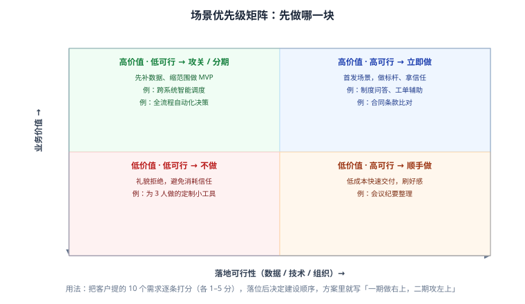
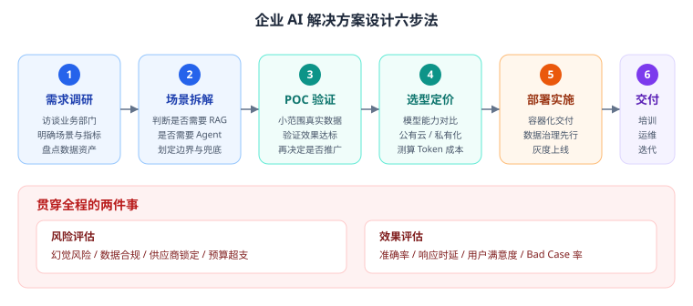
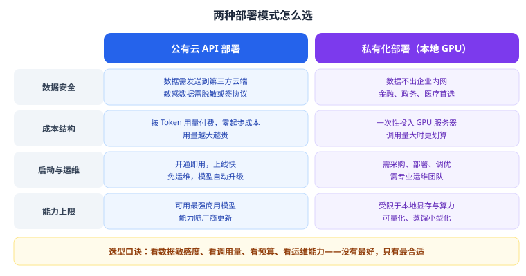
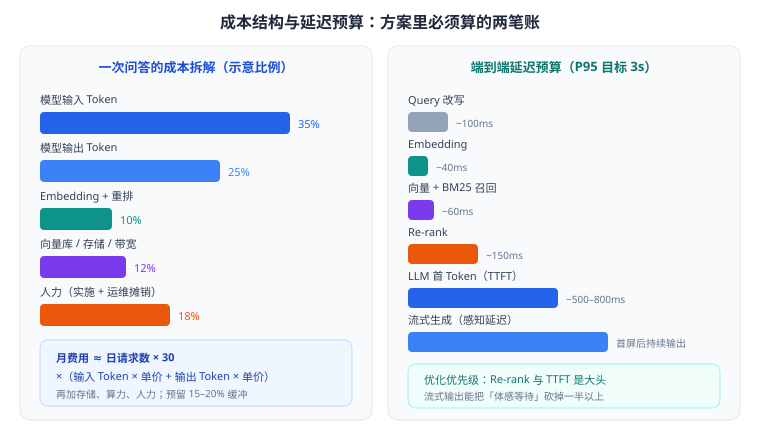

# 第 17 章 解决方案设计与售前

> 返回 [全书目录](../00-全书导读与目录.md)。上一篇：[16-多智能体与工作流编排](../第四篇-Agent工程/16-多智能体与工作流编排.md)；下一篇：[18-售前方法论与价值量化](18-售前方法论与价值量化.md)。

> [!abstract] 本章解决什么问题
> 这是 FDE 的「主战场」，也是简答题最容易拉开差距的地方。
>
> 技术好的人很多，能把技术写成一份**客户看得懂、财务算得清、研发做得出、领导敢签字**的方案的人很少。本章就干这件事。

---

## 17.1 售前的本质：不是讲技术，是消除风险

客户买 AI 项目，真正担心的是四件事：

| 客户担心 | 你要给的东西 |
| --- | --- |
| 「能不能做成？」 | POC + 同类案例 + 明确的能力边界 |
| 「要花多少钱？」 | 一次性 + 年运营 + 敏感度分析 |
| 「会不会出事？」 | 合规方案 + 权限设计 + 兜底机制 |
| 「上线后谁管？」 | 运维方案 + 培训 + 迭代机制 |

> [!important] 一句话
> **方案不是「我们技术多强」，而是「你的风险我们怎么兜」。** 所有章节都应该围绕「降风险」来写。

### 需求挖掘：从「我要一个 AI」到「你要省 30 个人力」

客户说的往往不是需求，是愿望。用 SPIN 四步把愿望拆成可验收的需求：

| 步骤 | 问什么 | 示例 |
| --- | --- | --- |
| S 现状 | 现在怎么做的？ | 「客服每天处理 800 单，人均 80 单」 |
| P 问题 | 哪里最痛？ | 「新人培训 2 个月才能上手，老员工流失严重」 |
| I 影响 | 不解决会怎样？ | 「旺季要临时招 20 人，成本 40 万/月」 |
| N 价值 | 解决后值多少？ | 「若 60% 常见问题自动答，可省 12 人」 |

---

## 17.2 需求调研清单（可直接打印带去客户现场）

### A. 业务侧（8 问）

1. 这个场景现在由谁做？每天/每月多少次？
2. 一次处理平均耗时多久？最耗时的是哪一步？
3. 出错率多少？出错后果是什么（返工/罚款/投诉）？
4. 有没有量化目标（省人/提效/降投诉）？
5. 谁是最终用户？他们的电脑/手机水平如何？
6. 上线后谁负责运营？有没有专人？
7. 有没有试点部门可以先跑？
8. 预算区间与决策流程？

### B. 数据侧（8 问）

9. 知识/数据在哪里？（文档系统、网盘、数据库、老员工脑子里）
10. 有多少份？什么格式？多少是扫描件？
11. 谁维护？多久更新一次？有没有版本管理？
12. 有没有密级划分？谁能看什么？
13. 数据质量如何？有没有重复、过期、互相矛盾？
14. 是否涉及个人信息、商业机密？
15. 数据能否出内网？
16. 有没有历史问答记录/工单可以拿来建评测集？

### C. 技术侧（7 问）

17. 现有系统有哪些？需要对接哪些（OA/CRM/ERP）？
18. 有没有 GPU？机房还是云？网络带宽如何？
19. 日均并发峰值多少？
20. 可接受的响应时延？
21. 有没有信创要求（国产芯片/操作系统/数据库）？
22. 安全要求：等保几级？是否需要审计日志？
23. 上线时间窗口？

### D. 组织侧（4 问）

24. 项目发起人是谁？有没有一把手支持？
25. 有没有反对声音？担心什么（替代岗位？）
26. 培训怎么安排？谁来做内部推广？
27. 验收标准谁定？怎么算通过？

> [!tip] 调研的隐藏价值
> 这 27 个问题的答案，**直接就是方案文档的素材**：痛点→第 1 章，数据→第 6 章，系统→第 7 章，时延并发→第 4 章，合规→第 11 章，组织→第 9、12 章。调研做扎实，方案自然写得出来。

---

## 17.3 场景优先级：先做哪一块



客户一口气提 10 个需求是常态。用**价值 × 可行性**打分（各 1–5 分），落进四象限：

| 象限 | 策略 | 话术 |
| --- | --- | --- |
| 高价值 · 高可行 | **一期必做**，做标杆 | 「这个我们 6 周能上，先拿结果说话」 |
| 高价值 · 低可行 | 分期，先补数据/缩范围 | 「先做其中 30% 的场景，验证后再扩」 |
| 低价值 · 高可行 | 顺手做，成本可控 | 「这个简单，我们随一期带上」 |
| 低价值 · 低可行 | 明确不做 | 「投入产出不划算，建议用现有流程解决」 |

> [!warning] 售前大忌
> 什么都答应。承诺一堆做不出来的功能，POC 一验就露馅，反而丢掉整个项目。**敢说「这个不做」，客户才信你说的「这个能做」。**

---

## 17.4 架构设计：给出「可落地的图」



### 分层架构（方案里必画）

| 层 | 内容 | 设计要点 |
| --- | --- | --- |
| 接入层 | Web / 企微 / App / API | 统一鉴权、限流、审计 |
| 应用层 | 会话、权限、RAG 服务、Agent 编排、工具适配 | 无状态、可水平扩展 |
| 模型层 | 推理服务、Embedding、重排、外部 API | 多模型适配、降级策略 |
| 数据层 | 向量库、关系库、对象存储、缓存 | 备份、版本留痕 |
| 运维层 | 监控、日志、Trace、成本看板 | 可观测性三件套 |

完整参考架构见 [23 章部署参考架构](../第六篇-工程与合规/23-工程落地与合规运维.md#232-部署架构)。

### 架构说明的三段写法（评审最看重）

1. **数据怎么流**：从文档到答案，每一步输入输出是什么；
2. **为什么这么分层**：哪层可替换（换模型不改业务）、哪层是瓶颈（重排）、哪层要扩容（推理）；
3. **降级怎么做**：模型超时降级到小模型、检索失败降级到 FAQ、服务挂了降级到人工。

> [!tip] 加分项
> 主动画一张「降级路径图」。90% 的方案只画正常流程，画了降级路径的立刻显得专业。

---

## 17.5 选型：模型、部署、组件

### 模型选型矩阵

| 维度 | 权重 | 怎么评 |
| --- | --- | --- |
| 场景能力 | ★★★★★ | 用你的真实任务做小样本测试（20–50 条） |
| 中文表现 | ★★★★ | 中文语料、专业术语、政策表述 |
| 上下文窗口 | ★★★ | 能否容纳检索片段 + 对话 |
| 时延 | ★★★★ | TTFT 与生成速度（交互场景敏感） |
| 成本 | ★★★★ | 按预估用量算月费 |
| 部署方式 | ★★★ | 是否支持私有化/专有实例 |
| 生态 | ★★ | 工具调用、结构化输出、文档完善度 |

**原则：用真实任务做 20 条盲测，比看榜单靠谱。** 榜单测的是通用能力，你的场景可能完全不同。

### 部署模式决策



| 判断条件 | 结论 |
| --- | --- |
| 数据不能出内网 / 有等保或行业监管要求 | 私有化（开源模型 + 本地 GPU） |
| 日均调用量大且稳定（成本拐点以上） | 测算后倾向私有化 |
| 快速验证、用量波动、无 GPU 与运维团队 | 公有云 API |
| 既要安全又要省事 | 混合：敏感数据本地小模型，复杂推理走专有实例 |

> [!important] 成本拐点怎么算（面试常问）
> 私有化的年成本 ≈ GPU 服务器折旧 + 电费 + 运维人力；公有云年成本 ≈ Token 费用。
>
> **当「公有云年费 > 私有化年成本 × 1.3」时，私有化开始划算**（1.3 是留给运维复杂度的安全系数）。具体数字必须用真实报价算，不能拍脑袋。

### 组件选型清单

| 组件 | 备选 | 选型依据 |
| --- | --- | --- |
| 向量库 | Milvus / pgvector / 云服务 | 数据量、并发、是否已有 PG、是否需 pre-filter |
| Embedding | 商用 API / 开源自部署 | 数据敏感度、中文效果、成本 |
| 重排 | 开源小模型 / API | 延迟预算、成本 |
| 推理框架 | vLLM / TGI / Ollama | 吞吐、显存效率、易用性 |
| 编排 | 自研 / 低代码平台 | 可控性 vs 交付速度 |
| 前端 | 独立应用 / 嵌入现有系统 | 用户习惯（能不新建入口就不新建） |

---

## 17.6 成本测算：把「大概」变成「数字」



### TCO 的五个口袋

| 口袋 | 内容 | 一次性 / 持续 |
| --- | --- | --- |
| 软件与模型 | Token 调用费、模型授权、平台费 | 持续 |
| 算力与基础设施 | GPU、服务器、云资源、存储、带宽 | 一次性 + 持续 |
| 实施服务 | 调研、开发、数据治理、集成、测试 | 一次性 |
| 运维运营 | 人力、监控、迭代、培训 | 持续 |
| 隐性成本 | 数据清洗返工、员工学习曲线、流程改造 | 常被漏算 |

### 三档算例（假设单价，演示方法）

假设：输入 0.004 元/千 Token、输出 0.012 元/千 Token。

| 场景 | 日请求 | 平均输入 | 平均输出 | 单次成本 | 年模型费 |
| --- | --- | --- | --- | --- | --- |
| 小（单部门试点） | 1,000 | 2,000 | 300 | 0.0116 元 | ≈ 0.42 万元 |
| 中（全公司知识库） | 5,000 | 2,500 | 300 | 0.0136 元 | ≈ 2.45 万元 |
| 大（对外客服） | 20,000 | 3,000 | 400 | 0.0168 元 | ≈ 12.1 万元 |

> [!warning] 注意
> 模型费往往**不是**大头。中型项目里，实施人力（数据治理占 40% 工时）+ 运维人力通常超过模型费数倍。**只报 Token 费的方案，会被懂行的评审当场问穿。**

### ROI 算例（说服客户的关键）

某客服项目：日均 800 单，人均 80 单/天 → 需 10 人；上线后 60% 常见问题自动解决 → 可减 6 人；人均综合成本 8 万元/年。

```text
年节省 = 6 × 8 = 48 万元
项目投入 = 60 万元（实施）+ 15 万元/年（运营）
年净收益 = 48 - 15 = 33 万元
静态回收期 = 60 / 33 ≈ 1.8 年
```

> [!tip] 讲 ROI 的三个技巧
> 1. 用客户的数字，不用行业平均；
> 2. 给区间（乐观/保守），别给单点；
> 3. 除了省钱，一定要算「省不掉的收益」：响应速度、客户满意度、合规风险下降。

---

## 17.7 POC：用最小成本证明「能做」

### POC 的四条铁律

1. **范围小**：一个部门、一类文档、20 个高频问题；
2. **数据真**：用客户真实数据（脱敏），不用演示数据；
3. **指标前置**：开始前就书面约定验收指标；
4. **有退出机制**：不达标就停，及时止损，别硬撑。

### POC 计划模板（4–6 周）

| 周 | 工作 | 交付 |
| --- | --- | --- |
| W1 | 数据抽样（100–200 份）、需求确认、指标约定 | POC 方案书 |
| W2 | 解析清洗、分块入库、基础检索 | 可检索 demo |
| W3 | 混合检索 + 重排 + 提示词调优 | 内部测试版 |
| W4 | 建 50–100 条评测集，跑指标 | 评测报告 |
| W5 | 用户试用（5–10 人），收集 Bad Case | 试用反馈 |
| W6 | 修复、复测、评审 | POC 结项报告 |

### 验收指标示例（写进合同附件）

| 指标 | 目标 | 测量方法 |
| --- | --- | --- |
| 高频问题准确率 | ≥ 85% | 100 条评测集，人工判分 |
| 答案可溯源率 | 100% | 抽查引用是否真实存在 |
| P95 响应时延 | ≤ 3 秒 | 压测 + 线上埋点 |
| 拒答正确率 | ≥ 90% | 越界问题集测试 |
| 权限违规 | 0 次 | 多角色账号交叉测试 |

> [!important] POC 的真正目的
> 不是「证明我们技术牛」，而是**让客户内部形成共识**：业务部门认可效果、IT 认可架构、财务认可成本、法务认可合规。少一个，项目都推不动。

---

## 17.8 方案文档：12 章结构


| 章节 | 写什么 | 页数 | 常见问题 |
| --- | --- | --- | --- |
| 1 项目背景与目标 | 现状、痛点（带数字）、目标（可验收） | 2–3 | 目标写成「提升效率」这种没法验收的话 |
| 2 需求分析与范围 | 做什么、**不做什么**、角色与频次 | 3–4 | 不敢写「不做」，后期无限加需求 |
| 3 场景拆解与优先级 | 价值×可行性矩阵、分期路径 | 2–3 | 一次全上，工期崩 |
| 4 总体技术架构 | 分层图、数据流、降级路径 | 4–6 | 只有框图，没有数据流说明 |
| 5 关键技术方案 | RAG/Agent/提示词/选型理由 | 6–10 | 只写「用了 RAG」，没有参数与理由 |
| 6 数据方案与治理 | 数据源清单、清洗规则、更新、权限 | 4–6 | 低估数据治理工时 |
| 7 部署与集成 | 部署拓扑、对接接口、网络要求 | 3–5 | 没写客户要准备什么 |
| 8 效果评估与验收 | 指标定义、测试集、验收流程 | 3–4 | 指标不可测 |
| 9 实施计划 | 里程碑、人力、客户配合事项 | 2–3 | 没有客户侧任务，导致延期扯皮 |
| 10 成本与报价 | 一次性 + 年运营 + 敏感度 | 2–3 | 漏项、无缓冲 |
| 11 风险与应对 | 技术/合规/组织/供应商 | 2–3 | 只写技术风险 |
| 12 运维与运营 | 监控、Bad Case 闭环、迭代、培训 | 3–4 | 上线即结束，没有运营方案 |

> [!tip] 写作技巧
> 每章开头一句话结论（「本章结论：采用私有化部署，年成本约 X 万元」），让没时间细看的高管也能抓到重点。**方案是给决策者看的，不是给技术同行看的。**

---

## 17.9 常见异议与应对

| 客户说 | 真实担心 | 怎么答 |
| --- | --- | --- |
| 「AI 会胡说八道」 | 不敢信 | 讲 RAG 引用溯源 + 拒答策略 + 高风险人审；给评测数据，不给承诺 |
| 「太贵了」 | 算不过账 | 拆 TCO，给 ROI 与回收期；提供分期建设方案（先上一期） |
| 「数据不能给你」 | 合规 | 私有化部署、数据不出内网、签保密协议、可现场实施 |
| 「员工不会用/抵触」 | 组织阻力 | 嵌入现有工作流（不新建入口）、试点标杆、培训与激励 |
| 「开源免费，为什么找你」 | 质疑价值 | 开源是零件，方案是整车：数据治理、调优、集成、运维、责任兜底 |
| 「你们和 XX 比怎么样」 | 比价/比能力 | 不比参数比场景：用同类案例 + POC 指标说话 |
| 「先免费做一个看看」 | 压价 | 给「小范围付费 POC」，明确范围与周期，不做无边界免费 |

---

## 17.10 交付与验收

| 阶段 | 关键动作 | 交付物 |
| --- | --- | --- |
| 启动 | 项目组、沟通机制、风险登记册 | 项目计划 |
| 实施 | 周报、变更控制（需求变更必须走流程） | 周报、变更单 |
| 测试 | 功能 + 效果 + 性能 + 安全 | 测试报告 |
| 验收 | 按合同指标逐条验证 | 验收报告 |
| 移交 | 文档、账号、源码/配置、培训 | 移交清单 + 培训记录 |
| 运营 | 监控、Bad Case 闭环、季度复盘 | 运营月报 |

> [!warning] 变更控制是保命符
> 「顺便再加个小功能」是项目死亡的第一步。所有变更必须评估工期与费用并书面确认——**这不是不配合，是专业。**

---

## 17.11 简答模板：给场景写方案

**题目示例**：「某集团有 5000 份制度文件，员工查询困难，要求做一个制度问答助手，数据不能出内网。请给出方案。」

**① 背景与目标**（2 句）：5000 份制度分散、版本混乱、查询靠问人；目标：80% 常见制度问题可自助查询，答案可溯源，数据不出内网。

**② 总体架构**：私有化部署；文档解析（含扫描件 OCR）→ 结构分块 + 元数据（部门/密级/生效日期）→ 本地 Embedding → Milvus（pre-filter 权限）→ 混合检索（向量 + BM25）→ RRF → 本地重排 → 私有化大模型生成（强制引用编号）。

**③ 实施步骤**：数据盘点与质量抽检 → 清洗分块 → 入库建索引 → 检索与重排调优 → 提示词与拒答 → 建 200 条评测集 → 灰度上线一个部门 → 全量推广。

**④ 效果指标**：Recall ≥ 0.85、Faithfulness ≥ 0.90、P95 ≤ 3s、溯源率 100%、权限违规 0。

**⑤ 风险与应对**：幻觉 → 引用 + 拒答 + 高风险人审；权限 → pre-filter + 双校验 + 审计；数据质量 → OCR 校对 + 抽检；成本 → 重排降 K + 缓存 + 模型分级；组织 → 嵌入 OA 入口 + 培训。

---

## 17.12 本章考点速记

> [!success]- 必背 10 条（点击展开自测）
> 1. 售前本质是**消除风险**：能不能做成、花多少钱、会不会出事、谁来管。
> 2. 需求挖掘用 SPIN：现状 → 问题 → 影响 → 价值。
> 3. 场景排序用「价值 × 可行性」四象限；敢说「不做」。
> 4. 架构五层：接入、应用、模型、数据、运维；必须写降级路径。
> 5. 模型选型靠真实任务盲测，不靠榜单。
> 6. 部署决策看四点：数据敏感度、调用量、预算、运维能力；成本拐点 = 公有云年费 > 私有化年成本 × 1.3。
> 7. TCO 五个口袋：软件模型、算力、实施、运维、隐性成本。
> 8. ROI 要用客户数字，给区间，算回收期。
> 9. POC 四铁律：范围小、数据真、指标前置、有退出机制。
> 10. 方案 12 章；三处最易被打回：目标不可验收、指标没定义、成本没算清。

---

**上一篇**：[第 16 章 多智能体与工作流编排](../第四篇-Agent工程/16-多智能体与工作流编排.md)　|　**下一篇**：[第 18 章 售前方法论与价值量化](18-售前方法论与价值量化.md)
