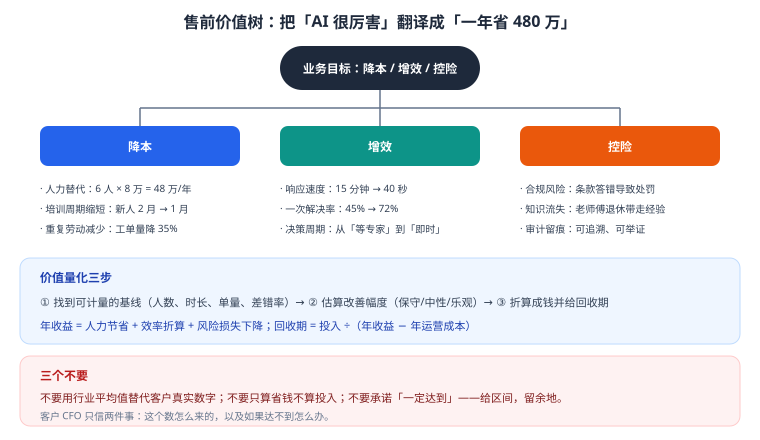

# 第 18 章 售前方法论与价值量化

> 返回 [全书目录](../00-全书导读与目录.md)。上一篇：[17-解决方案设计与售前](17-解决方案设计与售前.md)；下一篇：[19-POC与交付管理](19-POC与交付管理.md)。

> [!abstract] 本章解决什么问题
> 技术方案写得再好，算不清价值，客户也不会签。
> 本章给一套可复用的售前方法：**怎么问、怎么算、怎么讲、怎么应对异议**。

---

## 18.1 售前不是讲技术，是消除四类风险



| 客户担心 | 你要给的证据 |
| --- | --- |
| 能不能做成 | POC + 同类案例 + 明确能力边界 |
| 花多少钱 | TCO + ROI + 敏感度分析 |
| 会不会出事 | 合规方案 + 权限设计 + 兜底机制 |
| 上线谁管 | 运维方案 + 培训 + 迭代机制 |

> [!important] 一句话
> **方案不是「我们技术多强」，而是「你的风险我们怎么兜」。**

---

## 18.2 需求挖掘：SPIN 四步

| 步骤 | 问什么 | 示例话术 |
| --- | --- | --- |
| S 现状 | 现在怎么做的？ | 「现在客服每天大概处理多少单？人均多少？」 |
| P 问题 | 哪里最痛？ | 「新人多久能独立上手？老员工流失影响大吗？」 |
| I 影响 | 不解决会怎样？ | 「旺季临时招人要多少成本？培训来得及吗？」 |
| N 价值 | 解决后值多少？ | 「如果 60% 常见问题能自动答，能省多少人？」 |

> [!tip] 关键技巧
> 让客户自己说出数字。客户说的「一天 800 单」，比你说的「行业平均 500 单」有说服力一百倍——**因为那是他的账**。

---

## 18.3 价值量化的三步法

### 第一步：找可计量的基线

| 维度 | 指标 | 数据来源 |
| --- | --- | --- |
| 人力 | 人数、人均成本 | HR / 财务 |
| 时间 | 单次处理时长 | 访谈 / 系统日志 |
| 单量 | 日均/月均处理量 | 业务系统 |
| 质量 | 差错率、返工率、投诉率 | 质检 / 客服系统 |

### 第二步：估算改善幅度（给区间，不给单点）

| 指标 | 保守 | 中性 | 乐观 |
| --- | --- | --- | --- |
| 常见问题自动解决率 | 40% | 55% | 70% |
| 单次处理时长下降 | 30% | 50% | 65% |
| 新人上手周期缩短 | 20% | 40% | 50% |

### 第三步：折算成钱 + 回收期

```text
年收益 = 人力节省 + 效率折算 + 风险损失下降
回收期 = 项目投入 ÷（年收益 − 年运营成本）
```

**算例**（客服场景）：

```text
基线：日均 800 单，人均 80 单/天 → 10 人；人均综合成本 8 万/年
中性假设：60% 常见问题自动解决 → 可减 6 人
年节省 = 6 × 8 = 48 万
项目投入 60 万（一次性）+ 15 万/年（运营）
年净收益 = 48 − 15 = 33 万
回收期 = 60 ÷ 33 ≈ 1.8 年
```

> [!warning] 三个不要
> 1. 不要用行业平均值替代客户真实数字；
> 2. 不要只算省钱不算投入；
> 3. 不要承诺「一定达到」——给区间，留余地。

---

## 18.4 价值主张的三层讲法

| 层 | 讲给谁 | 讲什么 |
| --- | --- | --- |
| 业务价值 | 业务负责人 | 「一年省 48 万，响应从 15 分钟到 40 秒」 |
| 技术价值 | IT / 架构 | 「私有化、可溯源、权限到块、可降级」 |
| 战略价值 | 高管 | 「知识资产化，老师傅经验不再随人流失」 |

> [!tip] 汇报顺序
> 先讲业务价值（钱），再讲技术保障（稳），最后讲战略意义（势）。**倒过来讲，高管三分钟就走神了。**

---

## 18.5 竞品对比：不比参数，比场景

| 客户问 | 错误回答 | 正确回答 |
| --- | --- | --- |
| 「你们模型比 XX 强吗」 | 列榜单分数 | 「在您的场景上我们跑过 50 条测试，准确率高 8 个点，这是报告」 |
| 「他们便宜一半」 | 降价 | 「我们贵在数据治理与运维兜底，这部分他们不含；三年 TCO 对比在这」 |
| 「开源免费为什么找你们」 | 讲技术 | 「开源是零件，方案是整车：治理、调优、集成、运维、责任兜底」 |

---

## 18.6 七类常见异议与应对

| 异议 | 真实担心 | 应对 |
| --- | --- | --- |
| 「AI 会胡说」 | 不敢信 | 讲引用溯源 + 拒答 + 人审；给评测数据，不给承诺 |
| 「太贵了」 | 算不过账 | 拆 TCO，给 ROI 与回收期；提供分期建设 |
| 「数据不能给你」 | 合规 | 私有化、不出内网、签保密协议、可现场实施 |
| 「员工不会用」 | 组织阻力 | 嵌入现有工作流、试点标杆、培训激励 |
| 「先免费做一个」 | 压价 | 小范围付费 POC，明确范围与周期 |
| 「为什么不用我们自己的团队」 | 能力质疑 | 提供培训 + 共建模式，明确分工 |
| 「出了问题谁负责」 | 责任 | 合同明确 SLA、验收标准、应急响应 |

---

## 18.7 售前交付物清单

| 阶段 | 交付物 | 作用 |
| --- | --- | --- |
| 初次接触 | 能力介绍（1 页）、同类案例（2 页） | 建立信任 |
| 需求调研 | 需求清单、数据清单、初步可行性 | 锁定范围 |
| 方案阶段 | 方案文档（12 章）、架构图、报价 | 支撑决策 |
| POC | POC 方案、评测报告、验收单 | 证明可行 |
| 商务 | SOW、SLA、里程碑计划 | 明确责任 |

---

## 18.8 客户分级：四类客户，四种打法

不是所有客户都值得投入同样的售前资源。按「懂不懂」和「做不做」两个维度分成四格：

| 类型 | 特征 | 打法 | 投入 |
| --- | --- | --- | --- |
| **懂且要做** | 有明确场景、有预算、有技术判断 | 直接进方案与 POC，少讲概念 | 高（值得） |
| **懂但暂不做** | 认可价值，但优先级不够 | 保持接触，给「立项材料」帮他争取预算 | 低（长期） |
| **不懂但要做** | 上级要求，自己没想清 | **帮他定义场景**，从小场景切入 | 高（教育成本大） |
| **不懂也不做** | 只是来比价 / 完成流程 | 给标准材料，不投入定制 | 极低 |

> [!important] 最容易被浪费的是第三类
> 「不懂但要做」的客户，如果你直接给一个大方案，他会觉得「都挺好」然后无限期搁置。
> 正确做法是：**帮他把需求收敛到一个 4 周能验证的小场景**，先做出来，再谈扩展。这类客户的价值不在第一单，在后续三年的持续投入。

---

## 18.9 一次完整售前的时间线（真实节奏）

| 阶段 | 时间 | 动作 | 产出 | 常见失误 |
| --- | --- | --- | --- | --- |
| 线索 | D0 | 拿到需求描述 | — | 直接发产品介绍 |
| 首次沟通 | D1–D3 | 30 分钟电话，只问不答 | 一页「需求假设」 | 讲了一小时技术 |
| 现场调研 | D7–D14 | 见业务 + IT + 决策者三方 | 需求清单 + 约束清单 | 只见了业务一个人 |
| 方案初稿 | D15–D21 | 写 12 章方案（第 21 章） | 方案 v1 + 报价区间 | 报价给单一数字 |
| 方案汇报 | D22–D28 | 45 分钟汇报 + 答疑 | 修改清单 | 讲了 60 页 PPT |
| POC 立项 | D30–D45 | 签 POC 协议，明确验收标准 | POC 计划 | 没写验收标准 |
| POC 执行 | 4–6 周 | 见第 19 章 | POC 报告 | 范围蔓延 |
| 商务 | POC 后 2–4 周 | 报价、合同、招投标 | 合同 | 验收条款模糊 |

> [!tip] 这条时间线最重要的两处
> **D7–D14 的三方会面**：只见到业务方，方案一定偏；只见到 IT，方案一定保守。
> **POC 前的验收标准**：这是全书反复强调的一条，因为它是唯一能防止「POC 做完了客户说不是我要的」的机制。

---

## 18.10 售前五个致命错误

| # | 错误 | 后果 | 正确做法 |
| --- | --- | --- | --- |
| 1 | **过早给方案** | 方案基于错误假设，后面全改 | 前两次沟通只问不答 |
| 2 | **承诺效果** | 「准确率能到 95%」→ 上线 82%，信任崩塌 | 承诺方法与门禁，不承诺数字 |
| 3 | **免费无限 POC** | 无边界 POC 必烂尾，还倒贴人力 | 定向 POC + 明确验收 + 收费或对赌 |
| 4 | **只讲技术不讲价值** | 决策者听不懂，预算批不下来 | 三段话（问题值多少钱/能省多少/最坏情况） |
| 5 | **忽视看门人** | 方案很好，被 IT/法务一票否决 | 提前拿 IT 的上线材料清单 |

> [!warning] 第 2 条值得单独说
> 售前最危险的诱惑是「先把单拿下，效果后面再说」。
> 但 AI 项目的效果高度依赖客户配合（数据质量、标注投入、推广力度），**你无法单方面保证数字**。
> 正确表述：「以双方确认的 100 题测试集为基准，我们承诺达到 Faithfulness ≥0.90；这需要贵方在数据准备阶段投入 2 人×5 天。」——**把承诺和方法、前提绑在一起。**

---

## 18.11 本章考点速记

> [!success]- 必背 6 条（点击展开自测）
> 1. 售前本质是消除四类风险：能不能做、多少钱、会不会出事、谁管。
> 2. 需求挖掘用 SPIN：现状 → 问题 → 影响 → 价值。
> 3. 价值量化三步：找基线 → 估幅度（给区间）→ 折算 + 回收期。
> 4. 价值主张三层：业务（钱）、技术（稳）、战略（势）。
> 5. 竞品对比不比参数比场景，用自家测试数据说话。
> 6. 异议处理核心：给证据、给区间、给兜底。

---

**上一篇**：[第 17 章 解决方案设计与售前](17-解决方案设计与售前.md)　|　**下一篇**：[第 19 章 POC 与交付管理](19-POC与交付管理.md)
