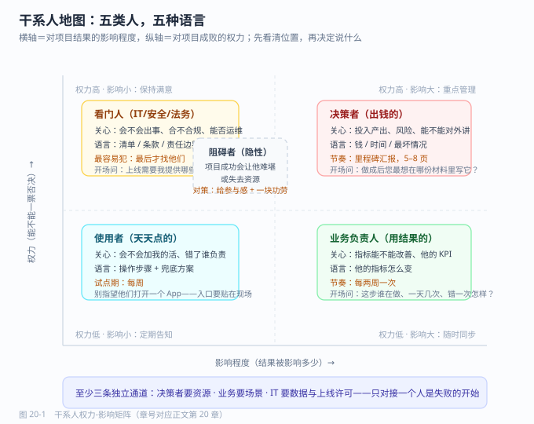

# 第 20 章 项目推进与干系人沟通

> 返回 [全书目录](../00-全书导读与目录.md)。上一篇：[19-POC与交付管理](19-POC与交付管理.md)；下一篇：[21-方案文档写作](21-方案文档写作.md)。

> [!abstract] 本章解决什么问题
> 技术方案没问题，但数据拿不到、业务方不用、领导换人——项目怎么才能活下来？
>
> - 画干系人地图并保持三条独立通道
> - 数据拿不到的七种策略按成本顺序用
> - 用降级三句式把承诺从 100 分落到 70 分
>
> **产出**：一张干系人地图 + 一套汇报与升级机制　|　预计 11 分钟


## 20.1 项目死掉的原因，很少是技术

复盘过一批失败或半途而废的 AI 项目，归因大致是这样一个分布：

| 失败原因 | 占比（经验值） | 典型表现 |
| --- | --- | --- |
| 数据拿不到 / 质量不行 | 30% | 立项三个月，数据仍在「走流程」 |
| 业务方不用 | 25% | 上线了，日活个位数 |
| 决策者换人 / 预算砍掉 | 20% | 新领导有新优先级 |
| 期望错位 | 15% | 「我要的是全自动，你给我一个搜索框」 |
| 技术方案确实不行 | 10% | 效果达不到验收线 |

也就是说，**90% 的失败不发生在技术层**。而 FDE 恰恰是那个「既懂技术又要对结果负责」的角色，所以这一章不是软技能选修，是必修。

> [!important] 一句话立场
> **技术方案决定项目能不能做成，干系人管理决定项目能不能活到做成那天。**

---

## 20.2 干系人地图：五类人，五种语言

任何项目开始时，第一件事不是画架构图，是画这张图。

| 角色 | 关心什么 | 你要给他的语言 | 沟通频率 | 常见误判 |
| --- | --- | --- | --- | --- |
| **决策者**（出钱的） | 投入产出、风险、能不能对外讲 | 钱、时间、风险三句话 | 里程碑 | 以为他关心技术细节 |
| **业务负责人**（用结果的） | 指标能不能改善、他的 KPI | 他的指标怎么变 | 每两周 | 以为他会替你推动 |
| **使用者**（天天点的） | 会不会增加我的工作量、出错谁负责 | 操作步骤、兜底方案 | 每周（试点期） | 以为「好用」是显然的 |
| **IT / 安全 / 法务**（看门人） | 会不会出事、合不合规、能不能运维 | 清单、条款、责任边界 | 关键节点 | 最后才找他们 |
| **阻碍者**（隐性反对） | 项目成功会让他难堪 / 失去资源 | 让他成为参与者，给他一块功劳 | 私下 | 忽视，直到被卡 |

> [!warning] 最容易犯的错
> **只跟「业务负责人」一个人对接。** 这个人往往既没有预算权、也没有数据权、还不能代表使用者。
> 正确做法：**至少三条独立通道**——决策者（要资源）、业务（要场景）、IT（要数据与上线许可）。

### 三条通道各自的开场问题

| 通道 | 你该问的第一句话 |
| --- | --- |
| 决策者 | 「这件事做成之后，您最想在哪份材料里写它？」 |
| 业务负责人 | 「现在这一步谁在做、一天做多少次、错一次会怎样？」 |
| IT / 安全 | 「如果要上线，您这边需要我提供哪些材料？」 |

第三句尤其重要——**提前拿到 IT 的清单，比事后补材料省一个月**。

---



---

## 20.3 让项目活下来：立项与预算的三段话

很多 FDE 技术很强，但项目在立项会上就被砍了，原因是讲不清三件事。这三段话要能背下来：

```text
① 现在的问题值多少钱？
   「客服 40 人，人均日处理 80 单，30% 是重复咨询，
     折算每年约 168 万元人力成本耗在重复问题上。」

② 做完之后能省多少、要花多少？
   「预计覆盖 60% 重复咨询，年省约 100 万元；
     一次性投入 60 万元，年运营 8 万元，回收期约 8 个月。」

③ 最坏情况是什么？
   「若覆盖率只达到 30%，年省 50 万元，回收期约 14 个月，仍在可接受区间。」
```

第三段是**绝大多数方案缺失、也是最能建立信任的一段**。敢讲最坏情况的人，评审会认为你真的算过。

> [!tip] 立项材料的最小集合
> 一页纸（问题 + 价值 + 最坏情况）、一张架构图、一份里程碑表、一份风险清单。
> **不要交 60 页方案**——评审只会看前三页，剩下 57 页反而稀释了重点。

---

## 20.4 数据拿不到怎么办：七种策略按顺序用

这是 FDE 最高频的卡点。按成本从低到高试：

| # | 策略 | 具体做法 | 适用 |
| --- | --- | --- | --- |
| 1 | **换样本** | 先用 20 份能拿到的做 POC，证明价值再要全量 | 默认首选 |
| 2 | **换形态** | 要不到原始库，就要导出文件 / 打印件扫描 | 系统权限受限 |
| 3 | **换范围** | 先做一个部门、一个产品线 | 全域阻力大 |
| 4 | **换责任人** | 让业务负责人出面要，而不是你 | 你级别不够 |
| 5 | **换依据** | 拿合规要求 / 上级文件作为依据 | 有制度抓手 |
| 6 | **换架构** | 数据不出域：把模型部署到数据所在侧 | 安全是硬约束 |
| 7 | **升级** | 走项目周会 / 领导小组 | 前六条都失败 |

> [!warning] 一条纪律
> **永远不要在没有数据的情况下承诺效果。** 「数据到位后两周内给出效果评估」是正确的表述；「效果肯定没问题」会在两周后变成事故。

---

## 20.5 汇报节奏：三种材料，三种颗粒度

| 材料 | 频率 | 长度 | 内容结构 | 给谁 |
| --- | --- | --- | --- | --- |
| **周报** | 每周 | 半页 | 本周完成 / 下周计划 / 阻塞项（要谁做什么） | 业务 + IT |
| **里程碑汇报** | 每 2–4 周 | 5–8 页 | 目标达成度 + 指标数据 + 风险 + 决策请求 | 决策者 |
| **季度复盘** | 每季 | 10 页 | 价值兑现 + 问题 + 下阶段规划 | 决策者 + 财务 |

**周报的写法有个技巧**：把「阻塞项」写成「请求句式」，而不是「问题陈述」。

```text
✗ 差：数据接口一直没开通，进度受影响。
✓ 好：需要 IT 张工在 3 月 15 日前开通工单库只读账号（已提申请单 #1234），
      否则解析环节将顺延 5 个工作日。
```

差别在于：后者有**人、有日期、有后果、有凭据**，抄送给谁都知道该谁动。

---

## 20.6 期望管理：怎么说「不」，怎么降级承诺

FDE 最难的技能不是写代码，是**在客户期待 100 分时，把承诺稳稳落在 70 分并让对方满意**。

### 三句式降级法

```text
① 认可目标：「全自动处理确实是最终形态，我认同这个方向。」
② 给出约束：「以目前的数据质量（30% 是扫描件），全自动的准确率上限在 70% 左右，
             直接全自动会有 30% 的单子出错，退单成本比人工还高。」
③ 给出路径：「本期先做「AI 起草 + 人工确认」，准确率能到 95%，
             等扫描件补录完成后，二期再开全自动。」
```

### 五种必须拒绝的需求（及替代话术）

| 需求 | 为什么必须拒 | 替代说法 |
| --- | --- | --- |
| 「保证 100% 准确」 | 技术上不可能，写进合同就是雷 | 「关键字段准确率 ≥98%，且全部可溯源核对」 |
| 「什么都能问」 | 无边界的知识库必然大量拒答 | 「覆盖 X 类问题，占实际咨询量 80%」 |
| 「下个月上线」 | 数据工程来不及 | 「下月上线试点版（覆盖 1 个部门），全量在 X 月」 |
| 「不用标注就能调好」 | 没有评测集就无法迭代 | 「需要业务方投入 2 人×3 天建 50 题评测集」 |
| 「先免费做个 POC」 | 无边界 POC 必烂尾 | 「6 周定向 POC，验收标准见附件，费用 X」 |

---

## 20.7 冲突与升级：什么时候该把事捅上去

升级（escalation）是工具，不是情绪。用错一次会毁掉关系。

| 该升级 | 不该升级 |
| --- | --- |
| 关键路径被阻塞超过 5 个工作日，且已书面提醒两次 | 对方只是回复慢了一天 |
| 需求变更影响工期/成本，且对方拒绝走变更流程 | 你对某个技术选型有不同意见 |
| 出现合规/安全红线 | 你想让对方领导「压」对方 |
| 承诺的资源未到位，影响里程碑 | 你想显示自己「有背景」 |

**升级的正确姿势**：**先告知，再升级。**

```text
「张经理，这个接口的事我们已经同步过两次（3/2、3/8），
  目前仍阻塞解析环节。按计划这周五需要给客户里程碑报告，
  我会在报告里如实写明阻塞原因与影响。如果您这边有新的时间点，
  请今天告诉我，我调整措辞。」
```

这段话的威力在于：**你给了对方「体面解决」的机会，同时明确告知了后果**。多数情况下对方会立刻动；真不动，你再升级也站得住。

---

## 20.8 干系人变化：换人、换领导、换优先级

项目周期超过 6 个月，几乎一定会遇到这三种变化。

| 变化 | 风险 | 应对动作（48 小时内） |
| --- | --- | --- |
| **对接人换人** | 历史决策全丢，重新扯一遍 | 交一份「决策台账」：已定事项、原因、未决事项 |
| **决策者换人** | 新领导有新优先级，项目被砍 | 30 分钟内讲清「已投入 / 已产出 / 再投多少能收口」 |
| **预算收紧** | 砍二期、砍运维 | 提前准备「最小可运行版」方案，保住核心价值 |

> [!important] 决策台账（很多项目缺这个）
> 一张表：日期 / 决策内容 / 决策人 / 理由 / 影响范围。
> 它有三个用途：换人时交接、验收时对账、扯皮时举证。**成本几乎为零，价值极高。**

---

## 20.9 本章考点速记

> [!success]- 折叠背诵版
> **失败归因**：数据 30%、不用 25%、换人砍预算 20%、期望错位 15%、技术 10% → **90% 不在技术层**。
>
> **五类干系人**：决策者（钱/时间/风险）、业务负责人（他的指标）、使用者（工作量/责任）、看门人（清单/条款/边界）、阻碍者（给参与感）。
> **三条独立通道**：决策者要资源、业务要场景、IT 要数据与上线许可。
>
> **立项三段话**：问题值多少钱 → 能省多少/花多少 → 最坏情况是什么（**第三段最能建立信任**）。
>
> **数据拿不到七策略**：换样本 → 换形态 → 换范围 → 换责任人 → 换依据 → 换架构 → 升级。
> **纪律**：没有数据不承诺效果。
>
> **汇报三材料**：周报（半页，阻塞写成请求句式）、里程碑（5–8 页，带决策请求）、季度复盘。
>
> **降级三句式**：认可目标 → 给出约束 → 给出路径。
> **五种必拒**：100% 准确、什么都能问、下月全量、不用标注、免费 POC。
>
> **升级纪律**：先告知后升级；阻塞 >5 工作日且书面提醒两次才升级。
>
> **决策台账**：日期/内容/决策人/理由/影响范围 —— 换人交接、验收对账、扯皮举证。

---

**上一篇**：[第 19 章 POC 与交付管理](19-POC与交付管理.md)　|　**下一篇**：[第 21 章 方案文档写作](21-方案文档写作.md)
