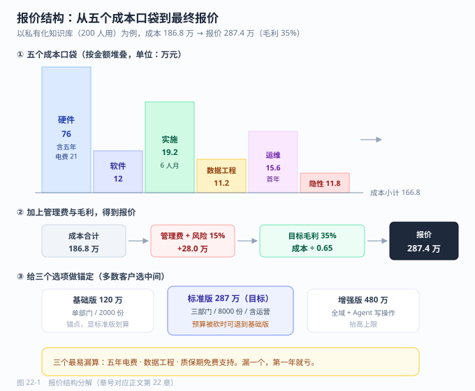

# 第 22 章 商务报价与招投标

> 返回 [全书目录](../00-全书导读与目录.md)。上一篇：[21-方案文档写作](21-方案文档写作.md)；下一篇：[23-工程落地与合规运维](../第六篇-工程与合规/23-工程落地与合规运维.md)。

> [!abstract] 本章解决什么问题
> 方案过了，报价怎么报才不亏？投标怎么不被废标？合同哪几条必须死磕？
>
> - 算清五个成本口袋与五年 TCO
> - 用「云 vs 私有化」拐点（×1.3）判断部署形态
> - 把验收四要素（指标/样本/判定人/整改）写进合同
>
> **产出**：一份不亏的报价单 + 一份过评分表的标书　|　预计 13 分钟


## 22.1 先看清成本：五个口袋，漏一个就亏

AI 项目的成本不是一个数，是五个口袋。报价时只报前两个（很多人只报第一个），是亏损的最主要原因。

| 口袋 | 内容 | 占比（经验值） | 常见漏算 |
| --- | --- | --- | --- |
| **① 硬件 / 算力** | GPU 服务器、存储、网络、机柜电费 | 30–45% | 只算 GPU 不算存储与网络；不算五年电费 |
| **② 软件许可** | 模型商业授权、向量库、中间件、平台 | 5–15% | 开源组件的商业版；模型商用许可 |
| **③ 实施人力** | 需求、数据工程、开发、测试、部署 | 25–40% | 数据工程被严重低估（常占实施 40%） |
| **④ 运维与运营** | 值守、更新、知识库运营、模型升级 | 10–20%（年） | 只报首年，五年 TCO 少算 4 年 |
| **⑤ 隐性成本** | 培训、文档、驻场差旅、验收返工、质保期支持 | 5–15% | 质保期内的免费支持没算人力 |

### 一个完整的 TCO 算例（私有化知识库，200 人用）

| 项 | 计算 | 金额（万元） |
| --- | --- | --- |
| GPU 服务器（1 台 8 卡 24G 级） | 单价 | 68 |
| 存储与备份（20 TB） | 单价 | 8 |
| 五年电费与机柜 | 6 kW × 24 h × 365 × 5 × 0.8 元/度 ≈ 21 | 21 |
| 软件许可（向量库商业版 + 平台） | 3 年订阅 | 12 |
| 实施人力 | 6 人月 × 3.2 万 | 19.2 |
| 数据工程（8000 份文档解析、清洗、抽检） | 4 人月 × 2.8 万 | 11.2 |
| 首年运维 | 0.5 人 × 12 月 × 2.6 万 | 15.6 |
| 培训与文档 | 一次性 | 4 |
| 质保期支持（1 年，含在实施内） | 0.3 人年 | 7.8 |
| **小计** | | **166.8** |
| 管理费与风险准备金（12%） | | 20.0 |
| **成本合计** | | **186.8** |
| 报价（毛利率 35%） | 成本 ÷ (1 − 0.35) | **287.4** |

> [!warning] 三个最容易被漏掉的数
> ① **五年电费**：一台 8 卡服务器 6 kW，五年电费 21 万元，比很多软件许可都贵。
> ② **数据工程**：客户说「文档都在共享盘里」，实际是 8000 份混杂 PDF，解析+抽检要 4 人月。
> ③ **质保期支持**：合同写「免费质保一年」，这一年的人力必须摊进报价，否则第一年就亏。

### 公有云 vs 私有化的成本拐点

```text
年 API/云成本 = 日均调用次数 × 365 × 单次成本
私有化年成本 = 硬件折旧（5 年直线）+ 年运维人力 + 电费
拐点：年云成本 > 私有化年成本 × 1.3 时，转私有化更划算
```

乘 1.3 的理由：私有化有隐性成本（升级、故障、扩容不灵活），需要 30% 的溢价才值得换。

**算例**：日均 5000 次问答，单次 0.06 元 → 年云成本 10.95 万元。私有化年成本 = 76 万/5 + 15.6 + 4.2 ≈ 35 万元。10.95 < 35 × 1.3 = 45.5 → **继续用云**。
若日均涨到 20000 次 → 年云成本 43.8 万元，接近拐点；涨到 30000 次（65.7 万）→ **应转私有化**。

> [!tip] 这张算例在方案里的价值
> 客户问「为什么不用公有云，便宜啊」时，你能当场给出拐点次数，这比任何形容词都有说服力。**算例是售前最硬的武器。**

---



---

## 22.2 三种商业模式：选错模式比报错价更致命

| 模式 | 计价方式 | 客户感受 | 你的风险 | 适用 |
| --- | --- | --- | --- | --- |
| **项目制**（一次性交付） | 按人月 + 硬件打包 | 「一次买断，心里有底」 | 需求蔓延吃掉毛利 | 政企、内网、一次性建设 |
| **订阅制**（SaaS / 年费） | 按账号 / 按年 | 「先用起来，压力小」 | 客户流失、续费难 | 标准化产品、中小企业 |
| **按量计费**（Token / 次数） | 用多少付多少 | 「不用不花钱」 | 收入不可预测、客户不敢用 | 平台型、开发者工具 |
| **混合**（建设费 + 年服务费） | 一次性 + 15–25%/年 | 「有人管，放心」 | 服务费收不上来 | **推荐默认** |

> [!important] 一条定价经验
> **AI 项目尽量做「建设费 + 年运营费」的混合模式。**
> 因为 AI 系统不是交付完就结束——知识库要更新、模型要升级、效果会衰减。只收建设费的 project 会在第二年变成「免费无限支持」，最终双方都不满意。

---

## 22.3 报价单怎么拆：让客户看得懂，也让自己不亏

一份合格的报价单不是一行总价，而是六段结构：

| 段 | 内容 | 作用 |
| --- | --- | --- |
| 1 硬件与基础软件 | 服务器、存储、网络、OS、数据库 | 客户可比价（透明段） |
| 2 AI 平台与许可 | 模型授权、向量库、编排平台 | 体现技术含量 |
| 3 实施服务 | 按阶段列人月（需求/数据/开发/测试/上线） | 让客户看到工作量 |
| 4 数据工程 | 按文档量/页数计价 | 单独列出，避免被当成「顺手做」 |
| 5 培训与文档 | 场次、人数、交付物 | 低成本高感知 |
| 6 运维与质保 | 首年含、次年起年费 | 为后续收入铺路 |

**两个报价技巧**：

- **透明段与价值段分开**：硬件是透明段（客户一定会比价），实施与数据是价值段（客户比不了）。把毛利放在价值段，客户更容易接受。
- **给三个选项**：基础版 / 标准版 / 增强版。多数客户会选中间那个——这叫锚定，且能让你在预算被砍时仍有成交可能。

| 版本 | 覆盖 | 报价 | 设计意图 |
| --- | --- | --- | --- |
| 基础版 | 单部门、2000 份文档 | 120 万 | 锚点，显得标准版划算 |
| **标准版** | 三部门、8000 份、含运营 | **287 万** | **目标成交** |
| 增强版 | 全域、含 Agent 写操作 | 480 万 | 抬高上限，衬托标准版 |

---

## 22.4 定价的三种逻辑，以及什么时候用哪种

| 逻辑 | 做法 | 优点 | 缺点 | 何时用 |
| --- | --- | --- | --- | --- |
| **成本加成** | 成本 × (1 + 毛利率) | 不亏、易解释 | 客户不认「你的成本关我什么事」 | 政府/国企招标、硬件为主 |
| **价值定价** | 按客户收益的 10–20% 定价 | 毛利高 | 需要能量化收益 | 收益清晰（客服、审单） |
| **竞争定价** | 参照竞品报价 | 易中标 | 容易陷价格战 | 同质化竞争、多家投标 |

**价值定价的算例**：客户年省 168 万元，按 15% 取价 → 25 万元/年服务费。这个数字客户能算明白，也愿意付。但如果客户年省只有 30 万，按价值定价只能报 4.5 万——**这时候说明项目价值不够，应该劝客户先做小场景，而不是硬报低价**。

> [!warning] 报价的三个禁忌
> ① **不要先报最低价再往上加**——加不上去，且失去信任。
> ② **不要在没算清数据工程量前报总价**——数据是最容易翻倍的部分。
> ③ **不要承诺「效果不达标退款」**——效果依赖客户配合（数据、标注、推广），你无法单方面控制。

---

## 22.5 招投标：先看能不能投，再谈怎么写

### 第一步：资格性审查（决定「能不能投」）

| 项 | 常见要求 | 应对 |
| --- | --- | --- |
| 营业执照 / 经营范围 | 含软件开发、信息技术服务 | 提前核对 |
| 类似业绩 | 近 3 年 N 个同类合同 | 提前储备案例与合同复印件 |
| 财务指标 | 近 3 年无亏损、营收规模 | 用母公司或联合体 |
| 资质证书 | CMMI、ISO 27001、双软 | 提前办，周期长 |
| 信用记录 | 无失信、无重大违法 | 自查信用中国 |
| 授权 | 原厂授权书（用第三方模型/软件时） | 提前找原厂开 |

> [!warning] 废标陷阱（每年都有人栽）
> 缺一个签字、少一个章、密封袋没盖章、投标函金额大小写不一致、技术参数负偏离未声明、电子标书格式不符——**这些与方案质量无关，但直接废标**。
> 做法：做一张「废标检查清单」，投标前由**非编写人**逐项打勾。

> [!tip] 12 项废标自查
> 逐项打勾版见 [44-附录E-交付检查清单总汇](../附录/44-附录E-交付检查清单总汇.md) 的 44.10，最后一项是「由非编写人复核」——这一项能挡掉 80% 的形式性废标。

### 第二步：评分办法（决定「怎么写」）

典型技术标评分结构（不同项目差异大，以招标文件为准）：

| 评分项 | 分值量级 | 拿分要点 |
| --- | --- | --- |
| 技术方案完整性 | 15–25 | 逐条响应招标参数，不遗漏 |
| 架构与安全性 | 10–20 | 给架构图、给安全清单 |
| 实施与项目管理 | 10–15 | 给排期、给团队、给方法论 |
| 类似业绩 | 10–20 | 合同复印件 + 验收证明 |
| 团队资质 | 5–10 | 项目经理证书、AI 相关资质 |
| 演示 / POC | 10–20 | **实机演示最能拉开差距** |
| 报价 | 20–40 | 低价不必然高分，看评分公式 |

### 第三步：技术偏离表（最容易丢分也最容易得分）

招标文件里每条参数都要逐条响应，格式固定：

| 序号 | 招标要求 | 响应情况 | 偏离 | 说明 |
| --- | --- | --- | --- | --- |
| 3.2.1 | 支持国产化 CPU 与 OS | 完全响应 | 无偏离 | 已在鲲鹏 + 麒麟环境完成适配 |
| 3.2.5 | 单机并发 ≥100 | 完全响应 | 无偏离 | 实测 120 并发，P95 延迟 4.2 s |
| 3.2.9 | 支持 10 种以上文档格式 | 优于 | 正偏离 | 支持 14 种，含 OFD |

> [!tip] 正偏离的写法
> 不要写「我们支持更多」这种模糊话。写「**优于：支持 14 种，含 OFD，实测见附件**」。
> 评委在有限时间里只会看「无偏离/正偏离」两列和说明里的数字，**数字是唯一能被记住的东西**。

---

## 22.6 合同六条款：这六条不看，后面一定吵

| 条款 | 关键点 | 该写什么 | 不该写什么 |
| --- | --- | --- | --- |
| **验收标准** | 最核心 | 可量化指标 + 样本量 + 测试方法 + 数据来源 | 「效果满足甲方要求」 |
| **付款节点** | 现金流 | 3:4:2:1（预付/上线/初验/质保） | 验收后一次性付 |
| **知识产权** | 归属与授权 | 定制部分归甲方，通用组件/预训练模型授权使用 | 「全部知识产权归甲方」（会把你的底座送掉） |
| **数据权属与安全** | 合规 | 数据归甲方，乙方仅受托处理，不得留存/训练 | 模糊处理 |
| **违约责任** | 上限 | 违约金总额不超过合同额 5–10% | 无上限 |
| **退出与交接** | 兜底 | 终止时的数据导出、文档移交、过渡期支持 | 不写 |

> [!warning] 验收标准是唯一必须死磕的条款
> 「准确率 ≥90%」这种写法必吵：测什么题？谁出题？谁判定？达不到怎么办？
> 正确写法示例：
> 「以双方共同确认的 100 题测试集为基准，由甲方业务专家判定，答案命中预设要点即计为正确；准确率 ≥85% 视为通过。首次未通过，乙方有 15 个工作日整改，整改后复测一次；复测仍未通过，双方协商扣减合同金额或终止。」
> **这段话把「指标、样本、判定人、整改机制」四件事都定死了，吵架的空间就没了。**

---

## 22.7 五个真实亏损陷阱

| 陷阱 | 场景 | 损失量级 | 避免方法 |
| --- | --- | --- | --- |
| **需求蔓延** | 「顺便再加个功能」×10 次 | 20–50% 毛利 | 变更单制度（见 19.5） |
| **数据黑洞** | 文档质量极差，反复返工 | 1–2 人月 | 数据工程单列报价，按页计价 |
| **免费运维** | 质保期内无限次上门 | 10–20 万/年 | 质保范围写清（远程/现场次数） |
| **硬件涨价** | 签合同时未锁价 | 5–15% | 硬件单独报价，注明有效期 30 天 |
| **模型涨价/下线** | 依赖单一 API | 不可控 | 混合架构 + 合同约定价格调整机制 |

---

## 22.8 本章考点速记

> [!success]- 折叠背诵版
> **五个成本口袋**：硬件 30–45%、软件 5–15%、实施 25–40%、运维 10–20%/年、隐性 5–15%。
> **三个最易漏**：五年电费、数据工程、质保期支持。
>
> **成本拐点**：年云成本 > 私有化年成本 × **1.3** → 转私有化（1.3 是隐性成本溢价）。
>
> **三种模式**：项目制、订阅制、按量计费。**推荐混合：建设费 + 年运营费 15–25%。**
>
> **报价六段**：硬件 / 平台许可 / 实施 / 数据工程 / 培训 / 运维质保。**硬件透明段，实施数据是价值段。**
> **三选项锚定**：基础 / 标准（目标）/ 增强。
>
> **三种定价**：成本加成（招标）、价值定价（收益的 10–20%）、竞争定价。
> **三禁忌**：先报低价再加、没算数据工程量就报总价、承诺效果不达标退款。
>
> **招投标两步**：资格性审查（能不能投）→ 评分办法（怎么写）。**废标陷阱清单由非编写人核对。**
> **偏离表**：只写「无偏离/正偏离 + 数字」，不写形容词。
>
> **合同六条款**：验收标准、付款节点、知识产权、数据权属、违约责任上限、退出交接。
> **验收标准四要素**：指标 + 样本 + 判定人 + 整改机制。

---

**上一篇**：[第 21 章 方案文档写作](21-方案文档写作.md)　|　**下一篇**：[第 23 章 工程落地与合规运维](../第六篇-工程与合规/23-工程落地与合规运维.md)
