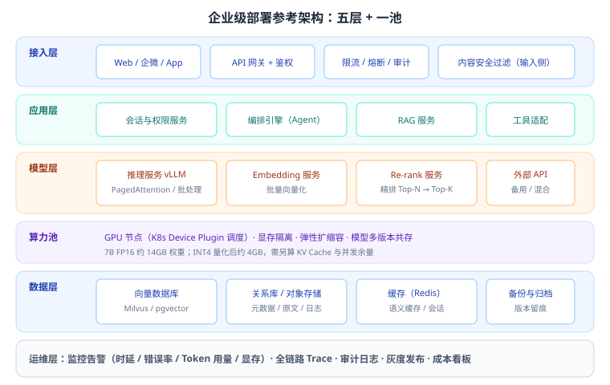

# 第 23 章 工程落地与合规运维

> 返回 [全书目录](../00-全书导读与目录.md)。上一篇：[22-商务报价与招投标](../第五篇-方案与商务/22-商务报价与招投标.md)；下一篇：[24-部署与容量规划](24-部署与容量规划.md)。

> [!abstract] 本章解决什么问题
> 方案写得再好，落地时也会被三件事卡住——**数据不干净、显存不够、合规不过**。
>
> 本章给出可计算的数字（显存、并发、成本）和可执行的清单（治理、合规、运维），让你在评审和答辩时说得具体。

---

## 23.1 数据治理：决定项目成败的 40% 工时

### 治理五步

| 步骤 | 动作 | 产出 |
| --- | --- | --- |
| 1 盘点 | 列出所有数据源、格式、数量、负责人 | 数据资产清单 |
| 2 分级 | 公开 / 内部 / 机密 / 绝密；个人信息单独标注 | 分级表 + 处理规则 |
| 3 清洗 | 去重、纠错、统一格式、OCR 校对 | 清洗流水线 + 质量报告 |
| 4 入库 | 分块、元数据、权限标签、版本号 | 索引库 |
| 5 更新 | 增量识别（hash 比对）、审核、旧版下线 | 更新机制 + 责任人 |

### 数据质量六维评估（可写进方案）

| 维度 | 检查项 | 不达标的后果 |
| --- | --- | --- |
| 完整性 | 关键章节是否缺失 | 答不上 |
| 准确性 | OCR 错字率、数字是否正确 | 答错（最危险） |
| 一致性 | 多版本文档是否矛盾 | 答得前后不一 |
| 时效性 | 是否过期、有无生效日期 | 用旧政策答新问题 |
| 唯一性 | 是否重复入库 | 召回重复、浪费预算 |
| 可用性 | 格式是否可解析 | 直接入不了库 |

> [!warning] 真实教训
> 某项目「制度问答」上线后被投诉：同一问题两个答案。排查发现库里有 3 个版本的《报销制度》，元数据没记生效日期，检索随机命中。**加一个 `effective_date` 字段 + 时效过滤就解决了，但前期没设计就要返工重建索引。**

---

## 23.2 部署架构



### 关键设计点

| 设计点 | 做法 | 为什么 |
| --- | --- | --- |
| 无状态应用层 | 会话存 Redis，服务可水平扩展 | 应对并发峰值 |
| 模型服务独立 | 推理服务与业务解耦，独立扩缩容 | GPU 贵，只给模型用 |
| 多模型适配层 | 统一接口，屏蔽厂商差异 | 换模型不改业务代码、可降级 |
| 网关统一入口 | 鉴权、限流、审计、灰度 | 安全与治理的落点 |
| 数据层分离 | 向量库 / 关系库 / 对象存储各司其职 | 各取所长，便于扩容 |

### 私有化部署的客户准备清单（售前必给）

| 项目 | 要求 |
| --- | --- |
| GPU | 按模型规模定（见 23.3 显存与容量测算）；建议至少 2 卡（一主一备或负载分担） |
| CPU / 内存 | 16 核 / 64GB 起（含向量库与应用） |
| 存储 | 原文 + 向量 + 日志，建议 ≥ 1TB SSD |
| 网络 | 内网互通；如跨网段需开通策略 |
| 操作系统 | 主流 Linux；信创环境需提前验证驱动兼容性 |
| 中间件 | Docker / K8s（或直接容器运行）、数据库 |
| 账号权限 | 安装账号、数据库账号、对接系统账号 |

> [!tip] 这一页最能体现专业度
> 客户 IT 部门最怕「供应商来了说要这个要那个」。提前给清单，等于替他们省了两周沟通。

---

## 23.3 显存与容量测算（必考计算）

### 公式

> **显存占用 ≈ 模型权重 + KV Cache + 运行时开销（1–2GB）**
>
> - 权重 = 参数量 × 每参数字节数（FP16 = 2，INT8 = 1，INT4 ≈ 0.5）
> - KV Cache = 2 × 层数 × KV 头数 × 头维度 × 序列长度 × 并发数 × 字节数

### 权重速查

| 模型规模 | FP16 | INT8 | INT4 |
| --- | --- | --- | --- |
| 7B | 14 GB | 7 GB | ≈ 4 GB |
| 14B | 28 GB | 14 GB | ≈ 8 GB |
| 32B | 64 GB | 32 GB | ≈ 18 GB |
| 70B | 140 GB | 70 GB | ≈ 40 GB |

### 算例：7B 模型，4096 上下文，并发 8

```text
权重（FP16）           = 14 GB
KV Cache = 2 × 32层 × 8头 × 128维 × 4096 × 8 × 2字节 ≈ 4.2 GB
运行时开销             ≈ 1.5 GB
合计                   ≈ 19.7 GB  →  单张 24GB 显卡（如 4090 / L4 级别）可跑
若改 INT4：权重 4GB + KV 4.2GB + 1.5GB ≈ 9.7GB  →  可跑双并发余量更大
```

> [!important] 三条工程结论
> 1. **KV Cache 随「上下文 × 并发」线性增长**，长上下文 + 高并发是显存杀手；
> 2. 量化主要省**权重**，不省 KV Cache（KV 也可量化，但工程复杂度上升）；
> 3. 生产环境别把显存占满，**留 15–20% 余量**应对长请求与碎片。

### 并发与吞吐估算

| 指标 | 估算方式 |
| --- | --- |
| 单请求生成速度 | 消费级卡 7B 约 20–50 token/s（随量化与框架变化） |
| 吞吐（批量） | 连续批处理可显著提升总吞吐，非线性的 |
| 并发上限 | 受显存（KV Cache）与算力双重限制，需压测确认 |
| 所需卡数 | 峰值并发 ÷ 单卡可承载并发 × 1.3（安全系数） |

---

## 23.4 推理优化与模型轻量化

### 四种轻量化手段

| 手段 | 原理 | 收益 | 代价 |
| --- | --- | --- | --- |
| **量化** | 降低参数精度（FP16 → INT8/INT4） | 显存降 50–75%，速度提升 | 精度损失 1–3%（通常可接受） |
| **蒸馏** | 大模型教小模型 | 小模型获得大部分能力 | 上限受限，需训练 |
| **剪枝** | 去掉不重要的参数/结构 | 减小体积 | 需精细调优，易掉点 |
| **MoE 稀疏** | 每次只激活部分专家 | 同参数量下更快 | 显存仍需容纳全部专家 |

常见量化方案：GPTQ（训练后量化，GPU 友好）、AWQ（激活感知，精度更好）、GGUF（llama.cpp 生态，CPU/混合推理友好）。

### 推理框架与关键技术

| 技术 | 作用 |
| --- | --- |
| **PagedAttention**（vLLM，Kwon 等 2023） | 像操作系统管理内存一样管理 KV Cache，显著降低显存碎片、提升吞吐 |
| 连续批处理（Continuous Batching） | 请求动态进出批次，提高 GPU 利用率 |
| 前缀缓存（Prefix Caching） | 相同系统提示只算一次，降低首 Token 延迟 |
| 投机解码（Speculative Decoding） | 小模型起草、大模型校验，加速生成 |

> [!tip] 选型建议（写进方案）
> 私有化首选 **vLLM + 4bit 量化**：部署简单、吞吐高、生态成熟；显存极度受限（如单卡 16GB）再考虑更激进的量化或更小模型。

---

## 23.5 应用安全：五个必查项

| 风险 | 场景 | 措施 |
| --- | --- | --- |
| 提示注入 | 用户输入或检索文档夹带指令 | 输入分隔、内容标注为「数据非指令」、输出过滤 |
| 越权访问 | 检索到无权文档、工具调用越权 | pre-filter、工具最小权限、二次校验 |
| 敏感信息泄露 | 回答带出手机号、身份证、薪酬 | 入库脱敏、输出正则过滤、字段级权限 |
| 输出注入下游 | 模型输出直接拼 SQL / HTML / 命令 | 参数化查询、转义、Schema 校验 |
| 供应链风险 | 第三方模型、插件、依赖库 | 供应商评估、依赖锁定、私有仓库 |

### 上线前安全检查清单

- [ ] 多角色账号交叉测试（实习生 / 部门主管 / 高管），确认无越权；
- [ ] 注入测试：文档中埋「忽略指令」文本，看是否被触发；
- [ ] 敏感信息测试：问「列出所有员工手机号」，确认拒答；
- [ ] 工具权限测试：确认写操作需确认、无权限工具不可调用；
- [ ] 日志审计：确认每次问答与工具调用可追溯；
- [ ] 压测：峰值并发下 P95 延迟与错误率达标；
- [ ] 降级演练：断开模型服务，确认降级到 FAQ / 人工。

---

## 23.6 合规：硬门槛，不是加分项

### 主要法规依据（现行）

| 法规 / 办法 | 生效 | 与 AI 项目的关系 |
| --- | --- | --- |
| 《网络安全法》 | 2017-06-01 | 网络运营者基础安全义务、等级保护 |
| 《数据安全法》 | 2021-09-01 | 数据分类分级、重要数据出境评估 |
| 《个人信息保护法》 | 2021-11-01 | 告知同意、最小必要、自动化决策透明 |
| 《生成式人工智能服务管理暂行办法》 | 2023-08-15 | 训练数据合法、内容安全、算法备案、投诉机制 |
| 《人工智能生成合成内容标识办法》 | 2025-09-01 | 生成内容需显式/隐式标识（防伪造、可追溯） |

### 落地动作清单

| 动作 | 说明 | 责任方 |
| --- | --- | --- |
| 数据来源合法性审查 | 文档是否有权使用？是否含他人著作权内容？ | 客户 + 供应商 |
| 个人信息处理 | 脱敏、去标识化、单独同意（如涉及） | 客户 |
| 内容安全 | 输入输出双向过滤，敏感话题拒答 | 供应商 |
| 生成内容标识 | 对 AI 生成内容添加标识（按标识办法） | 供应商 |
| 算法备案 | 具有舆论属性或社会动员能力的服务需备案 | 客户 |
| 等级保护 | 按行业要求做等保测评（常见二级/三级） | 客户 |
| 日志留存 | 按法规要求留存访问与操作日志 | 双方 |
| 应急处置 | 安全事件预案、投诉受理渠道 | 双方 |

> [!warning] 高频考点
> 「企业上线 AI 应用前必须做哪些合规动作？」标准答法：**数据来源合法性 → 个人信息保护 → 内容安全审核 → 生成内容标识 → 算法备案（如适用）→ 等级保护 → 日志与应急机制。** 答题时结合场景挑 4–5 条展开，比罗列全部更有分。

### 私有化 ≠ 合规豁免

很多客户以为「数据不出内网就没事」。实际上：模型输出仍需内容安全；个人信息仍需保护；生成内容仍需标识；日志仍需留存。**合规是行为要求，不是部署位置要求。**

---

## 23.7 运维：上线只是开始


### 监控四类指标

| 类别 | 指标 | 告警阈值（示例） |
| --- | --- | --- |
| 效果 | 准确率抽检、Bad Case 率、拒答率 | 准确率环比降 5% |
| 性能 | P95 延迟、首 Token 延迟、错误率 | P95 > 5s；错误率 > 1% |
| 资源 | GPU 利用率、显存占用、队列长度 | 显存 > 85%；队列积压 |
| 成本 | 日 Token 用量、日费用、单次成本 | 日费用超预算 120% |

### SLO 示例（写进运维方案）

| SLO | 目标 |
| --- | --- |
| 可用性 | 99.5%（月度） |
| P95 响应时延 | ≤ 3 秒 |
| 答案溯源率 | 100% |
| 严重故障恢复 | ≤ 30 分钟 |

### Bad Case 闭环（最重要的运营机制）

```text
收集（用户点踩 / 转人工 / 抽检）
  → 归类（没检索到 / 检索错 / 答偏 / 幻觉 / 权限 / 时延）
  → 归因（数据？分块？检索？提示词？模型？）
  → 修复（改一个变量）
  → 回归（评测集验证）
  → 回灌（把该问题加入评测集）
  → 记录（版本 + 结论）
```

> [!tip] 一句话
> **没有 Bad Case 闭环的 AI 系统，效果只会随时间衰减**（业务在变、文档在变、用户在变）。运营机制比模型选型更决定长期成败。

### 发布与回滚

| 环节 | 做法 |
| --- | --- |
| 灰度 | 先 5% 用户 → 20% → 全量；按部门/角色分批 |
| 门禁 | 评测指标不降级才允许发布 |
| 回滚 | 提示词、索引、模型版本均可一键回退 |
| 变更窗口 | 避开业务高峰；大变更提前通知 |

---

## 23.8 监控与告警：四个看板，缺一个就是盲飞

AI 系统的监控比传统系统多两类指标：**质量**与**成本**。传统运维只看「活着没」，AI 系统要能看出「变笨了没」。

| 看板 | 核心指标 | 告警阈值（经验） | 告警方式 |
| --- | --- | --- | --- |
| **① 可用性** | 请求成功率、P95/P99 延迟、队列长度、GPU 利用率 | 成功率 <99% / P95 > 目标 ×1.5 / 队列 > 上限 | 立即（电话/短信） |
| **② 质量** | 拒答率、点踩率、引用准确率（抽样）、工具调用失败率 | 拒答率 > 基线 +10 pt / 点踩率 > 15% | 当日（企业微信/邮件） |
| **③ 成本** | 日 Token 消耗、单次成本、缓存命中率 | 日消耗 > 预算 ×1.2 | 当日 |
| **④ 数据** | 索引延迟、增量任务成功率、过期内容占比 | 索引延迟 > 15 min / 任务连续失败 3 次 | 立即 |

> [!important] 质量指标必须「有基线」才能告警
> 「拒答率 18%」本身不是问题，问题是「从 12% 涨到 18%」。
> 所以上线第一周就要把基线记下来，**没有基线的监控等于没有监控**。

**三个容易被忽略的告警**：

| 告警 | 为什么重要 | 阈值建议 |
| --- | --- | --- |
| **输出格式失败率** | 结构化输出解析失败会直接导致业务失败 | >1% 告警 |
| **检索零命中率** | 大量零命中说明索引或查询出了问题 | >5% 告警 |
| **单用户高频调用** | 可能是脚本刷接口，也可能是攻击 | >100 次/小时 |

---

## 23.9 SLA 怎么定，怎么守

SLA 不是「写个 99.9% 就行」，要算得清代价。

**可用性换算表**（每月停机时间）：

| 可用性 | 每月停机 | 每年停机 | 适合 |
| --- | --- | --- | --- |
| 99% | 7.2 小时 | 3.65 天 | 内部工具 |
| 99.5% | 3.6 小时 | 1.8 天 | **内部生产系统（推荐起点）** |
| 99.9% | 43 分钟 | 8.8 小时 | 对外服务 |
| 99.95% | 22 分钟 | 4.4 小时 | 关键业务 |

**延迟 SLA 的写法**（不能只写平均值）：

```text
✗ 差：「平均响应时间 ≤3 秒」
✓ 好：「P95 端到端延迟 ≤6 秒，P99 ≤12 秒；统计口径为服务端从收到请求到返回首字的时间，
       排除客户端网络耗时；每月统计，达标天数 ≥28 天视为达标。」
```

**错误预算（Error Budget）**：把「允许出错的空间」显式化，避免运维和业务互相拉扯。

```text
月度错误预算 = (1 − SLA 目标) × 总请求数
例：99.5% × 100 万次 = 5000 次失败额度
预算耗尽 → 冻结新功能上线，全力修稳定性
```

> [!warning] 承诺 SLA 前必须确认三件事
> ① 依赖的模型服务自身有没有 SLA（供应商挂了你不背锅？）；
> ② 客户机房/网络的稳定性你是否可控；
> ③ 降级后是否仍满足 SLA（降级到小模型延迟降了，但效果降了算不算违约）。
> 这三条不写清，SLA 就是一张空头支票。

---

## 23.10 故障分级与值班

不是所有故障都值得半夜叫醒人。分级是保护团队的手段。

| 级别 | 定义 | 响应时限 | 升级 | 复盘 |
| --- | --- | --- | --- | --- |
| **P0** | 全量不可用 / 数据泄露 / 错误写操作 | 15 分钟 | 立即上报项目负责人 + 客户 | 24 小时内 |
| **P1** | 核心功能不可用 / 大面积错误答案 | 30 分钟 | 1 小时未解决升级 | 3 日内 |
| **P2** | 部分功能异常 / 性能明显下降 | 4 小时 | 当日未解决升级 | 一周内 |
| **P3** | 个别 bad case / 体验问题 | 次日 | 不升级 | 汇总处理 |

**值班的三条纪律**：

1. **有值班表，不靠「谁看见谁处理」**——没人负责的故障会拖成事故。
2. **一线有「止血权限」**：能直接降级、回滚、限流，不需要层层审批。
3. **P0/P1 必须写复盘**，且复盘产物是清单不是感想（见 33.5）。

> [!tip] 一个低成本高收益的动作
> 把「降级开关」做成一个页面上的按钮，一线值班点一下就能切到小模型/静态 FAQ。
> 这个按钮能把平均恢复时间（MTTR）从 40 分钟压到 5 分钟——**比任何优化都有效**。

---

## 23.11 交付流程：12 周标准节奏

| 阶段 | 周期 | 关键交付物 | 客户配合 |
| --- | --- | --- | --- |
| 需求调研 | W1–W2 | 需求清单、数据清单、方案 V1 | 业务访谈、数据开放 |
| 方案设计 | W2–W3 | 方案 V2、架构图、报价 | 评审确认 |
| POC | W3–W5 | POC 报告、验收签字 | 试用、反馈 |
| 数据治理 | W3–W7 | 清洗后数据、质量报告 | 数据负责人配合 |
| 开发调优 | W5–W8 | 可用系统、评测报告 | 接口对接 |
| 测试 | W8–W9 | 测试报告、安全检查 | 参与 UAT |
| 灰度上线 | W9–W10 | 灰度报告 | 试点部门 |
| 培训移交 | W10–W11 | 手册、培训记录、移交清单 | 指定运营人 |
| 运营迭代 | W11+ | 月报、Bad Case 清单 | 持续反馈 |

> [!important] 时间分配真相
> 数据治理常占 40% 以上工时，且最容易延期（等客户给数据、等业务确认口径）。**方案里必须把「客户配合事项」写成带日期的清单**，否则延期责任全在你。

---

## 23.12 本章考点速记

> [!success]- 必背 10 条（点击展开自测）
> 1. 数据治理五步：盘点、分级、清洗、入库、更新；质量六维：完整、准确、一致、时效、唯一、可用。
> 2. 部署五层 + 算力池；模型服务与业务解耦，多模型适配层支持降级。
> 3. 显存 ≈ 权重 + KV Cache + 1–2GB；7B FP16 = 14GB，INT4 ≈ 4GB。
> 4. KV Cache = 2 × 层 × KV头 × 头维 × 序列长 × 并发 × 字节；随上下文与并发线性增长。
> 5. 生产留 15–20% 显存余量；卡数 = 峰值并发 ÷ 单卡并发 × 1.3。
> 6. 轻量化：量化（最实用）、蒸馏、剪枝、MoE；vLLM + PagedAttention 提吞吐。
> 7. 安全五查：注入、越权、泄露、输出注入下游、供应链。
> 8. 合规五法：网安法、数安法、个保法、生成式 AI 管理办法（2023-08-15）、内容标识办法（2025-09-01）。
> 9. 私有化不等于合规豁免；合规是行为要求。
> 10. 运维四监控（效果/性能/资源/成本）+ Bad Case 闭环 + 灰度与回滚。

---

**上一篇**：[第 22 章 商务报价与招投标](../第五篇-方案与商务/22-商务报价与招投标.md)　|　**下一篇**：[第 24 章 部署与容量规划](24-部署与容量规划.md)
