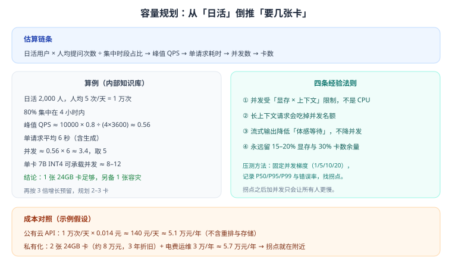

# 第 24 章 部署与容量规划

> 返回 [全书目录](../00-全书导读与目录.md)。上一篇：[23-工程落地与合规运维](23-工程落地与合规运维.md)；下一篇：[25-安全与合规体系](25-安全与合规体系.md)。

>
> [!abstract] 本章解决什么问题
> 客户问「要买什么机器」「能扛多少人同时用」「为什么这么慢」，你要能当场算出来。
> 本章给公式、给算例、给压测方法，避免「先买最贵的」这种糊弄式回答。

---

## 24.1 从业务量倒推硬件



```text
日活用户 × 人均提问次数 ÷ 集中时段占比 → 峰值 QPS
峰值 QPS × 单请求耗时 → 并发数
并发数 ÷ 单卡可承载并发 × 1.3（安全系数）→ 卡数
```

### 完整算例

```text
条件：日活 2000 人，人均 5 次/天，80% 集中在 4 小时，单请求平均 6 秒
日请求 = 2000 × 5 = 10,000 次
峰值 QPS = 10,000 × 0.8 ÷ (4 × 3600) ≈ 0.56
并发 = 0.56 × 6 ≈ 3.4，取 5
7B INT4 单卡可承载并发 ≈ 8–12（视上下文长度）
所需卡数 = 5 ÷ 10 × 1.3 ≈ 0.65 → 取 1，另备 1 张容灾
结论：2 张 24GB 卡
```

> [!important] 三个关键变量
> 1. **集中时段占比**：企业应用通常 70–85% 的请求集中在 4 小时内；
> 2. **单请求耗时**：包含检索、重排、生成，通常 3–8 秒；
> 3. **单卡并发**：受显存（KV Cache）与算力双重限制，必须实测。

---

## 24.2 显存计算（复习 + 扩展）

```text
显存 ≈ 权重 + KV Cache + 运行时开销（1–2GB）

权重 = 参数量 × 每参数字节（FP16=2, INT8=1, INT4≈0.5）
KV Cache = 2 × 层数 × KV头数 × 头维度 × 序列长度 × 并发 × 字节
```

| 模型 | FP16 | INT8 | INT4 |
| --- | --- | --- | --- |
| 7B | 14 GB | 7 GB | ≈ 4 GB |
| 14B | 28 GB | 14 GB | ≈ 8 GB |
| 32B | 64 GB | 32 GB | ≈ 18 GB |
| 70B | 140 GB | 70 GB | ≈ 40 GB |

### 算例：7B / 4096 上下文 / 并发 8

```text
权重（FP16）           = 14 GB
KV Cache = 2 × 32 × 8 × 128 × 4096 × 8 × 2B ≈ 4.2 GB
运行时开销             ≈ 1.5 GB
合计 ≈ 19.7 GB → 单张 24GB 卡可跑
若 INT4：4 + 4.2 + 1.5 ≈ 9.7 GB → 余量充足
```

> [!warning] 常见误判
> 「14GB 的卡能跑 7B FP16」——错，还要加 KV Cache 与开销，实际需要 20GB 左右。**报价前务必按公式算，别按权重估。**

---

## 24.3 推理优化四件套

| 技术 | 作用 | 典型收益 |
| --- | --- | --- |
| PagedAttention（vLLM） | 高效管理 KV Cache，减少碎片 | 吞吐显著提升 |
| 连续批处理 | 请求动态进出批次 | GPU 利用率提升 |
| 前缀缓存 | 相同系统提示只算一次 | 首 Token 延迟下降 |
| 投机解码 | 小模型起草、大模型校验 | 生成速度提升 |

> [!tip] 选型建议
> 私有化首选 **vLLM + 4bit 量化**：部署简单、吞吐高、生态成熟。显存极度受限（单卡 16GB）再考虑更激进量化或更小模型。

---

## 24.4 压测方法（必须做）

### 压测设计

| 项 | 做法 |
| --- | --- |
| 并发梯度 | 1 / 5 / 10 / 20 / 40 逐步加压 |
| 请求样本 | 真实问题 100 条（长短混合） |
| 观察指标 | P50 / P95 / P99 延迟、错误率、GPU 利用率、显存 |
| 持续时间 | 每档 5–10 分钟，观察是否抖动 |
| 拐点判断 | 延迟陡增或错误率上升的并发点 |

### 结果解读

```text
并发 1→10：P95 稳定在 2.5s，GPU 利用率 45%
并发 20：P95 涨到 6s，GPU 利用率 85%，队列开始积压
结论：单卡安全并发约 10–12；生产按 8 配置，留余量
```

> [!warning] 拐点之后
> 超过拐点继续加并发，只会让**所有人更慢**（排队），不会提升吞吐。此时应加卡或限流，而不是继续压。

---

## 24.5 部署拓扑三选一

| 拓扑 | 适用 | 优点 | 缺点 |
| --- | --- | --- | --- |
| 单机容器 | 试点、小规模 | 简单、成本低 | 无高可用 |
| 主备双机 | 中型生产 | 故障可切换 | 资源利用率低 |
| K8s 集群 | 多业务、弹性 | 弹性扩缩、隔离 | 运维复杂 |

### 高可用要点

1. 模型服务至少 2 副本（跨节点）；
2. 向量库做主从或定期快照；
3. 网关层限流 + 熔断；
4. 降级路径：模型不可用 → 小模型 → FAQ → 人工。

---

## 24.6 成本结构（别只算模型费）

| 项 | 一次性 | 年运营 |
| --- | --- | --- |
| GPU 服务器 | 8–30 万/台 | 折旧 |
| 存储 | 1–5 万 | 扩容 |
| 软件/平台 | — | 授权费 |
| 模型调用（若公有云） | — | 按 Token |
| 电费 | — | 0.5–2 万/台/年 |
| 运维人力 | — | 0.5–1 人 |

> [!tip] 报价提醒
> 客户常只盯「模型费」，而真实大头往往是**实施人力 + 运维人力**。把这两项列清楚，报价才不会被质疑「为什么这么贵」。

---

## 24.7 三张容量表：从试点到全量

不用每次从头算。把常见规模做成三张表，现场直接查、按比例调。

| 项 | 试点（200 人） | 部门级（2000 人） | 全公司（10000 人） |
| --- | --- | --- | --- |
| 日活 | 150 | 1500 | 7000 |
| 人均日提问 | 5 | 5 | 6 |
| 日请求 | 750 | 7500 | 42000 |
| 峰值 QPS（80% 集中 4h） | 0.04 | 0.42 | 2.3 |
| 平均单请求耗时 | 6 s | 6 s | 6 s |
| 并发 | 1（取 3） | 3（取 6） | 14（取 20） |
| 模型 | 7B INT4 | 14B INT4 | 14B INT4 / 32B INT4 |
| GPU 需求 | 1×24G | 2×24G | 4×48G |
| 硬件预算 | 4–6 万（工作站） | 15–25 万 | 60–90 万 |
| 备注 | 可与开发共用 | 需独立部署 | 需高可用 + 主备 |

> [!tip] 这张表的正确用法
> 客户说「我们有 5000 人」，你不必重算——**按 2000 与 10000 之间插值，再往上取一档**。
> 现场能 30 秒给出量级，比「我回去算一下」专业得多。

---

## 24.8 KV Cache 才是容量的真正天花板

很多人算完权重就以为够了，实际决定并发的是 KV Cache。先把「每 Token 的 KV 开销」算出来，这是一次性工作：

```text
7B 级模型典型结构：32 层，8 个 KV 头（GQA），头维度 128，FP16（2 字节）

每 Token KV = 2（K 和 V）× 32 层 × 8 头 × 128 维 × 2 字节
           = 131,072 字节 ≈ 128 KB
```

有了这个数，任何上下文长度下的单请求占用都能心算：

| 上下文长度 | 单请求 KV | 24G 卡（INT4 权重 4 GB + 运行时 1.5 GB，可用 ≈18 GB）可并发 |
| --- | --- | --- |
| 2k | 256 MB | ≈70（实际受算力限制，约 20–30） |
| 4k | 512 MB | ≈35（实际约 12–20） |
| 8k | 1 GB | ≈18（实际约 8–12） |
| 16k | 2 GB | ≈9（实际约 4–6） |
| 32k | 4 GB | ≈4（实际约 2–3） |

> [!important] 一条结论
> **上下文长度翻倍，可并发直接减半。**
> 所以「把整份文档塞进上下文」这种设计，成本不是线性增长，是**平方级**的（长度 × 并发同时上升）。这也是 10.9 上下文压缩的真正价值——它省的不只是 Token 费，是**卡**。

**两个降 KV 的手段**（不用换卡就能提并发）：

| 手段 | 做法 | 收益 | 代价 |
| --- | --- | --- | --- |
| KV Cache 量化（FP8/INT8） | 推理框架开启 KV 量化 | KV 占用减半，并发翻倍 | 长上下文精度略降，需回归测试 |
| 前缀缓存（Prefix Caching） | 相同系统提示只算一次 | 首 Token 延迟降 30–60% | 需固定提示词前缀，动态部分放后面 |

---

## 24.9 量化方案怎么选：不是越狠越好

| 方案 | 显存 | 精度损失（经验） | 速度 | 坑 |
| --- | --- | --- | --- | --- |
| FP16 / BF16 | 100% | 基准 | 基准 | 显存最贵 |
| INT8（SmoothQuant 类） | ≈50% | 极小（<1 pt） | 略快 | 部分算子不支持 |
| INT4 GPTQ | ≈27% | 小（1–3 pt） | 快 | 长上下文易退化 |
| INT4 AWQ | ≈27% | 小（1–2 pt） | 快 | 需校准集，校准质量影响大 |
| 4bit KV Cache | KV 再减半 | 中（长文明显） | 略快 | **长上下文任务慎用** |

> [!warning] 量化的两个真实陷阱
> ① **榜单上掉 1 分，业务上可能掉 10 分**：量化对「需要精确数字/条款」的任务影响远大于对「闲聊」的影响。必须在自己的 50 题集上重测（见 8.5）。
> ② **长上下文退化不明显但致命**：短问答题看不出差别，一到 8k 以上的文档摘要就开始丢要点。**如果你的场景是长文档，量化后必须专门测长文任务。**

---

## 24.10 多卡：什么时候该上，什么时候是浪费

| 场景 | 建议 | 理由 |
| --- | --- | --- |
| 模型能装进单卡 | **优先单卡** | 多卡要付通信开销，吞吐不一定更好 |
| 模型装不进单卡（如 32B FP16） | 张量并行（TP=2/4） | 唯一选择 |
| 单卡能装但并发不够 | **加副本，不加 TP** | 副本线性扩展，TP 有通信损耗 |
| 跨机房/跨节点 | 尽量不跨 | 通信延迟会吃掉大部分收益 |

**一个容易踩的算例**：

```text
14B INT4 ≈ 8 GB，单卡 24G 能装。
若用 TP=2 部署（每卡 4 GB），理论显存更宽裕，
但每层都要 all-reduce 通信，实测吞吐反而比单卡低 10–20%。
正确做法：单卡跑 2 个副本（2 个进程），吞吐约为 TP=2 的 1.8 倍。
```

> [!important] 一条判断
> **「装得下就用副本，装不下才用并行。」**
> 这句话能帮你避免大量「买了 8 张卡结果只跑出 3 张卡性能」的浪费。

---

## 24.11 GPU 与 CPU 的分工：省钱的关键

不是所有组件都要 GPU。算力分工做对了，能省一整张卡。

| 组件 | 放哪 | 理由 | 备注 |
| --- | --- | --- | --- |
| 大模型推理 | **GPU** | 算力密集 | 必须 |
| Embedding | CPU 可接受 | 短文本、可批处理 | 量大时再上 GPU |
| 重排（交叉编码器） | CPU 可接受 | 候选少（20–50 条） | 延迟敏感时上 GPU |
| 文档解析 / OCR | **CPU** | 离线批处理 | 不要占推理卡 |
| 向量检索 | CPU | 内存型索引 | 千万级以内够用 |
| 业务 API / 网关 | CPU | — | — |

> [!tip] 政务/制造项目的常见配置
> 一张卡做推理，其余卡空着——**这往往是浪费**。正确做法是把 Embedding、重排、OCR 都放到 CPU 或独立小卡上，把 GPU 全部留给生成，吞吐能提升 20–40%。

---

## 24.12 排队、限流与优先级

容量不足时，系统必须**有序地慢**，而不是一起崩。

| 机制 | 配置建议 | 作用 |
| --- | --- | --- |
| 并发上限 | 压测拐点 × 0.8 | 防止排队雪崩 |
| 队列长度 | 并发上限 × 2–3 | 超出直接拒绝（快速失败） |
| 请求超时 | P95 × 2 | 防止长尾拖死线程 |
| 优先级 | 交互 > 批处理；付费 > 试用 | 保证关键用户 |
| 限流维度 | 用户 / 部门 / 全局 | 防止单用户刷爆 |
| 排队提示 | 前端显示预计等待 | 降低焦虑，减少重复提交 |

**降级链的触发条件要写死**（不能靠人判断）：

```text
队列等待 > 10 s        → 切换到小模型
GPU 利用率 > 95% 持续 60 s → 拒绝新的批处理请求
模型服务无响应 > 3 次   → 切备用实例
全部不可用              → 返回静态 FAQ + 转人工入口
```

> [!warning] 快速失败优于慢速成功
> 用户能接受「稍后再试」，不能接受「等了 30 秒然后报错」。
> **宁可 3 秒内明确拒绝，也不要让请求在队列里排到超时。**

---

## 24.13 上线前的性能检查

- [ ] 压测报告（并发梯度 + 拐点）
- [ ] 显存余量 ≥ 15%
- [ ] 限流配置（QPS、并发、Token/日）
- [ ] 熔断与降级演练
- [ ] 慢请求日志与追踪
- [ ] 扩容预案（加卡/加副本步骤）

---

## 24.14 本章考点速记

> [!success]- 折叠背诵版
> **容量链条**：日活 × 人均次数 ÷ 集中时段占比 → QPS → ×平均耗时 → 并发 → ÷单卡并发 ×1.3 → 卡数。
> **三档参考**：200 人 1×24G / 2000 人 2×24G / 10000 人 4×48G。
>
> **显存三件**：权重 + KV Cache + 运行时 1–2 GB。**7B FP16 = 14 GB，实际需 ~20 GB。**
> **KV 每 Token（7B/32层/8KV头/128维/FP16）≈128 KB**；上下文翻倍 → 并发减半。
> 4k 上下文单请求 512 MB、8k 1 GB、32k 4 GB。
>
> **降 KV 两招**：KV Cache 量化（减半）、前缀缓存（首响降 30–60%）。
>
> **量化**：INT8 掉点 <1 pt、INT4 掉 1–3 pt；**长文档场景量化后必须专门测长文**。
>
> **多卡原则**：**装得下用副本，装不下才并行。** 14B INT4 单卡跑 2 副本 > TP=2。
>
> **分工**：GPU 只留生成；Embedding/重排/OCR/解析放 CPU，吞吐 +20–40%。
>
> **推理优化四件套**：PagedAttention、连续批处理、前缀缓存、投机解码。
>
> **压测**：梯度 1/5/10/20/40，找拐点；拐点后加并发只会更慢。
> **限流**：并发上限 = 拐点 ×0.8；队列 = 并发 ×2–3；超时 = P95×2；**快速失败优于慢速成功**。
>
> **成本大头常在人力，不只在模型费。**

---

**上一篇**：[第 23 章 工程落地与合规运维](23-工程落地与合规运维.md)　|　**下一篇**：[第 25 章 安全与合规体系](25-安全与合规体系.md)
