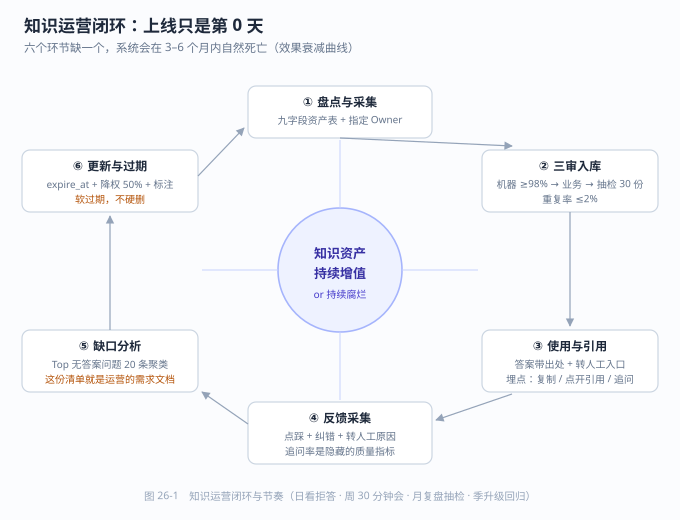

# 第 26 章 数据治理与知识运营

> 返回 [全书目录](../00-全书导读与目录.md)。上一篇：[25-安全与合规体系](25-安全与合规体系.md)；下一篇：[27-案例一-制造业设备维修](../第七篇-行业案例/27-案例一-制造业设备维修.md)。

> [!abstract] 本章解决什么问题
> 系统上线三个月，日活掉了一半，用户说「答案过时了」——这时候该做什么？
>
> - 用「效果衰减四阶段」定位现在处于哪一段
> - 用三审 + 软过期机制治理内容
> - 用五个指标 + 周会节奏把运营跑起来
>
> **产出**：一份运营期方案与交接清单　|　预计 11 分钟


## 26.1 上线不是终点，是效果衰减的起点

所有 AI 知识库都逃不过同一条曲线：上线时效果最好，之后缓慢下滑。

| 时间 | 典型表现 | 原因 |
| --- | --- | --- |
| 上线第 1 周 | 命中率高、用户新鲜、问题集中 | 问题集中在准备好的高频场景 |
| 第 1–3 月 | 新问题增多，拒答率上升 | 用户开始问「边界问题」 |
| 第 3–6 月 | 答案过时，用户抱怨「说错了」 | 制度/价格/产品已变更，库里没更新 |
| 第 6–12 月 | 日活下降，用户回到老办法 | 体验低于预期，信任流失 |

> [!important] 一条交付纪律
> **方案里必须写「运营期」，不能只写「建设期」。**
> 只交付系统不交付运营，等于把一条必然下滑的曲线交给客户，然后看着它变成「AI 没什么用」的结论。

---



---

## 26.2 知识资产盘点：先知道自己有什么

做运营的第一步不是写规则，是**把内容盘清楚**。用一张表：

| 字段 | 说明 | 用途 |
| --- | --- | --- |
| 文档 ID | 唯一标识 | 追溯 |
| 标题 / 类型 | 制度 / 手册 / FAQ / 工单 / 合同 | 分类统计 |
| **业务归属（Owner）** | 哪个部门哪个人负责内容正确性 | **最关键**，没有 owner 的内容必然腐烂 |
| 生效 / 失效日期 | 制度类必须有 | 过期自动下架 |
| 版本 / 修订记录 | 与旧版的关系 | 避免多版本冲突 |
| 密级 / 可见范围 | 公开 / 部门 / 岗位 | 权限控制依据 |
| 质量分 | 抽检得分 | 决定是否入库 |
| 访问频次 | 被检索次数 | 判断价值 |
| 引用次数 | 被答案引用次数 | 判断影响力 |

**四类内容的运营策略完全不同**：

| 类型 | 变化频率 | 运营重点 | 更新方式 |
| --- | --- | --- | --- |
| 制度 / 法规 | 低（季度/年度） | 版本与时效 | 到期提醒 + 人工确认 |
| 产品 / 价格 | 高（周/月） | 及时性 | 系统对接，自动同步 |
| 操作手册 | 中（随版本） | 与产品版本对齐 | 版本号绑定 |
| 工单 / FAQ | 极高（日） | 沉淀与去重 | 自动聚类 + 人工精选 |

> [!tip] 一条最有效的治理动作
> **给每份文档指定 owner，并在文档页脚打印「责任人 + 最后审核日期」。**
> 这一条能解决 70% 的内容腐烂问题，成本几乎为零。没有 owner 的知识库，三个月后必然充满过期内容。

---

## 26.3 内容质量治理：三审 + 过期 + 去重

### 三审机制

| 审 | 谁审 | 审什么 | 通过标准 |
| --- | --- | --- | --- |
| **一审 机器** | 流水线 | 解析质量、格式、重复 | 字符准确率 ≥98%、重复率 ≤2% |
| **二审 业务** | 内容 owner | 内容是否正确、是否最新 | 签署确认 |
| **三审 抽检** | 运营 | 随机抽样人工比对 | 抽 30 份，合格率 ≥95% |

### 过期机制（必须自动化）

```text
入库时写入 expire_at（默认：制度类 12 个月、产品类 3 个月、FAQ 6 个月）
每日任务扫描：expire_at < today → 状态置为「待确认」
待确认内容：检索时降权 50%，并在答案中标注「该内容可能已过期，请核实」
超 30 天未确认：自动下架，进入缺口清单
```

> [!warning] 不要直接删除过期内容
> 直接删会导致「昨天还能答，今天答不上」，用户会认为系统坏了。
> 正确做法是**降权 + 标注 + 通知 owner**，让内容「软过期」。

### 去重与冲突处理

同一个问题在库里有多份不同答案，是 RAG 最隐蔽的错误源。三类冲突：

| 冲突类型 | 例子 | 处理 |
| --- | --- | --- |
| **版本冲突** | 2023 版和 2025 版制度都在库 | 只保留现行版，旧版移入「历史库」并标记不可检索 |
| **层级冲突** | 集团制度 vs 分公司细则 | 按元数据层级过滤，优先本单位 |
| **表述冲突** | 两份文件对同一流程描述不一致 | 建「冲突清单」，交 owner 裁决，**不能靠模型自己选** |

---

## 26.4 运营指标：五个数就能看清健康度

| 指标 | 定义 | 健康区间（经验） | 异常含义 |
| --- | --- | --- | --- |
| **有答案率** | 有引用的回答数 / 总提问数 | 70–85% | 过低=内容缺口；过高=可能在编造 |
| **拒答率** | 明确拒答数 / 总提问数 | 10–25% | 过高=检索不到；过低=该拒没拒 |
| **点踩率** | 点踩数 / 有反馈数 | ≤15% | 上升=内容过时或检索退化 |
| **转人工率** | 转人工数 / 总会话数 | 与场景相关 | 上升=用户不信任 |
| **Top 无答案问题** | 拒答问题聚类 Top 20 | — | **最有价值的运营输入** |

> [!important] Top 无答案问题清单是运营的「需求文档」
> 每周把这 20 条拿出来看：是新业务没覆盖？是术语没对齐？还是分块切坏了？
> **能持续消化这份清单的团队，系统会越用越好；不看的团队，系统会越用越差。** 这就是「知识复利」与「知识负债」的分界。

### 反馈信号怎么设计才有用

| 信号 | 采集方式 | 用途 | 注意 |
| --- | --- | --- | --- |
| 点赞 / 点踩 | 一键 | 粗筛 bad case | 必须能附言，否则无法定位 |
| 纠错提交 | 表单（含正确答案） | 直接生成待审内容 | 要奖励，否则没人填 |
| 引用点击 | 点开来源 | 判断引用是否有用 | 点开率低=引用是装饰 |
| 复制 / 导出 | 行为埋点 | 判断答案是否被真正使用 | 比点赞更真实 |
| 追问次数 | 会话轮次 | 一次答不清就会追问 | 追问率是隐藏的质量指标 |

---

## 26.5 运营节奏：周会看什么，月度改什么

| 周期 | 动作 | 输出 |
| --- | --- | --- |
| **每日** | 看拒答 Top、看错误告警 | 紧急缺口当日补 |
| **每周** | 30 分钟运营会：点踩 Top10 归因、无答案 Top20 分类 | 内容补充清单 + 检索调优清单 |
| **每月** | 指标复盘、抽检 30 份、过期内容清理 | 月报（一页） |
| **每季** | 模型/参数升级评估、黄金集回归测试 | 升级决策 + 回归报告 |

> [!tip] 30 分钟周会的固定议程
> ① 上周点踩 Top3 是什么原因（内容缺失/检索错/生成错/该拒没拒）→ ② 本周补什么内容、谁负责、何时完成 → ③ 有没有指标异常。
> **每次必须产出「谁在什么时间前做什么」，否则会议无效。**

---

## 26.6 数据安全治理：三个必须落地的动作

| 动作 | 做法 | 验收 |
| --- | --- | --- |
| **最小权限** | 检索前按用户身份过滤（pre-filter），不是检索后再删 | 用低权限账号测，确认搜不到高密级内容 |
| **全链路审计** | 记录谁在何时问了什么、看到了哪些文档、答案是什么 | 抽查任意一次会话可完整还原 |
| **脱敏与去标识** | 入库前对身份证/手机/银行卡做掩码或哈希 | 抽检 100 条，敏感字段零明文 |

> [!warning] 权限最常见的错误实现
> 「检索 Top10 → 过滤掉无权限的 → 剩 3 条给模型」——这是**错的**。
> 因为过滤后剩下的 3 条可能完全不相关，模型会基于错误上下文编答案。
> 正确做法是**在向量检索时就带权限条件**（元数据过滤），保证返回的 10 条都是有权且相关的。详见 10.9。

---

## 26.7 运营团队：交付给谁，怎么交接

AI 系统交付后必须有明确的责任人，否则三个月就荒废。推荐三种落地形态：

| 形态 | 组成 | 适合 | 风险 |
| --- | --- | --- | --- |
| **业务方自运营** | 业务骨干 1 人（兼）+ IT 1 人（兼） | 中小项目 | 兼职=优先级最低，容易停摆 |
| **联合运营** | 客户 1 人 + 厂商 0.5 人 | **推荐** | 需明确分工与费用 |
| **厂商代运营** | 厂商 1 人专职 | 大型项目 | 客户依赖，长期成本高 |

**交接清单（缺一项就会在三个月后出问题）**：

```text
□ 知识资产盘点表（含 owner）
□ 解析与清洗规则文档
□ 分块与检索参数说明（为什么这样设）
□ 黄金评测集（100 题）+ 基线指标
□ 运营手册（周会怎么开、指标怎么看、内容怎么加）
□ 权限矩阵与审计查询方法
□ 常见故障处理手册（含回滚步骤）
□ 升级路径（模型换代的评估方法）
```

---

## 26.8 本章考点速记

> [!success]- 折叠背诵版
> **核心认知**：上线是效果衰减的起点，不是终点。方案必须包含运营期。
>
> **知识盘点九字段**：ID、标题/类型、**Owner**、生效失效日、版本、密级、质量分、访问频次、引用次数。
> **四类内容策略**：制度（版本时效）、产品价格（自动同步）、手册（版本绑定）、FAQ（聚类沉淀）。
>
> **三审**：机器（准确率 ≥98%、重复 ≤2%）→ 业务 owner → 运营抽检 30 份 ≥95%。
> **过期机制**：expire_at + 降权 50% + 标注 + 通知，**软过期不硬删**。
> **三类冲突**：版本冲突（只留现行）、层级冲突（按元数据过滤）、表述冲突（建清单人工裁决）。
>
> **五指标**：有答案率 70–85%、拒答率 10–25%、点踩率 ≤15%、转人工率、Top 无答案问题。
> **Top 无答案清单 = 运营的需求文档。**
>
> **节奏**：日看拒答、周 30 分钟会（点踩 Top3 归因 + 补内容 + 责任人）、月复盘抽检、季升级回归。
>
> **安全三动作**：最小权限（**检索前过滤，不是检索后删**）、全链路审计、入库脱敏。
>
> **交接八项**：资产表、规则、参数说明、黄金集、运营手册、权限矩阵、故障手册、升级路径。

---

**上一篇**：[第 25 章 安全与合规体系](25-安全与合规体系.md)　|　**下一篇**：[第 27 章 案例一 制造业设备维修](../第七篇-行业案例/27-案例一-制造业设备维修.md)
