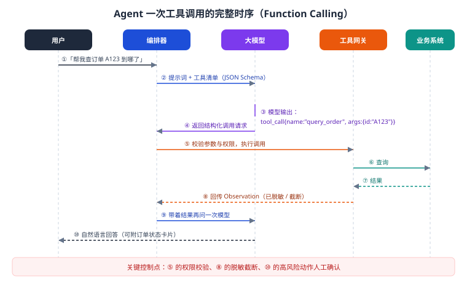
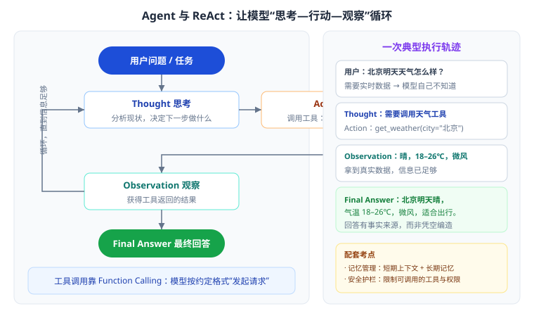

# 第 13 章 Agent 工程实践

> 返回 [全书目录](../00-全书导读与目录.md)。上一篇：[12-RAG评测与实验设计](../第三篇-数据与RAG工程/12-RAG评测与实验设计.md)；下一篇：[14-工具设计与集成工程](14-工具设计与集成工程.md)。

> [!abstract] 本章解决什么问题
> RAG 让模型「会说」，Agent 让模型「会做」。但企业真正关心的是——**它会不会乱做、做错谁负责、怎么证明它做对了**。
>
> 本章按「能力 → 编排 → 记忆 → 护栏 → 可观测」的顺序讲，最后给出 RAG 与 Agent 的选型判断。

---

## 13.1 Agent 是什么，以及它不该做什么

### 定义

**Agent = 大模型（决策）+ 工具（执行）+ 记忆（上下文）+ 规划（拆解）+ 护栏（约束）。**

与 RAG 的本质区别：

| | RAG | Agent |
| --- | --- | --- |
| 能力 | 查资料、答问题 | 调工具、改数据、跑流程 |
| 风险 | 答错（可溯源纠正） | **做错（可能造成实际损失）** |
| 评价标准 | 准确性 | 准确性 + **可靠性 + 可控性** |

### 什么时候该用 Agent（判断清单）

用 Agent 的前提，四条至少满足三条：

1. 任务需要**多步执行**（不是一次问答能解决）；
2. 需要**实时数据或执行动作**（查库存、下单、发邮件、建工单）；
3. 步骤之间有**依赖**（后一步要用前一步结果）；
4. 步骤**无法完全预先枚举**（需要临场判断）。

反过来，这些情况**不该**用 Agent：

| 场景 | 更合适的方案 |
| --- | --- |
| 只是知识问答 | RAG |
| 步骤完全固定（审批流、报销流） | 传统工作流 / RPA |
| 一次模型调用能解决 | 提示词 + 结构化输出 |
| 高风险不可逆动作（付款、删库） | 人工确认 + 系统流程，Agent 只做建议 |

> [!important] 这句话在评审里很值钱
> **「能用确定性流程解决的，不要交给模型自主决策。」** Agent 应该用在「必须临场判断」的节点，而不是替代整个业务流程。

---

## 13.2 Function Calling：模型与工具的标准接口



### 完整时序（十步，背下来）

1. 用户提出需求；
2. 编排器把「系统提示 + 工具清单（JSON Schema）+ 对话」发给模型；
3. 模型判断需要工具，输出结构化调用请求（工具名 + 参数）；
4. 编排器收到请求；
5. **校验参数与权限**（关键控制点）；
6. 调用业务系统；
7. 业务系统返回结果；
8. 结果**脱敏、截断**后作为 Observation 回传模型（关键控制点）；
9. 模型基于结果继续推理，可能再次调用工具；
10. 输出自然语言回答（高风险动作前需人工确认）。

### 工具定义示例

```json
{
  "name": "query_order",
  "description": "根据订单号查询订单状态与物流信息。仅在用户询问订单进度时使用。",
  "parameters": {
    "type": "object",
    "properties": {
      "order_id": {"type": "string", "description": "订单号，形如 A123456"},
      "include_logistics": {"type": "boolean", "default": true}
    },
    "required": ["order_id"]
  }
}
```

### 工具设计五原则

| 原则 | 说明 | 反例 |
| --- | --- | --- |
| 单一职责 | 一个工具做一件事 | `do_everything(action, params)` |
| 描述精确 | 描述决定模型会不会选对 | 只写「查询订单」，不写何时用 |
| 参数受控 | 枚举优于自由文本，必填项明确 | 参数是任意 SQL 字符串 |
| 幂等安全 | 写操作要可重试、可撤销 | 无幂等的「扣款」接口 |
| 返回精简 | 只返回模型需要的信息 | 返回 500 行 JSON |

> [!warning] 高频坑
> 工具描述写得含糊，模型会「乱选工具」；工具返回太啰嗦，会挤爆上下文并推高成本。**工具描述与返回结构，是 Agent 效果的两大隐形变量。**

### 并行调用与错误处理

- **并行**：互不依赖的工具调用可并行（如同时查订单和查库存），降低延迟；
- **错误处理**：工具报错时不要把原始堆栈丢给模型，转成结构化错误（`{"error":"ORDER_NOT_FOUND","hint":"请确认订单号"}`），模型才能正确应对；
- **重试**：只对幂等读操作重试，写操作必须幂等键。

---

## 13.3 ReAct：思考与行动交替



事实依据：Yao 等，2022，《ReAct: Synergizing Reasoning and Acting in Language Models》。核心洞察：让模型**显式写出思考**再行动，比「直接输出动作」更可靠；同时用**观察结果**纠正思考，避免空想。

### 一次完整轨迹

```text
问题：帮我看看订单 A123 到哪了，如果超过 5 天没到就帮我催一下。

Thought 1: 需要先查订单状态和发货时间。
Action 1: query_order(order_id="A123")
Observation 1: {"status":"运输中","ship_date":"2026-10-18","days":7}

Thought 2: 已 7 天，超过 5 天阈值，需要催单。催单是写操作，先确认规则是否允许自动催。
Action 2: get_policy(topic="催单")
Observation 2: {"auto_urge_allowed":true,"max_per_day":1}

Thought 3: 允许自动催单，且今日未催过。执行催单。
Action 3: urge_delivery(order_id="A123", reason="超时7天")
Observation 3: {"ok":true,"ticket":"T8891"}

Thought 4: 信息齐全，可以回答。
Final Answer: 您的订单 A123 已运输 7 天（10 月 18 日发出），超过承诺时效，
我已为您提交催单（工单号 T8891），预计 24 小时内物流会联系您。
```

### 提示词骨架

```text
你可以使用以下工具：{tool_list}

请严格按以下格式循环：
Thought: 分析当前信息，说明下一步要做什么、为什么
Action: 工具名(参数 JSON)
Observation: （由系统填入，你不要自己编）
...（可重复）
Final Answer: 给用户的最终回答

规则：
- 每次只调用一个工具（或明确说明并行调用）；
- 不得编造 Observation；
- 写操作前必须确认权限与规则；
- 超过 6 轮仍未解决，输出「需要人工介入」。
```

### 五种典型失败模式

| 失败模式 | 表现 | 对策 |
| --- | --- | --- |
| 死循环 | 反复调同一个工具 | 最大轮次限制（如 6 轮）、重复调用检测 |
| 幻觉工具 | 调用不存在的工具/参数 | 工具白名单、Schema 严格校验 |
| 参数错误 | 订单号编造、日期格式错 | 参数校验 + 错误提示回灌 |
| 过早收敛 | 信息不足就下结论 | 提示词要求「信息不足时继续查」 |
| 过度行动 | 未经确认执行写操作 | 写操作强制人审 / 二次确认 |

---

## 13.4 四种主流编排模式

| 模式 | 结构 | 优点 | 缺点 | 适用 |
| --- | --- | --- | --- | --- |
| **ReAct** | 思考-行动循环 | 灵活、可纠错 | 轮次多、延迟高 | 探索型任务 |
| **Plan-and-Execute** | 先出完整计划，再逐步执行 | 全局性好、可控 | 计划错了全错 | 步骤较明确的多步任务 |
| **Router（路由）** | 先分类，分派给专用流程/子 Agent | 简单、快、成本低 | 复杂问题覆盖不足 | 客服分流、意图识别 |
| **Reflection（反思）** | 生成后自我检查再修正 | 质量高 | 成本 ×2 以上 | 写作、代码、高风险输出 |

**工程建议**：**Router 打底 + 局部 ReAct**。用路由把 80% 的常见问题走确定性流程，只在真正需要判断的地方开 ReAct——既稳又省。

---

## 13.5 多 Agent 协同与 MCP

### 三种协作模式

| 模式 | 结构 | 适用 | 风险 |
| --- | --- | --- | --- |
| 主管模式（Supervisor） | 主管拆任务、分派给专家 Agent、汇总 | 复杂任务、角色差异大 | 主管判断错则全错 |
| 流水线（Pipeline） | A 的输出是 B 的输入，串行 | 写作、审核、发布 | 误差累积 |
| 交接（Handoff） | 一个 Agent 判断「该转给谁」 | 客服、售前分流 | 转接抖动 |

**什么时候才上多 Agent**：单 Agent 的提示词已经超过 2000 字还管不好；不同子任务需要不同工具集与不同权限；需要独立审计每一步。

否则，**多 Agent 只会增加成本、延迟和不确定性**——这是简答题里很好的「辩证分」。

### MCP（Model Context Protocol）

事实依据：Anthropic 于 2024 年 11 月开源的开放协议，用于标准化「模型如何连接外部工具与数据源」。类比：**AI 应用的 USB-C 接口**——工具方实现一次 MCP Server，任何支持 MCP 的客户端都能用。

价值：降低集成成本、避免为每个模型重复适配；企业可把内部系统封装成 MCP Server 统一管控权限与审计。

---

## 13.6 记忆管理：让 Agent 不「失忆」也不「撑爆」

| 类型 | 内容 | 存储 | 生命周期 |
| --- | --- | --- | --- |
| 短期（工作记忆） | 当前任务上下文、工具返回 | 提示词 / 内存 | 单次会话 |
| 长期（语义记忆） | 用户偏好、企业知识、历史结论 | 向量库 / 数据库 | 持久 |
| 情景记忆 | 过去类似任务的完整轨迹 | 日志 + 向量 | 持久，可检索复用 |
| 程序记忆 | 成功的操作流程（可复用 SOP） | 结构化配置 | 长期迭代 |

### 三个工程手段

1. **摘要压缩**：超过 N 轮后，把历史总结成「事实清单 + 未完成事项」，替换原始对话；
2. **按需检索**：不把所有记忆塞进上下文，用向量检索取相关片段（记忆的 RAG 化）；
3. **遗忘机制**：过期信息降权/删除（如「用户三个月前的偏好」可能已失效），避免错误引导。

> [!warning] 常见错误
> 把全部历史对话无脑拼进提示词 → 成本线性上升、关键信息被淹没、模型开始「记串」。**记忆不是越多越好，是越相关越好。**

---

## 13.7 安全护栏：Agent 的刹车系统

### 五道护栏（按层部署）

| 层 | 措施 |
| --- | --- |
| 输入层 | 提示注入检测、敏感词过滤、超长/异常输入拦截 |
| 决策层 | 工具白名单、最大轮次、预算上限（Token/金额） |
| 执行层 | 参数校验、权限校验、写操作二次确认、幂等键 |
| 输出层 | 敏感信息脱敏、有害内容过滤、引用校验 |
| 审计层 | 全链路日志、操作留痕、可回放 |

### 对照 OWASP LLM Top 10（2025）自查

| 编号 | 风险 | 在企业 Agent 里的表现 | 对应护栏 |
| --- | --- | --- | --- |
| LLM01 | 提示注入 | 文档/网页夹带恶意指令 | 输入隔离、内容标注为「数据非指令」 |
| LLM02 | 敏感信息泄露 | 回答带出他人信息 | 权限过滤、输出脱敏 |
| LLM03 | 供应链 | 第三方模型/插件风险 | 供应商评估、依赖锁定 |
| LLM04 | 数据与模型投毒 | 恶意文档入库 | 入库审核、来源可信 |
| LLM05 | 输出处理不当 | 直接把模型输出拼进 SQL/HTML | 参数化、转义、Schema 校验 |
| LLM06 | 过度代理（Excessive Agency） | 工具权限过大，能删能转 | 最小权限、人审 |
| LLM07 | 系统提示泄露 | 被套出内部规则 | 提示词隔离、输出过滤 |
| LLM08 | 向量与嵌入弱点 | 越权检索、投毒向量 | pre-filter、入库校验 |
| LLM09 | 错误信息 | 幻觉被当真 | RAG + 引用 + 拒答 |
| LLM10 | 资源滥用 | 无限循环烧钱 | 轮次/Token 预算上限 |

> [!important] 一句总结
> **Agent 的能力上限由模型决定，能力下限由护栏决定。** 企业项目里，护栏做不好，能力再强也不敢上线。

---

## 13.8 选型：RAG、Agent、工作流怎么配

| 需求特征 | 推荐组合 |
| --- | --- |
| 只查资料、要溯源 | RAG（无 Agent） |
| 查资料 + 简单查询类工具 | RAG + 1–2 个只读工具 |
| 多步任务 + 写操作 | 工作流主干 + Agent 在关键节点决策 + 人审 |
| 高频固定流程 | 纯工作流 / RPA，模型只做理解与填槽 |
| 开放探索型任务 | ReAct Agent + 强护栏 + 预算上限 |

> [!tip] 简答题万能句式
> 「我们采用**工作流为主干、Agent 为节点**的混合架构：确定性步骤用工作流保证稳定与可审计，只有必须临场判断的环节交给 Agent，并对写操作设置人工确认与预算上限。」——这句话同时体现了技术判断、风险意识和工程成熟度。

---

## 13.9 可观测性：怎么证明它「做对了」

| 要记录什么 | 为什么 |
| --- | --- |
| 每次 LLM 调用（prompt、输出、Token、耗时） | 成本归因、问题复现 |
| 每次工具调用（参数、返回、耗时、是否成功） | 定位失败环节 |
| 完整轨迹（Thought/Action/Observation 序列） | 可回放、可审计 |
| 用户反馈（点赞/点踩/转人工） | 效果闭环 |
| 会话级指标（轮次、总成本、是否完成） | 评估 Agent 效率 |

**回放能力**是 Agent 上线的前提：出了问题，能一键重现当时的完整上下文，否则永远查不清。

---

## 13.10 最小代码骨架

```python
MAX_STEPS = 6
BUDGET_TOKENS = 20000

def run_agent(question, user):
    messages = [system_prompt(TOOLS), user_msg(question)]
    used, steps = 0, 0

    while steps < MAX_STEPS and used < BUDGET_TOKENS:
        resp = llm(messages, tools=TOOLS, temperature=0.2)
        used += resp.usage.total_tokens
        if not resp.tool_calls:                     # 没有工具调用 → 收尾
            return resp.content

        for call in resp.tool_calls:
            name, args = call.name, call.args
            if name not in ALLOWED_TOOLS:            # 护栏 1：白名单
                result = {"error": "TOOL_NOT_ALLOWED"}
            elif not has_permission(user, name, args):  # 护栏 2：权限
                result = {"error": "FORBIDDEN"}
            elif is_write_op(name) and not confirmed(user, call):
                result = {"error": "NEED_CONFIRMATION"}  # 护栏 3：写操作人审
            else:
                result = safe_execute(name, args)    # 校验 + 超时 + 幂等
            messages.append(tool_result(call.id, sanitize(result)))  # 脱敏截断
        steps += 1

    return "这个问题需要人工介入，已为您创建工单。"
```

---

## 13.11 简答模板：设计一个企业级 Agent

**① 场景与边界**：解决什么问题、覆盖哪些意图、明确不做什么（越界转人工）。
**② 架构**：路由 + 工作流主干 + 节点 ReAct；工具清单与权限矩阵；记忆分层。
**③ 关键设计**：工具 Schema 严格化、写操作人审、最大轮次与预算、全链路 Trace。
**④ 效果与安全**：任务完成率、平均轮次、误操作率；OWASP 十项自查；审计留痕。
**⑤ 风险与演进**：先只读工具、再逐步开放写操作；灰度放量；Bad Case 回灌。

---

## 13.12 会话与状态设计：多轮对话的四个工程问题

Agent 比 RAG 多一个东西要管：**状态**。状态管不好，会出现「它忘了刚才说的」「它重复执行了」「两个人串了」。

| 问题 | 表现 | 设计要点 |
| --- | --- | --- |
| **会话隔离** | A 用户看到 B 用户的上下文 | 会话 ID 由服务端生成并绑定用户，绝不接受客户端传入 |
| **超时与恢复** | 用户隔天回来，Agent 还在说「刚才那个订单」 | 会话 TTL（30–60 分钟）+ 超时后主动重置并说明 |
| **并发冲突** | 同一用户手机与电脑同时操作，状态互相覆盖 | 会话级乐观锁（版本号），冲突时提示「另一端正在操作」 |
| **状态一致性** | Agent 以为已退款，实际工具调用失败 | 状态以「工具返回」为准，不以「模型声称」为准 |

> [!important] 一条铁律
> **模型说「已经帮您退款了」不算数，工具返回 `success` 才算数。**
> 实现上：所有状态变更必须以工具返回码为准，模型输出只是「描述」。这条不做，就会出现「系统说退了但钱没退」的事故。

**会话状态该存什么**（最小集合）：

```json
{
  "session_id": "s_20261020_abc",
  "user_id": "u_123",
  "created_at": "...", "last_active": "...",
  "intent_stack": ["售后", "退款"],
  "slots": {"order_id": "2026...", "amount": 187},
  "pending_action": {"tool": "refund", "status": "awaiting_confirm"},
  "tool_history": [{"tool": "query_order", "ok": true}],
  "version": 7
}
```

只存「结构化槽位」，不存整段对话原文——原文放日志，状态放结构。这样上下文不会膨胀（见 16.4）。

---

## 13.13 从需求到上线：Agent 项目的 12 项检查

上线前逐项打勾，任何一项「否」都不建议上生产。

| # | 检查项 | 通过标准 |
| --- | --- | --- |
| 1 | 有明确的「不做清单」 | 书面列出越界场景与拒答策略 |
| 2 | 工具数量 ≤12 且有分组 | 工具正确率 ≥0.92（自建任务集） |
| 3 | 所有写工具有幂等键 | 重复提交测试无副作用 |
| 4 | 写操作按风险分级 | L3 动作 100% 人工审批 |
| 5 | 有最大轮次与超时 | 循环卡死率 ≤2% |
| 6 | 工具返回内容与指令隔离 | 间接注入测试未通过执行 |
| 7 | 全链路 trace 可还原 | 任取一次会话能还原「看到/决定/做了」 |
| 8 | 有降级链并演练过 | 主模型断开后仍可服务 |
| 9 | 权限最小化 | 低权限账号越权测试 0 次 |
| 10 | 任务集评测达标 | 完成率 ≥0.75、越权 0 |
| 11 | 红队清单跑过并修复 | 高危项全部关闭 |
| 12 | 有运营与复盘机制 | 周会机制、责任人、指标看板就绪 |

> [!tip] 这 12 项可以直接当验收清单
> 客户问「你怎么保证它不乱来」时，把这张表递过去，比任何口头承诺都有说服力。
> 而且它天然形成「我们做了 12 项检查」的记忆点——**专业感来自清单，不来自形容词**。

---

## 13.14 本章考点速记

> [!success]- 必背 10 条（点击展开自测）
> 1. Agent = 模型 + 工具 + 记忆 + 规划 + 护栏；与 RAG 的区别是「会做」，风险更高。
> 2. 用 Agent 的四条件：多步、实时数据/动作、步骤有依赖、无法预先枚举。
> 3. Function Calling 十步时序；两个控制点：执行前校验、回传前脱敏。
> 4. 工具设计五原则：单一职责、描述精确、参数受控、幂等安全、返回精简。
> 5. ReAct（Yao 2022）：Thought → Action → Observation 循环。
> 6. 五种失败模式：死循环、幻觉工具、参数错误、过早收敛、过度行动。
> 7. 四种编排：ReAct / Plan-Execute / Router / Reflection；工程常用 Router + 局部 ReAct。
> 8. 记忆四类：短期、长期语义、情景、程序；靠摘要、按需检索、遗忘机制管理。
> 9. 护栏五层：输入、决策、执行、输出、审计；对照 OWASP LLM Top 10。
> 10. MCP（Anthropic 2024）标准化工具接入；Agent 上限看模型，下限看护栏。

---

**上一篇**：[第 12 章 RAG 评测与实验设计](../第三篇-数据与RAG工程/12-RAG评测与实验设计.md)　|　**下一篇**：[第 14 章 工具设计与集成工程](14-工具设计与集成工程.md)
